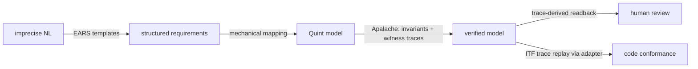

# Formal Specification Methodology

Turn imprecise requirements into verified formal specifications with Quint and Apalache, driven by AI agents. **One Quint model per area carries its own requirements as doc comments; one intent file holds what a model cannot say; one ledger is written by the tools; five commands.** Git tracks changes, PRs gate approval, verification is continuous.

The chain from natural language to verified code is held by mechanisms, not by trust in the AI:



- **EARS** limits each requirement to five sentence patterns, so "precise" means filled fields, checkable.
- **Witness traces** prove every claimed behavior is reachable, so a model whose invariants hold vacuously cannot pass.
- **Conformance replay** runs the model's traces against the real code; a requirement is *verified* only when its trace replays green.
- **No free-floating claims.** Every annotation is generated from the model or checked against it.
- **Humans judge behaviors, not translations.** Reviewers read Given / When / Then rows, organized as journeys that run end to end.

### The arrows are dependencies, not a schedule

The diagram says what rests on what, not an order to march through. The phases — **elicit → vocab → structure → formalize → check → generate → verify** — are sections of one area, not stages; nothing is "in" a phase, so nothing is blocked in one. **Do any part, in any order, at any time**: formalize one requirement while nine are still sentences, check a model that covers a third of the area, extract from code before eliciting. `/spec` reads the area's state and picks up wherever you are.

There is no workflow machinery on top: no propose, approve or sync commands, no state advanced by hand. **Git tracks the change, PR review is the approval, `/spec-code-verify` is the continuous gate.**

> This is a **template repository**. Clone it, run `tools/bootstrap.sh` (strips template-only files), then run `/spec`. After bootstrap this file is your project's reference.

### Two tiers — the precision core stands alone

| Tier | What it gives | Tools needed | Commands |
|---|---|---|---|
| **1 — Precision core** | EARS requirements, a declared **scope**, state×event and external×outcome completeness, closed-world entities, modality, assumptions, the deterministic **readback**, the semantic **diff**, all gated by `spec-lint`. | Python 3 only | `/spec`, `/spec-readback` |
| **2 — Formal proof** | Quint model, Apalache invariants (bounded or inductive), witness traces, conformance replay against code; optional Alloy (structure) and z3 (arithmetic). | + Java 17, Quint, Apalache | `/spec-check`, `/spec-code-generate`, `/spec-code-verify` |

Tier 1 is complete on its own. Tier 2 proves internal consistency, reachability and code conformance; it does not invent or correct intent. **The trust boundary is at elicitation** (NL → EARS fields): human + AI judgment, backstopped by lint (a functional requirement you can't write as a formal `@while` / `@shall` is too vague to verify), the completeness matrices and the questions model mutation raises. Everything downstream of a captured EARS field is mechanized.

---

## Core Concepts

A **spec area** is three files, each the only source of what it holds (see "Where the Spec Lives: Quint-First"):

- `specs/<name>.qnt` — the Quint model, **and** every requirement, invariant, property, constant and example as a `///` doc comment on the declaration that realizes it;
- `specs/<name>.intent.json` — what a model cannot say (kind, purpose, scope, decisions, assumptions, …);
- `specs/<name>.records.json` — the ledger: tool-written (verdicts, traces, pins, logs), except the extraction triage and `nl_explanation`, which are agent judgment.

No tool reads those files directly: `tools/spec_source.py` derives one **area view** from them (shape: `schemas/area.schema.json`). An area's `kind` is `area` or `contract`; an interactive surface is an ordinary `area`. See "The Two Kinds of Area".

A **project** is `.spec/project.json` (areas, code repos, architecture defaults, topology) plus the area files. Per-developer paths and the active change live in `.spec/local.json` (gitignored).

---

## Quick Start

```bash
git clone <this-template-url> my-project && cd my-project
./tools/bootstrap.sh                 # strips template metadata
/spec                                # in Claude Code: detects state, walks setup
```

For an existing codebase, `/spec auth` sees code at `src/auth/` and no spec, and walks extraction — see "Brownfield: Keeping the Spec True to the Code".

---

## The Five Commands

| Command | What it does |
|---|---|
| `/spec` | Adaptive entry point. Detects the state (greenfield, brownfield, existing, drift) and walks the beat that fits: elicitation, vocabulary, structure, formalization (`@while` / `@shall` on the governing action), extraction, reconciliation, project config. Writes the model and the intent file. |
| `/spec-check` | Apalache invariants, witness probes, the state×event and external×outcome passes, model mutation when the model or examples changed (red-team with `--reality`). Writes verdicts to the ledger and traces to `specs/<area>/traces/`; unresolved counterexamples and `no-witness` results are filed as `Q-NNN`. Cascades to every contract spanning the area. |
| `/spec-code-verify` | Replays witness, example and journey traces against the code through the conformance adapter, runs `test_command`, validates `traceability[]`, detects drift (a failing run whose `traceability[]` files changed since the last log entry's `code_sha` — sets `drift_detected`, which routes `/spec` to drift codify), appends to `verification_log[]`. |
| `/spec-code-generate` | Generates code from the architecture and the model, plus the conformance adapter and replay harness. Writes `traceability[]` and `conformance`. Refuses contracts. |
| `/spec-readback` | Runs `tools/spec-readback.py`: the readback is generated, not authored, so identical input gives byte-identical output and its `git diff` is the review. Per area, per change, per project. |

### Change and area

Every command runs inside the **active change** and can be narrowed to one **area**.

- **Change** — a unit of work that can span areas (see "Unit of Work: Changes"). `/spec change <slug>` opens or switches; it is remembered per developer, so **without an area, every command acts on all areas of the active change.**
- **Area** — `/spec auth`, `/spec-check auth`, `/spec-readback auth`. With `/spec` this also adds the area to the active change; with the others it is a one-off.

---

## Repo Layout

```
<your-project>/
├── METHODOLOGY.md
├── .spec/
│   ├── project.json        ← areas, repos, architecture defaults, topology
│   ├── local.json          ← per-dev repo paths + active change (gitignored)
│   ├── readback.md         ← project readback
│   ├── patterns/           ← optional Layer 2 catalog
│   └── protocols/          ← optional Layer 5 catalog
├── specs/
│   ├── auth.qnt            ← model + every record as /// doc comments
│   ├── auth.intent.json    ← what the model cannot say
│   ├── auth.records.json   ← the ledger
│   ├── auth.probes.qnt     ← generated witness probes
│   ├── auth.readback.md    ← generated review document
│   ├── session-ownership.als ← optional Alloy model of a contract
│   ├── changes/            ← change manifests + their readbacks
│   ├── journeys/           ← use cases: <area>.<ID> steps in order, with a run
│   └── auth/
│       ├── traces/         ← ITF witness traces (committed)
│       │   └── runs/       ← example and journey runs as traces (spec-runs)
│       └── gen/            ← regenerable views: red-team backlog (gitignored)
├── schemas/                ← area.schema.json (the view); intent/records schemas generated from it
├── templates/              ← spec.qnt, probes.qnt (reference), contract.als
├── .github/workflows/      ← spec-ci.yml (cheap gates), spec-mutation.yml (nightly)
└── tools/                  ← see "Tools" under Reference
```

All spec content lives in the area's files. Change manifests and journeys are overlays — references only.

---

## Anatomy of a Spec Area

Required: `kind`, `area`, `version` in the intent file. Everything else grows conversationally.

**`specs/auth.qnt`** — each record on the declaration that realizes it:

```quint
module auth {
  type AccountStatus = Unlocked | Locked
  var accounts: UserId -> AccountStatus

  /// @con CON-001
  /// Failed-login threshold before locking.
  /// @pairs INV-004
  pure val MAX_FAILED_ATTEMPTS: int = 5

  /// @req REQ-001
  /// When a registered user submits valid credentials, the system shall
  /// create an Active session owned by that user.
  /// @status specified
  /// @when a registered user submits valid credentials
  /// @shall isActive(sid) and sessionOwner.get(sid) == uid
  ///
  /// @req REQ-005
  /// While the account is Locked, the system shall refuse the login.
  /// @status specified
  /// @modality forbidden
  /// @while isLocked(uid)
  action login(uid: UserId, sid: SessionId): bool = all { ... }

  /// @req REQ-003
  /// When a sign-in fails, the system shall count it, and lock the account
  /// once the count reaches MAX_FAILED_ATTEMPTS.
  /// @status specified
  /// @while not(isLocked(uid))
  /// @old before: int = attemptsOf(uid)
  /// @shall attemptsOf(uid) == before + 1
  ///   and (isLocked(uid) iff attemptsOf(uid) >= MAX_FAILED_ATTEMPTS)
  action login_failed(uid: UserId): bool = all { ... }

  /// @inv INV-001
  /// At most one Active session per user.
  /// @criticality critical
  val singleSession: bool = ...

  /// @example EX-002
  /// A locked account cannot sign in
  /// @refs REQ-005
  run lockedLoginRefused = lockedBob.expect(isLocked("bob"))
    .then(login("bob", "s2").fail())
}
```

**`specs/auth.intent.json`** — purpose, concepts (entities, actors, verbs), scope, externals, assumptions, decisions, state machines, architecture, `formal_model` (`quint_file`, `probes_file`, `probe_domains`), `conformance`, open questions.

**`specs/auth.records.json`** — written by tools: `check_results`, `by_id` (witness status, trace, `model_sha`; `formal_status`), `traceability`, `verification_log`, provenance stamps, triage ledgers.

`tools/spec_source.py derive auth` prints the merged view. Field names below (`ears.response`, `obligation.formal_status`, …) are fields of that view.

---

## Where the Spec Lives: Quint-First

**The model is the referent, so the record sits on it.** An invariant *is* a `val`, a constant's value *is* a literal, an example *is* a `run`, a requirement sits *on the action it governs*. Kept beside the model, each needed a pointer or a copy and a lint rule to keep it honest; on the model there is nothing to drift.

| File | Holds | Why there |
|---|---|---|
| `<area>.qnt` doc comments | requirements (EARS fields with formal `@while` / `@shall` / `@old` / `@outcome`, modality, determinism, fit criterion, `@error` outcomes, extraction evidence), invariants, properties, constants, examples, screens and navigation edges | each is checkable against a declaration, and the reviewer reads claim and formula in one diff |
| `<area>.intent.json` | kind, spans, version, status, purpose, brief, scope, boundary, concepts, externals, assumptions, decisions, open questions, state machines, architecture, `ui_components`, `formal_model`, `conformance` | not about one declaration; some (a closed state list, a state machine) must stay independent of the model's text to catch it drifting |
| `<area>.records.json` | `check_results`, witness, outcome and obligation verdicts, `formal_status`, the brief's freshness pin, `verification_log`, `traceability`, `generated_from` / `extracted_from`, the extraction triage ledger | machine-written and high-churn (exceptions: `extraction_triage` and `counterexample.nl_explanation` are agent judgment, written by hand); in the model, every check would rewrite the file it just hashed |

The table is code: `MODEL_KEYS`, `UI_KEYS`, `RECORD_KEYS`, `MACHINE_PATHS` in `tools/spec_source.py`. Choices worth stating:

- **Error outcomes are `@error` tags on the requirement** — or on a `@verdict` of the action that calls the external; an outcome neither handles FAILs lint.
- **A refusal is shown by an example**, not declared by a tag (see "Refusal Examples").
- **Triage ledgers and freshness pins are in `records.json`** — keyed by fingerprint or hash, never in the file they describe.
- **Screens and navigation edges are records on the model**; `ui_components` stays in the intent file (no declaration to sit on).
- **`model_sha` hashes the model without its `///` records** (`spec_source.strip_docs`): rewording a record never stales a trace; changing a declaration does.

### The grammar

A `///` block documents the declaration below it, its **host**. One tag per line; a record starts at a record tag (`@req`, `@inv`, `@prop`, `@con`, `@example`, `@screen <Name>`, `@nav <From> -> <To>`) and runs to the next. The full tag table is the docstring of `tools/spec_source.py`. Hosting decides the rest:

| Record on | Means |
|---|---|
| `action <name>` | **event** requirement, `quint_ref` = that action: every step of it from a state where `@while` holds must end where `@shall` holds (`must`), where one `@outcome` holds (`may`), or must not happen (`forbidden`). Several requirements may share one action |
| a `pure def` / `pure val` + `@verified-by <test>` | **computed** requirement: a derived value no step carries, verified by the unit test it names |
| the `module` itself + `@shall` | **state** requirement: in every reachable state where `@while` holds, `@shall` holds |
| the `module` itself, no `@shall` | no form yet: a raw requirement, an NFR, a Tier-1 area |
| `val` / `temporal` / `pure val` / `run` | invariant, property, constant, example (a trailing `.expect(..)` is its expectation; `@expect` only on an action-hosted example) |
| `def` with `_prev*` parameters | transition invariant (`over: "probes"`), emitted into the probe module as `val <@quint-name>` — a name the model must **not** declare, not even the def's own (lint: `transition-invariant-name-clash`) |
| Alloy `assert`/`check` | structural invariant (`proof: structural`) |
| `type <Screen>`, one `@screen` per variant | a screen; lint FAILs a variant with no record and a record naming no variant |
| `action <name>` + `@nav From -> To` | a navigation edge; lint FAILs an action that does not read `<screenVar> == From` and set `<screenVar>' = To` |

`@refs` takes `ID` (this area) or `<area>.<ID>`, any kind (REQ, INV, PROP, CON, EX, DEC, ASM, Q). `@source` (elicited / extracted / reconciled / answered-question) works on every record. Helpers must not reuse Quint built-in names (`exists`, `filter`, …): lint FAILs `quint-builtin-redefined`. A module holding only records is not a model (`spec_source.has_model`). Untagged lines after a record tag are its description; after an attribute tag they continue that tag. `_`-prefixed names are reserved for probe ghosts. Lint FAILs unknown or malformed tags (`record-grammar`), a record with no host (`record-without-host`), a requirement reading a `_`-ghost (`requirement-reads-ghost`) and a constant valued twice (`constant-value-twice`); the intent file and ledger are schema-validated.

### One reader, one writer

`spec_source.load_area` derives the view; `spec_source.save_area` writes **only** the ledger and refuses — naming the fields — when anything authored would change. Claims are edited in the model and intent file, where a reviewer sees them. `spec-diff` and `spec-separation` derive the same view at any git revision. The reader is pure Python (Tier 1 needs no Quint); a test holds it to the same record→declaration map as `quint parse`.

Why a `.qnt` file: any Quint editor and the language server read it (a record is a doc comment on hover), `quint typecheck` checks every `@while` / `@shall` because the generator emits each as a `def` over the action's own parameters, and a PR shows a requirement and its Quint in one hunk. `tools/quint_ir.py` is the single parser for the model's semantics: Quint's typed IR when the CLI is installed, a regex fallback otherwise. `formal_model.quint_file` (default `<area>.qnt`) may point at a records-only module while authoring — **WARN while authoring, FAIL from `in-review`**.

---

## The Two Kinds of Area

### `kind: "area"` — functional area

A unit of behavior with code behind it — login, billing, search. `architecture`, `traceability` and `verification_log` apply; `/spec-code-generate` generates code; `/spec-code-verify` replays and tests it.

### `kind: "contract"` — cross-area agreement

Spec-only. Requires `spans: ["auth", "billing"]`; its model imports the spanned areas:

```quint
module userPermissionContract {
  import auth.* from "./auth.qnt"
  import billing.* from "./billing.qnt"
  val noOrphanAccounts: bool =
    billing::accounts.keys().forall(uid => auth::users.keys().contains(uid))
}
```

`/spec-check auth` also checks every contract whose `spans` includes `auth`. A failing contract means an area change broke a joint invariant: fix the area or evolve the contract. The code commands refuse contracts. Relational obligations may use the structural backend — see "The Structural Backend: Alloy (Optional)".

### UI blocks — interactive surfaces

An interactive surface is an ordinary area whose model is a state machine over screens. The screens are the variants of one sum type, each with a `/// @screen <Name>` record; each **navigation** edge is the action that moves the screen variable, with a `/// @nav [NAV-NNN] <From> -> <To>` record (the line below is the trigger; `@guard` the precondition). `NAV-NNN` makes an edge citable from triage, journeys and `@refs`. **From `*`** (`@nav NAV-002 * -> Settings`) is an edge from every screen — a sidebar link; its action only sets the screen var. `screens[]` and `navigation[]` are derived from those records; `ui_components[]` (fields, visible states) stays in the intent file.

```quint
  /// @screen Login
  /// Email/password form.
  /// @components Header, LoginForm
  type Screen = | Home | Login | Dashboard

  /// @nav NAV-001 Login -> Dashboard
  /// submit valid credentials
  action submit_success(u: UserId, s: SessionId): bool = all { current == Login, auth::login(u, s), current' = Dashboard, ... }
```

Lint: every variant has a `@screen` and vice versa; every `@nav` reads and sets the screen var as claimed; a screen with no navigation edge FAILs (`screens-no-navigation`), as does an edge to an undeclared screen (`navigation-unknown-screen`). `@auth-required` on a `@screen` marks it gated in the readback. The readback draws the navigation graph and screens table. A surface that depends on another area declares `spans` **and imports it** (qualified, `import auth from "./auth"`), so its guards call the real actions (`auth::login`) and its invariants are about the real state. IDs may be `UI-NNN`.

---

## EARS: How Imprecise Becomes Precise

Free text cannot be checked for completeness. A requirement starts `raw` (the sentence and English `@when` / `@while` / `@shall` words are the claim). **Past `raw`, the EARS clauses are Quint**, written on the action the requirement governs:

| EARS clause | Tag | What it is |
|---|---|---|
| When `<trigger>` | `@when <words>` + the host | the trigger IS the action the record sits on; `@when` is its English |
| While `<state>` | `@while <expr>` | a Quint boolean over the **pre**-state and the action's parameters |
| the system shall `<response>` | `@shall <expr>` | a Quint boolean over the **post**-state, same names |
| (before) | `@old <name>: <Type> = <expr>` | a pre-state value the post-condition may name, like JML's `old()` |
| If … then (unwanted) | `@unwanted` | error/abnormal handling; rendering only |
| Where `<feature>` | `@where <words>` | optional feature |

Each requirement compiles to two checks (see "Witness Obligations"): **every** step of the action from `@while` ends in `@shall`, and **some** such step can happen. "Shall increment the count" is `@old before: int = attemptsOf(uid)` + `@shall attemptsOf(uid) == before + 1`; no `_prev`/`_last` ghost ever appears in authored text (lint: `requirement-reads-ghost`). A sentence that cannot be written as `@while` / `@shall` is too vague to verify, and that is the vagueness gate: past `raw`, a functional requirement without them FAILs (`requirement-not-formal`). A `@shall` that is constant or names no state FAILs (`shall-constant`, `shall-no-state`).

A requirement that is about state alone, not a step (no trigger), sits on the `module` with `@shall` (and optionally `@while`): the **state** form, checked in every reachable state. Prefer an invariant when there is no `@while`.

### What a reviewer reads

Each requirement leads with its EARS sentence rendered from the fields, then its **example rows** (Given / When / Then, derived from runs), then **Guarded by** (the invariants that read what its action changes). Nothing a reviewer agrees to is prose written beside the model; the one authored prose section is the area's brief.

### Modality: MUST, MAY, FORBIDDEN

| `modality` | Means | Evidence required |
|---|---|---|
| `must` (default) | exactly this outcome | obligation (every step ends in `@shall`) + one witness trace |
| `may` | several outcomes permitted; the choice is not the spec's | obligation (every step ends in some `@outcome`) + one witness **per outcome**, each found **with the others false** |
| `forbidden` | must never occur | the obligation alone: no reachable step of the action starts where `@while` holds. No `@shall`, no witness |

The obligation for a `may` is that every step ends in **one of** the `@outcome <name>: <expr>` predicates; the witnesses are one per outcome, each found with the others false. A `may` with one witness silently becomes a requirement. Lint FAILs a `may` with fewer than two outcomes and two outcomes with the same predicate (`may-outcomes-identical`), so outcomes the state cannot tell apart cannot both be claimed.

`determinism`: `deterministic` / `nondeterministic` (intended latitude) / `unspecified` (undecided — fine early, a gap later). `may` + `deterministic` FAILs.

**Non-functional requirements** (`@type non-functional`; the default is `functional`) get no witness; they need a `fit_criterion` with all three of `metric`, `target`, `measurement` — lint FAILs an NFR without one past `raw`. Every happy-path requirement prompts the question of its unwanted counterpart.

**Contradictory requirements** need no detector: conflicting guards make one unsatisfiable, and it comes back `no-witness`.

---

## Obligations and Witnesses: Every Step, and Some Step

A requirement says what happens **every time**: "when a user signs in, the system shall create a session" is false if one sign-in does not. A requirement that only has to be *possible* is a `may`. So each requirement compiles to two checks over the generated probe module, and is discharged only when both hold:

- **Obligation (∀), `oblig_<REQ>`.** An invariant: every reachable step of the governing action, from a state where `@while` held, ends where `@shall` holds. For `may`: ends where one `@outcome` holds. For `forbidden`: never starts where `@while` holds. A counterexample is a concrete step that breaks the requirement, saved under `specs/<area>/traces/<REQ>.violation.itf.json`.
- **Witness (∃), `witness_<REQ>`.** The negation of "such a step happened"; the counterexample is a trace **where it does**. A model where every invariant verifies can still be dead (one wrong guard makes `login` unreachable, and "at most one active session" holds over an empty state space), and the obligation of a step that never fires holds vacuously. The witness is what rules that out.

How the generator makes both sound without the author writing a ghost: in `stepP`, before the step, it evaluates `@while` and each `@old` expression over the action's own arguments and stores them in `_pre_<REQ>` / `_old_<REQ>_<name>`; `@shall` and each `@outcome` are emitted as `def post_<REQ>(<params>, <olds>)` and called with the step's argument ghosts after the step (one ghost per parameter *type position*, `_arg_<Type>_<k>`, so the cost of checking does not depend on what parameters are called; every trace is written back under `_last<Param>` names). `_lastAction == <quint_ref>` pins the step to the requirement's own action, so the claim is about *this call*, never a state an earlier call left behind, and `_pre_<REQ>` pins it to a step that started where the requirement applies, so a guard that already implies the postcondition cannot pass as a witness.

- **Freshness.** Both verdicts record `model_sha` (sha256 of `.qnt` + `.probes.qnt`, `tools/itf_tools.py sha <area>`). A changed model stales them, and lint FAILs a stale one.

`tools/spec-probes.py` generates `specs/<area>.probes.qnt`. `tools/spec-record.py check <area>` runs every invariant, obligation and witness probe, saves ITF traces under `specs/<area>/traces/`, and writes every verdict to `requirements[].obligation` and `requirements[].witness`. **The agent never hand-edits a verdict.**

| Check | Mechanism | Failure means |
|---|---|---|
| Every INV holds | Apalache | counterexample |
| Every REQ holds on every step of its action | `oblig_<REQ>` | the model breaks the requirement; the trace shows the step |
| Every REQ can happen via its own action | path-constrained witness | `no-witness`: unreachable as specified |
| Every verdict fresh | `model_sha` matches | stale |
| Every action fires somewhere | witnesses + `orphan-action` | dead action |
| Every action covered | `cover_<action>`: each step of the action is under some requirement's or verdict's `@while` | the action does something in a state no one specified |
| Every observable change explained | `explain_<action>_<var>`: a step that changes the var is under a requirement that reads it, or an open GAP / OUT-OF-SCOPE | an unstated side effect |
| Every IMPOSSIBLE / NO-OP verdict true | `verdict_<action>_<n>` | the verdict is wrong; the trace shows the step |
| Every numeric bound two-sided | `paired_invariant`, or a `@shall` that states both sides (`isLocked(uid) iff attemptsOf(uid) >= MAX`) | the threshold could fire early unnoticed |
| Every rejection shown by an example | `refusal-without-example` + verify preflight | nothing shows the call refused |

**Some requirements have no witness, by what they are** (`itf_tools.witness_exempt`, never authored): a `forbidden` one (a non-event has no trace; its obligation is the proof), a computed one (no step; its `@verified-by` test is the proof), and a state requirement without `@while` (an invariant has nothing to reach). The recorder writes `witness.status: "skipped"` for these itself. The code-side evidence for a prohibition is a refusal example (see "Refusal Examples").

Lint bookkeeping, no soft passes: `approved` is blocked while any requirement is unwitnessed or unchecked (`approved-unwitnessed`, `approved-unchecked`); a violated obligation FAILs at any status (`obligation-violated`); a trace file missing, invalid, stale, or with **no `model_sha`** FAILs; unhashable model files (probes recorded but missing) FAIL every verdict; a `no-witness` result FAILs at any status. `spec-record` skips checks whose `model_sha` already matches.

One witness trace, three uses: the reachability proof; a review artifact (`itf_tools.py mermaid` renders it as a sequence diagram); conformance input.

**Hollow witness.** The checker returns the *shortest* counterexample, so a one-state trace means nothing happened. Witnesses require `_lastAction == <quint_ref>`, so this should not occur; `itf_tools.is_hollow` still detects it structurally: `spec-record check` stamps `hollow` and fails the run, and `itf_tools.witness_status` reads a one-state `witnessed` trace as HOLLOW.

**Boundaries.** A witness shows a threshold *can* fire, never that it does not fire *early*. The obligation catches this when the `@shall` says both sides (`isLocked(uid) iff attemptsOf(uid) >= MAX_FAILED_ATTEMPTS`: loosen `>= 5` to `>= 1` and `oblig_REQ_003` fails). A constant an action reads still names a **paired invariant** (`@pairs INV-004`) asserting the other side as a state property:

```quint
val noEarlyLockout: bool =
  failedAttempts.keys().forall(uid =>
    (attemptsOf(uid) < MAX_FAILED_ATTEMPTS) implies not(isLocked(uid)))
```

---

## Conformance: Code Verifiable Against Requirements, Mechanically

`/spec-check` proves the *model*; hand-written tests by the same agent prove nothing about the code matching it. Conformance closes the loop with the model's own traces:

1. `/spec-code-generate` writes a **conformance adapter** (one method per action calling the real API; one getter per var returning the abstracted code state; `reset()`) and a **replay harness**, plus **one tampered self-test trace per observable var** (`_selftest.tampered.<var>.itf.json`, final value corrupted). The harness must FAIL every tampered trace; one that passes means a broken adapter, and every green result is void.
2. `/spec-code-verify` replays each witness trace (refusing stale ones): drive the code step by step with the trace's actions and ghost parameters, and after each step assert the code state equals the model state.
3. It replays every **example and journey run** the same way. `tools/spec-runs.py <area>` runs each under `quint test` and labels each step like a witness trace (`_lastAction`, `_last<Param>`); a call the run expects refused (`A(args).fail()`) becomes a state of its own — the state before it, copied, marked `_refused: true` — which the harness replays as a call the code must refuse with no var moving. These traces are stamped with `model_sha`; verify refuses missing or stale ones.
4. **A requirement is `verified` if and only if its witness trace replays green against the implementation.**

Wire `conformance.command` into the **code repo's own CI** too: the harness is an ordinary test file. Config, in the intent file:

```json
"conformance": { "adapter": "src/auth/conformance/adapter.ts", "harness": "tests/auth/conformance/replay.test.ts",
                 "command": "pnpm vitest run tests/auth/conformance", "traces_dir": "auth/traces" }
```

**Residual gaps, by construction:** whether the Quint action *means* its EARS sentence, and whether the adapter's abstraction is faithful (mitigated by the self-tests). The first can never be decided by a tool; what can — whether sentence and model can possibly agree — is checked (see "The EARS↔Model Bridge"), and model mutation asks the human about every behavior the examples leave open (see "Mutation and Separation").

**Property-based tier.** Replay is a few short traces. `conformance.pbt_command` drives the same adapter through many random sequences, e.g. `quint run --mbt --n-traces=1000 --out-itf=traces/pbt/out.itf.json specs/<area>.qnt`: `mbt::actionTaken` and `mbt::nondetPicks` carry the action and arguments the ghosts carry (`itf_tools.action_params` reads both). It complements replay; it never replaces it.

**Codegen caveat.** Code generated from the model largely passes by construction, so **conformance strength is inversely proportional to how much of the implementation was generated**. Brownfield, where the code was written independently, is the strongest case.

---

## Refusal Examples: Code-Side Evidence for Prohibitions

A rejection changes no state, so it has no witness — and a `login()` with no locked-account check would replay every happy-path trace green. Its evidence is an **example**: a run that reaches the blocking state, asserts it, and **ends** with the refused call:

```quint
  /// @example EX-006
  /// A locked account cannot sign in
  /// @refs REQ-005
  run lockedLoginRefused = init
    .then(login_failed("bob")) … ×5
    .expect(isLocked("bob") and attemptsOf("bob") == 5)
    .then(login("bob", "s2").fail())
```

`quint test` fails the run if the call goes through. The refused call is the **last** step: Quint assigns nothing after `.fail()`. The code side is replay's: `tools/spec-runs.py` makes the refusal a `_refused` state (sample: `examples/specs/subscription/traces/runs/refundRefused.itf.json`), and the harness asserts the code refuses **and** nothing moved — a rejection that increments a counter before throwing is not a rejection. The readback row: `login_failed(bob) × 5, so isLocked("bob") … | login(bob, s2) — refused | refused — nothing changes`. In a total-action model (actions record a result instead of being disabled), the refusal is an ordinary step whose result is the refusal, without `.fail()`.

A requirement is a rejection (`is_rejection()`, in `itf_tools.py`) when it is `forbidden`. A requirement on a `pure def` / `pure val` is **computed** (`is_computed()`): a pure calculation with nothing to refuse, which owes `/// @verified-by <test path>`; lint WARNs `computed-without-verified-by`, FAIL from `in-review`. `refusal-without-example` WARNs while authoring and FAILs from `in-review`; `spec-record verify` names every unshown rejection in its preflight.

---

## Scope: The Boundary Completeness Is Relative To

Nothing is complete in an unrestricted sense; a spec can be complete **relative to a declared boundary**:

```json
"scope": {
  "included": ["cancellation", "billing suppression", "access until period end"],
  "excluded": [
    { "item": "refunds", "reason": "Product policy: no refunds (DEC-001)." },
    { "item": "reactivation", "reason": "Resubscribing creates a new subscription.", "owner": "signup" }
  ]
}
```

The ship verdict names the scope it is relative to (or says none is declared). **OUT-OF-SCOPE must cite** the exclusion (`scope_ref`): dangling FAILs; missing WARNs while authoring, FAILs at review. An exclusion needs a `reason`.

---

## External Systems, Failure Behavior, and Assumptions

**Externals declare every outcome**, including the unwelcome ones — an external without outcomes is an idealized dependency:

```json
"externals": [{ "name": "BillingProvider",
  "outcomes": [{ "name": "SUCCESS" }, { "name": "DECLINED" }, { "name": "TIMEOUT" }, { "name": "NETWORK_ERROR" }] }]
```

**Error outcomes are the second completeness axis.** Each declared outcome must be handled: by a requirement that says what happens (`@error BillingProvider.TIMEOUT idempotent: NO_CHANGE — retry`), or by a `@verdict` on the action that calls the external, carrying `@error BillingProvider.TIMEOUT` (see "Completeness"). Lint FAILs an unhandled outcome (`outcome-unhandled`) and blocks approval on one handled only by a GAP (`outcome-open-gap`). `idempotent` answers "is a retry safe?". The encoding checks require the model to produce each named outcome (see "Encoding checks").

**Assumptions** state what the spec relies on but does not establish:

```json
"assumptions": [{ "id": "ASM-001", "statement": "BillingProvider responds within three retry windows.",
  "external": "BillingProvider", "affects": ["INV-003", "REQ-004"],
  "discharged_by": "Synthetic probe every 5 minutes; pages after 15." }]
```

Every mark whose ID is in `affects[]` renders `✓ … · under ASM-001`. The link runs one way (assumptions list what they bear on). There is no `verified-under-assumptions` status: dependence is declared, so it is applied at render time. Without `discharged_by` the readback prints *"Believed, not checked."* An `open` assumption blocks approval.

---

## Examples: Rows a Reviewer Reads, Runs the Checker Executes

An example is a Quint `run` with an `@example` record. It is at once:

- **a readback row**, derived from the run (`spec_source.example_row`): calls before the last are Given (repeats folded, `login_failed(bob) × 4`), the last call is When (`— refused` for `.fail()`), the trailing `.expect(..)` is Then;
- **a test** — `quint test` runs it;
- **a conformance case** — `tools/spec-runs.py` makes it a trace the code's harness replays.

| Example | Given | When | Then |
|---|---|---|---|
| EX-003 — The fifth failure locks the account | login_failed(bob) × 4 | login_failed(bob) | `isLocked("bob")` |

An example hosted on an **action** (before a model exists, or brownfield capture) carries `@given {json}`, `@when <action> [{json}]`, `@expect {json}`. A witness proves reachability; an example pins one case. Examples serve review, refusals, brownfield capture (`source: extracted-from-production`), regression pinning (`source: regression-for-REQ-004`) and answered questions (`source: answered-question`). Lint: the action and `quint_run` must exist, `refs` must resolve, an example asserting nothing WARNs. Run arguments must be literals (strings, numbers, booleans, variants, `Set`/`Map`/tuples/records, or a `pure val` by name) — anything else cannot become a replayable trace.

**How many examples are enough is measured**: `tools/spec-questions.py` asks about every small change to the model no example notices (see "Mutation and Separation").

---

## State Machines and Completeness Validation

`state_machines[]` in the intent file gives lint a structural picture of an entity, checked in milliseconds:

```json
"state_machines": [{ "entity": "Session", "quint_var": "sessions", "quint_type": "SessionStatus",
  "initial_state": "Active",
  "states": [{ "name": "Active" }, { "name": "Expired", "terminal": true }, { "name": "LoggedOut", "terminal": true }],
  "transitions": [{ "from": "Active", "to": "Expired", "trigger": "expire_session", "quint_action": "expire_session" }] }]
```

`from: "*"` means any non-terminal state. Declare one when you would draw it on a whiteboard; not for trivial enums.

**Lint** FAILs: `initial_state` undeclared; a transition to/from an undeclared state; a terminal state with an outgoing transition; a `quint_action` missing from the model. WARNs: unreachable state; non-terminal sink; a model action mutating `quint_var` but not listed; `entity` not in `concepts.entities[]`; a state no assignment builds (`state-never-produced`). The EARS↔model bridge adds `guard-not-in-action`, `effect-not-in-action`, `effect-wrong-variant`, `effect-contradicts-action` (see below). Lint finds structure; Apalache finds behavior.

**Closed worlds.** `"closed": true` on an entity makes its state list exhaustive: the model's variant type must match it **exactly**, or lint FAILs with both lists. It stops a generated model from inventing `Paused` or `PendingCancellation`. Leave it off for a genuinely open set; the completeness grid flags only the half-pinned case.

**Completeness is checked per action, on the model.** Two questions are asked of every action, and both are model checks, not tables to fill in:

- **Coverage** (`cover_<action>`): on every step the action takes, some requirement's or verdict's `@while` held. A step outside all of them is behavior nobody specified.
- **Explanation** (`explain_<action>_<var>`, one per observable variable the action assigns): on every step where the variable changes, a requirement that reads it was in force, or an open GAP / OUT-OF-SCOPE verdict covers the step. A change nobody explains is an unstated side effect. A variable no requirement has to explain (a clock, an index kept in step with another) carries `/// @internal <why>` on its `var`, which takes it out of this check.

Where no requirement speaks, the action carries a **verdict**, a `///` record on the action itself:

```quint
  /// @verdict NO-OP
  /// Time passing changes nothing a user can see; the clock is internal.
  action tick: bool = all { ... }
```

| Verdict | Means | Checked |
|---|---|---|
| `IMPOSSIBLE` | under its `@while`, the action cannot fire — a guard forbids it | `not(fired and while)` |
| `NO-OP` | it fires and deliberately changes nothing observable; the description names the deciding requirement | every observable var unchanged |
| `GAP` | a real hole, tracked by `@question Q-NNN`; blocks approval | counts toward coverage, not checked |
| `OUT-OF-SCOPE` | outside the boundary; `@scope` names the `scope.excluded[]` item | counts toward coverage, not checked |

`@while` narrows a verdict to some states (none means wherever the action fires); `@error Ext.OUTCOME` makes it the answer for an external's outcome. `spec-record check` runs the coverage, explanation and verdict checks with the obligations, and lint FAILs one that is missing or failed (`coverage-gap`, `change-unexplained`, `verdict-contradicted`, `approved-unchecked`). A guard can still hide a gap: a case the action refuses to fire in is covered by no check, so a missing transition belongs in an open question.

UI areas: the navigation graph plays the same role (endpoints declared, isolated screens flagged).

---

## The Structural Backend: Alloy (Optional)

**Off by default; most projects should leave it off.** Apalache answers "over all reachable **traces**"; Alloy answers "over all **structures** of size N". Turn it on only when contracts carry real relational obligations (referential integrity, cardinality, ownership) **and** those cost you in Apalache, which explores the product of the spanned state machines for a fact that has nothing to do with time.

| | Quint + Apalache | Alloy |
|---|---|---|
| Question | all reachable traces | all structures within scope N |
| Native to | state machines, guards, counters | cardinality, referential integrity, closure |
| Output / bound | ITF trace; step depth or inductive | instance; finite scope |

**Behavior stays in Quint, structure goes to Alloy, never both on one claim.** Alloy is not used for witnesses (a snapshot shows nothing happening) or replay (a snapshot drives nothing).

An invariant opts in by living on the Alloy assertion — a `///` record in the `.als` means `proof: "structural"`, `alloy_command: <name>` — with `formal_model.alloy_file` in the intent file and an explicit scope: `check noSharedSessions for 4 Session, 4 Account expect 0`. `spec-record check` runs `alloy exec` and reads the verdict from its `receipt.json`; no counterexample stamps `verified-in-scope` with the scope. Config: `"alloy": { "jar_path", "solver", "timeout_seconds" }` in `.spec/project.json` (`ALLOY_JAR` overrides); Alloy 6.2+ and JVM 17+. The runner enforces the wall clock and passes no `-y`/`-d` (ignored or surprising in the 6.2 CLI).

Three kinds of ✓, never collapsed: `✓ proven` (inductive), `✓ (≤N steps)` (bounded, N per check), `✓ (scope: 4 Session, 4 Account)` (no counterexample among structures that size — not a proof).

Lint (no jar needed) FAILs: structural with no `alloy_command` or no `alloy_file`; an `alloy_command` naming no check, or naming a `run`. A check with no `for` scope WARNs, FAILs from `in-review`; an `alloy_file` no invariant uses WARNs. Counterexample instances go to gitignored `gen/alloy/` (Alloy's choice of instance is not stable); the verdict, scope and solver are committed.

**z3 (also optional)** answers arithmetic and data questions. `proof: "smt"` + an `smt_file` asserting the invariant's **negation**: `unsat` → `verified-smt` (`✓ (smt)`); `sat` → `counterexample-found` (model in gitignored `gen/smt/`); `unknown` → `not-checkable` (`⊘`, never a pass). Config: `z3: { binary, timeout_seconds }`, `Z3_BIN` overrides.

---

## Provenance: Which Spec, Which Code

`verification_log[]` says a spec and a code commit were checked together. Two stamps record what the code was **built to** and what the spec was **read from**, both written by `spec-record stamp` (shas from git; never typed):

| Block | Written by | Answers |
|---|---|---|
| `generated_from` | `spec-record stamp <area> --generated`, after `/spec-code-generate` | which spec version this code was built to |
| `extracted_from` | `spec-record stamp <area> --extracted`, after an extraction | which code version this spec was read from |

`generated_from` stores the git sha **and** `spec_content_sha` (`itf_tools.compute_spec_sha`, a hash of what the area claims), so lint's `generated-from-stale` (WARN) moves only when the meaning moves. `spec-record changed <area>` diffs the code since the baseline (`extracted_from`, else `generated_from`, else the newest log entry — the fallback is named), through the extracted subtree and the files `traceability[]` claims; run it before the extraction audit. **Absent means unknown, never current**: stamps cannot be backfilled, and `stamp` without git or `changed` against an unresolvable baseline is refused.

---

## The EARS↔Model Bridge: What Can Be Checked Mechanically

**Translation cannot be verified; once the clauses are Quint, it no longer has to be.** `@while` and `@shall` are the model's own expressions, so there is no English to compare against the action: the obligation checks that the action does what `@shall` says on every step, and the witness that it ever does. What remains of the bridge is the sentence a reviewer reads (`ears_sentence` renders the formal clauses beside the description) and a reachability check on declared states:

| | The spec says | The model must | Finding |
|---|---|---|---|
| Reachability | a state is declared | some assignment builds it | `state-never-produced` |

### Encoding checks: a claim the model does not encode is not a claim

| Check | The annotation says | The model must |
|---|---|---|
| `constant-cited-not-read` | a sentence names a constant | the action it sits on reads it (directly or through a helper) |
| `constant-unread` | a `@con` is declared | something reads it |
| `error-outcome-not-modeled` / `-not-produced` | `@error Provider.DECLINED: …` | have a value for that answer **and** produce it in some action |
| `spans-without-import` | an area `spans` another | import it |

All run from the model's text (Tier 1, no Quint) and grade WARN, FAIL from `in-review`.

---

## Architecture (Layers 0–6)

Architecture is separate from behavior; each layer is optional and inherits.

| Layer | Captures | Where |
|---|---|---|
| 0. Stack | language, framework, persistence, layout | `architecture` in the intent file; defaults in `.spec/project.json` |
| 1. Components | per-area decomposition | `architecture.components[]` (optionally `specs/<area>/components/<name>.json`) |
| 2. Patterns | Outbox, CQRS, Saga | `.spec/patterns/<name>.json`, referenced from `architecture.patterns[]` |
| 3. ADRs | decisions with rationale and alternatives | `decisions[]` with `kind: "architecture"` |
| 4. Topology | deployment units and boundaries | `topology` in `.spec/project.json` |
| 5. Protocols | cross-boundary conventions | `.spec/protocols/<name>.json` |
| 6. Readbacks | generated review documents | `specs/<area>.readback.md`, `.spec/readback.md` |

Resolution: per-component, then per-area, then project. `inherits_project: false` makes an area standalone. Architecture changes do not affect `/spec-check`. Lint FAILs a pattern or protocol referenced in `architecture.patterns[]`/`protocols[]` with no catalog file (`missing-pattern`, `missing-protocol`) and WARNs on components with no `traceability[]` entry and on topology orphans.

---

## Multi-Repo: Config-Driven Paths

Spec and code may share a repo or not; no submodules. `.spec/project.json` names the repos and maps areas to them; each developer's checkout paths go in `.spec/local.json` (validated by `schemas/local.schema.json`):

```json
// .spec/project.json
{ "repos": { "service-api": { "url": "git@github.com:org/service-api.git", "default_branch": "main" } },
  "areas": [{ "name": "auth", "kind": "area", "code_repo": "service-api", "code_path": "src/auth/",
              "tests_path": "tests/auth/", "test_command": "pnpm test auth" }] }
// .spec/local.json (gitignored)
{ "repo_paths": { "service-api": "/Users/alice/work/service-api" }, "last_change": "billing-sso" }
```

The code commands resolve `repo_paths[code_repo] + code_path`. An area whose code is scattered uses `code_paths: [glob, …]` (and `exclude`) instead of `code_path`. A spec-only project has no `repos`.

---

## Unit of Work: Changes

**The change is the unit of work; the area is the unit of meaning.** A manifest at `specs/changes/<slug>.change.json` lists the targets and IDs a piece of work touches:

```json
{ "change": "billing-sso", "intent": "Billing accounts authenticate via SSO sessions", "status": "in-progress",
  "targets": [{ "name": "auth", "kind": "area", "ids": ["REQ-012", "INV-004"] },
              { "name": "user-permission", "kind": "contract", "auto": true, "ids": ["INV-CONTRACT-002"] }] }
```

It is an **overlay**: membership only. Per-target phase status is **never stored** — *checked* (`check_results.ran_at` ≥ `last_modified`, every witness fresh), *applied* (`traceability[]` covers the IDs), *verified* (latest log entry passes and post-dates the spec) are derived each time. Lint FAILs a stored phase flag.

- The **active change** is `last_change` in `.spec/local.json`; every spec edit happens inside one (bootstrap opens `initial-spec`; an area edit with none auto-opens one).
- Bare `/spec` shows the change dashboard; bare `/spec-check` checks all targets with the contract cascade deduplicated (spanning contracts join as `auto: true`); bare code commands run every code-bearing target; bare `/spec-readback` writes the **change readback** — the PR review surface.
- Status is `open | in-progress | landed | abandoned`; landing or abandoning clears the active change, and keep-open is the default — nothing is closed without an answer.
- Lifecycle is git-shaped: suggested branch `change/<slug>`, commits `spec(<slug>): …`, `status: "landed"` on merge. Opening a change while others are open asks, in one question, whether to mark each `landed`, `abandoned` or keep it; `landed` needs the merge confirmed; `abandoned` touches only the manifest.

Lint validates manifests on every run (schema, slug↔filename, targets resolve, no dangling IDs); landed and abandoned ones need only parse.

---

## Journeys: Use Cases in Temporal Order, Run End to End

A **journey** (`specs/journeys/<slug>.journey.json`) is a named user-visible flow whose `steps[]` reference `<area>.<ID>` in the order the user experiences them, possibly across areas. References only — delete every journey and the specs stay complete.

**Born at capture time.** A story told in elicitation becomes a journey file; in brownfield, `/spec` derives one per entry point in call order, and updates them on re-extraction. A step with no matching requirement is a gap. Edit one with `/spec _journeys/<name>`; a journey whose entry point is gone is reported, not deleted. Lint FAILs duplicate journey names, duplicate steps and dangling step refs.

**A journey is executable.** Its `run` (`"run": "auth-ui.signInJourney"`) names the Quint run that walks it: `quint test` executes it, `tools/spec-runs.py` makes it a trace the code replays, and lint checks it calls each step's action in order (`journey-run-order`, FAIL). One call may cover consecutive steps, and a call covers a step in another area through the imported action it performs (`auth::login` inside a UI action). With no run, `journey-not-executable` WARNs, FAILs once any of its areas is `in-review`.

**Each step carries example rows** (explicit `examples`, or every example whose `@refs` names the step); `journey-example-off-step` (an example whose last call is not the step's own action) and `journey-step-without-example` report the gaps. The area readback groups requirements as journey slices — who/story/route, a **Runs as** line, then each step's EARS sentence, rows and **Guarded by** invariants; the project readback shows each journey as a step table.

---

## Semantic Diff: What Actually Changed

`tools/spec-diff.py <ref> [<ref>]` reports what a text diff hides, over the derived view at each revision:

```
[auth]
  DOMAIN CHANGE
  CON-001 — was: MAX_FAILED_ATTEMPTS = 5 · now: MAX_FAILED_ATTEMPTS = 7 (widened)
  DECISION BLAST RADIUS
  DEC-005 → affects: CON-001, REQ-003, INV-002
  NEW VERIFICATION OBLIGATIONS
  CON-001: re-run the model — guards using it moved
```

Categories: **BEHAVIOR** (incl. a MAY narrowed to a MUST), **DOMAIN**, **BOUNDARY**, **EVIDENCE** (lost witnesses or verdicts, downgraded proofs), **OBLIGATIONS**, **BLAST RADIUS** (decisions whose `affects[]` point at anything that moved). Exit 1 on semantic change. `/spec-readback change <slug> --since <ref>` embeds it as **What Changed** (opt-in, so the readback stays a function of its inputs). A dangling `affects[]` entry FAILs.

---

## Brownfield: Keeping the Spec True to the Code

**Routing.** `/spec <area>` enters extraction when the area has code (`code_paths`/`code_path` resolves to source files), no `extracted_from` and no requirements yet — whether or not bootstrap scaffolded its intent file (`tools/spec-route.py <area>` decides).

**The point of extracting is a spec that is true of the code — and stays true.** Not to prepare a rewrite. The code has already made every decision an elicitation would ask about, so extraction should yield a *stronger* spec. And code moves, so extraction is a routine, not an onboarding event.

### 0. Look for a prior spec first

A code repo can outlive its spec. Grep for spec ids, adapters and `*.itf.json`; `tools/itf_tools.py summarize <dir>` prints each old trace's actions, arguments and diffs. **Keep the ids the code cites, name the model after the adapter** so the existing replay suite runs unchanged, and record what you cannot recover as an open question.

### 1. Read fields out of the code, not prose

| In the code | Becomes |
|---|---|
| literal in a guard | `CON-NNN` + paired invariant |
| branch condition | `ears.state` / `ears.trigger` |
| `catch` per dependency | external outcomes + `@error` |
| enum / status column | entity states + `closed: true` |
| early return / throw | `modality: "forbidden"` + a refusal example |
| an observable choice already made | `DEC-NNN` with `affects[]` |
| a genuinely free choice | `modality: "may"` |

Each item records `extraction: { evidence: "cart.js:31-35", confidence, inferred_by }`; the readback warns on `confidence: "low"`.

### 2. Account for the code you did NOT specify

`tools/spec-extract-audit.py` is the only check that runs **code → spec**: every decision site must be claimed in `extraction_triage[]` as `MAPPED` (a requirement or invariant covers it), `NOT-BEHAVIOR` (logging, metrics, tracing), `DEFENSIVE` (unreachable by construction, kept as a belt), `DEAD` (a finding about the code), `GAP` (behavior nobody specified — files a `Q-NNN`) or `OUT-OF-SCOPE` (cites `scope_ref`). A clean run means nothing *obvious* is unclaimed — never that the spec is complete. A regenerated implementation diverges almost always at a branch nobody wrote down, which no spec-shaped check can see. Sites are keyed by a fingerprint of their text and enclosing declaration, never a line number; a ledger row matching no site is reported. Scope the scan with `code_paths`/`exclude` (tests excluded unless `include_tests: true`); triage whole files with `--triage-file '<glob>' --verdict …`. Areas over ~25 files or ~300 sites are extracted in passes: the rest goes to `scope.excluded[]` with `"pass": 2`.

**Always `--record`, on every `/spec-check`.** An unrecorded audit is not neutral: the ship verdict (`⚠ NOT READY — code never audited` / `… N site(s) unaccounted`), header, attention list, completeness grid and lint (`extraction-audit-missing`, `extraction-sites-unclaimed`; WARN, FAIL from `in-review`) all read it. The general rule: **no completeness number lives only in terminal scrollback, and no surface renders *not measured* as *measured clean*.**

### 3. Harvest examples instead of inventing them

Real call sequences from logs and tests become examples with `source: "extracted-from-production"` and a `trace`.

### 4. Keep it true as the code moves

`/spec <area>` on an area whose code changed since extraction routes to **re-extract**: re-read the code, diff against the spec, walk the differences. Each resolves one of three ways: a deliberate change nobody wrote down (update the spec, maybe a `DEC-NNN`); the spec was always wrong (correct it); the code is wrong (file it against the code). This needs no `/spec-code-verify`, traceability, adapter or test command; drift codification is the same reconciliation arriving from verify.

### Optional: measuring extraction fidelity

Only when a rewrite or port is the actual plan. **The target is substitutability, not identical code**: a spec that determines the implementation uniquely is the implementation in a worse notation and can no longer disagree with it. The goal is a regenerated implementation **substitutable** for the original at a declared boundary:

```json
"boundary": { "entry_points": ["addItem(cartId, sku, qty)", "checkout(cartId)"],
  "observable_state": ["cart.status", "cart.items (sku → qty)"],
  "persistence_contract": "Existing carts must stay readable.",
  "free": ["file layout", "log wording", "error class names"] }
```

Then measure: `/spec-code-generate <area> --parallel` regenerates **from the spec alone**, beside the original (`parallel_path` may never sit inside the original's code path); `spec-record equiv <area>` drives both through the same sequences and diffs `observable_state` after every step, refusals included. Each divergence is a missing spec element or an intentional difference (`DEC-NNN`). The verdict is `equivalent-in-sequences`, always with the sequence count, written to `check_results.differential`. `equiv` refuses without `boundary.observable_state` or a comparator command (lint: `differential-without-boundary`).

| Question | Answered by |
|---|---|
| Does the code do what the spec says? | conformance replay |
| Does the spec describe everything the code does? | extraction audit |
| Does it still describe the code it came from? | re-extract |
| Is it enough to rebuild from? | differential run, when rebuilding |

---

## Mutation and Separation: Two Gates on the Gates

| Question | Answered by |
|---|---|
| Is the model safe? | Apalache |
| Is the model vacuous? | witness probes |
| Do the examples pin the model? | `tools/spec-questions.py` |
| Would the gates catch a wrong implementation? | `tools/spec-mutate.py` |

### spec-questions — what do the examples leave open?

An agent writes the model; a person approves the examples. A model can pass every approved example and still decide something nobody approved. `tools/spec-questions.py <area>` changes the model one small step at a time — a comparison at its boundary, a dropped guard, a dropped effect, a variant swap, a constant moved by one — only where behavior lives (never an invariant or a requirement's `@while` / `@shall`), and runs every `run` and invariant against each change:

- **killed by an example** (or a journey run): pinned by something a person approved;
- **killed otherwise**: pinned by the agent's claims;
- **survived**: random runs of the model are replayed on the changed model until they part; that step, cut to the calls the difference needs, becomes a scenario with a yes/no question and the run that answers it;
- **no difference found** (never read as "equivalent") or **stillborn** (did not compile): not counted.

> **Given** cancel_unanswered(alice, true) **When** cancel_declined(alice) — should unansweredTries[alice] = 0 hold? The model says so; a model where it does not passes every example too.

**Yes** adds that run as an example; **no** is a model bug found before any code exists. Questions are the human's to answer, never the agent's. The **spec mutation score** (examples' kills over behavior-changing mutants) is reported, never gated. Results go to `check_results.mutation` and the readback's **Questions the Examples Leave Open**; `.github/workflows/spec-mutation.yml` runs it nightly.

### spec-mutate — would any of this notice?

A green `/spec-code-verify` says nothing about whether its checks can fail. `tools/spec-mutate.py` breaks the traced implementation on purpose (boundary shifts, inverted comparisons and logic, bumped literals, deleted `throw`/`raise`) and checks the gates turn red. It edits only files in `traceability[]`, one mutant at a time, always restored (also on Ctrl-C), refuses a dirty tree, never touches comments or strings. **Survivors are the finding; kills are an upper bound** (a mutant that does not compile also turns the gate red).

### spec-separation — claims and code, not both at once

A claim can be weakened until the existing code satisfies it, leaving every gate green. A commit that moves a claim *and* the code it judges has no independent check left, so `tools/spec-separation.py` refuses it (pre-commit, `--rev`, `--range`). It compares parsed claim **values**, so reformats and tool-written bookkeeping are invisible to it. `QUINT_ALLOW_MIXED_COMMIT=1` opts out deliberately.

---

## Git Conventions (Minimal)

No branch model is imposed. Suggested:

- Spec changes live in PRs beside code changes.
- Tag spec versions if you want audit points: `git tag specs/auth/v1.0.0`.
- **Wire `conformance.command` into the code repo's CI.** Full `/spec-code-verify` runs are agent-driven (before merge or scheduled); `spec-ci.yml` carries only the cheap deterministic gates — lint, probes and run traces current, typecheck, `quint test`.

---

## Reference

### ID Prefixes

| Prefix | Meaning |
|---|---|
| `REQ-NNN` / `UI-NNN` | functional / UI requirement |
| `INV-NNN` | safety invariant |
| `PROP-NNN` | liveness property |
| `CON-NNN` | constraint |
| `DEC-NNN` | decision / ADR |
| `Q-NNN` | open question |
| `ASM-NNN` | assumption |
| `EX-NNN` | example |
| `NAV-NNN` | navigation edge (optional) |
| `*-CONTRACT-NNN` | contract-scoped variant |

### Lifecycle Statuses

```
requirement.status:   raw → needs-validation → specified → verified   (or → deferred)
                      ("verified" = its witness trace replays green against code)
requirement.witness.status: not-run → witnessed | no-witness | skipped | hollow
                      (modality "may": witnessed only when every outcome is)
invariant.formal_status: specified | not-run → verified            (bounded, to that check's steps)
                                  → verified-inductive   (proven; proof: inductive)
                                  → verified-in-scope    (Alloy; proof: structural)
                                  → verified-smt         (z3; proof: smt)
                                  → not-checkable        (no verdict from the backend — never a pass)
                                  → counterexample-found
                                  → accepted-risk
area.status:          raw → structured → formalized → in-review → approved
                      (approval blocked while any requirement is unwitnessed)
```

**`approved` is blocked by** an unwitnessed requirement, an open `Q-NNN` (`open-questions-on-approved`), an open assumption (`assumption-open-on-approved`), an open `GAP` verdict, or a `@criticality critical` invariant not verified by any backend or `accepted-risk` (`critical-not-verified`). `deferred` requirements are out of every gate.

**`verified` is bounded, not proven**: no counterexample within N steps, N recorded per check (`check_results.checks[].steps`) and rendered `✓ (≤N steps)`. `spec-record` runs a **two-pass ladder**: every bounded check at `apalache.shallow_steps` (default 3), then the clean ones at `apalache.max_steps` (default 10) while `apalache.budget_seconds` (default 900) lasts; a check the budget stopped keeps its shallow verdict and says why. Pass 1 projects its own cost after the first few checks and records it (`check_results.cost`), so a deep pass the budget never reached is a named cause in the readback, not a silent bound. Checks run in parallel (`--parallel`), each probe-module check on a slice of the module that drops the ghosts it never reads, and a witness the simulator already reached is taken from the simulator (`witness.found_by: "simulator"`): a witness is existential, so one concrete run is the proof whoever found it. Only that positive answer comes from the simulator — `no-witness`, obligations and invariants are always Apalache's. For an unbounded proof mark the invariant `proof: "inductive"` (`quint verify --inductive-invariant`, rendered `✓ proven`); it must be constrained enough or quint errors — an honest non-proof. Upgrade the load-bearing invariants. A shallow pass is never silently upgraded: `check_results.max_steps` is the ceiling, not a claim. When TLC explodes on liveness, fall back to a witnessed `run` plus a fairness note.

### Transition properties

An invariant is over one state, so "a group's policy never changes" needs the probe module, where `_prev*` ghosts hold the state before. Declare it `over: "probes"` and author it as a `def` whose parameters are the ghosts it reads; `tools/spec-probes.py` emits its body positively as `val <quint_name>`, and `spec-record` checks it with `--init=initP --step=stepP` (bounded or inductive as usual):

```quint
  /// @inv INV-004
  /// A group's policy never changes.
  /// @quint-name policyStable
  def policyStable_over(_prevGroups: GroupId -> Group): bool =
    groups.keys().forall(g => groups.get(g).policy == _prevGroups.get(g).policy)
```

Not `always(P(next(x)))` — quint compiles it to a form TLA+ rejects. The generator refuses a ghost no state var has. Lint FAILs `invariant-over-probes-without-predicate` and `invariant-over-probes-unparseable`; such invariants are excluded from the batched run, simulated in the probe module (`check_results.simulation.transition_invariants`), and marked in the readback.

### What Apalache Verifies

| Property | Verified? |
|---|---|
| Safety invariants | bounded by default (`✓ (≤N steps)`); proven only with `proof: inductive` |
| Behavior reachability | yes — witness probes |
| Liveness | **not by Apalache**: `properties[]` run as `quint verify --temporal` on **TLC** (`quint.temporal_backend`) — exhaustive over the model's finite state space, no trace on failure, rendered `✓ (TLC)` |
| Dead actions | witnessed REQs + `orphan-action` |
| Unreachable declared states | no — lint (`state_machines` reachability, `state-never-produced`) |
| Code matches the model | no — `/spec-code-verify` |

### Tools

Each tool's docstring (`--help`) is its manual. What each is for, and the rules that live in it:

| Tool | Purpose |
|---|---|
| `spec-lint.py` | Every structural, EARS, witness, encoding, journey and manifest check above. Runs as a pre-commit hook on changes under `specs/` and `.spec/` (`setup-hooks.sh`). |
| `spec-record.py` | The only writer of verdicts: `check` (simulator pre-gate, batched then per-id `quint verify`, `--temporal`, probes, Alloy/z3), `verify` (preflights, replay, tests, drift, `verification_log`), `stamp`, `changed`, `equiv`. |
| `spec-probes.py` | Generates the probe module; `--check` gates staleness. |
| `spec-runs.py` | Example and journey runs as replayable traces; `--check` needs no quint. |
| `spec-questions.py` | Model mutation and its questions; `--record`, `--summary`. |
| `spec-mutate.py` | Implementation mutation against the gates. |
| `spec-separation.py` | Refuses commits that move claims and code together. |
| `spec-diff.py` | The semantic diff. |
| `spec-extract-audit.py` | Code → spec coverage; `--record`. |
| `spec-route.py` | Which `/spec` beat a target enters. |
| `spec-readback.py` | The readbacks; `status <slug> --json` is the derived phase grid. |
| `spec_source.py` | The reader (derive, save, schemas). |
| `quint_ir.py`, `itf_tools.py` | Model IR; ITF validate / summarize / mermaid / status / sha / pin. |
| `bootstrap.sh`, `check-tooling.sh`, `setup-hooks.sh` | New project from the template; what is installed (`--install` for jsonschema; Alloy optional); the pre-commit hook. |

Rules that live in the tools:

- **Lint** says when it is partial: with no `jsonschema` it prints a PARTIAL banner (`"partial": true` in `--json`) instead of skipping schema validation silently. With `QUINT_IR_ENGINE=cli` and no Quint CLI it FAILs `quint/engine-unavailable`, and `spec-record` refuses to run — otherwise every model parses as "no module" and checks pass over nothing. A model file that yields no module FAILs `sidecar-unparseable` at any status.
- **spec-record check** starts with an advisory **simulator pre-gate** (`quint run`): invariants, transition invariants in the probe module, and a witness pre-screen counting each probe's positive form `reached_<ID>` (a probe is a negation, true at init). It writes `check_results.simulation`, **never** a verdict; `--only-simulate` runs just this and leaves `ran_at` alone, `--strict` fails on a violation, a run that did not start, or a probe no run reached; `--no-simulate` skips it. `--only <ids>` merges into the prior ledger. Bounded invariants run batched first; a batch that is not clean falls back to per-id with identical results. Flags newer quint releases added are probed via `--help`.
- **spec-record verify** refuses replay on any undischarged witness, any rejection no example shows, or any missing or stale run trace, and flips `verified` only on a green replay. The log keeps the newest 50 entries.
- **spec-probes** refuses a requirement on an action `step` does not call, mirrors every action `step` calls or fails; shared logic is a `def`, never a helper action. Parameter domains are a scope decision declared in `formal_model.probe_domains`, keyed by type or `param:<name>` (give each value domain its own alias, `type Role = str`). Ghost initial values are synthesized from types; `formal_model.ghost_zeros` covers what cannot be (lint: `ghost-zero-unsynthesizable`). Regenerating the module stales every witness and obligation. `tools/spec-lint.py <area> --cost` measures what checking it will cost (ghosts, largest slice, branching) and the advisory `cost/*` rules name the shapes that dominate it, each with a rewrite that keeps the meaning.

### The Brief: one authored section, pinned like a witness

The readback's derived sections state what is true but cannot orient a reader. The intent file's **`brief`** (a few paragraphs, plus optional *how it fits together*, *why it is this way*, *what to watch out for*) is the one authored section, rendered verbatim. Its freshness pin, `brief.written_against` (`tools/itf_tools.py pin <area> --brief`), hashes the semantic content it describes; once the spec moves past it, lint reports `brief-stale` (WARN, FAIL from `in-review`) and the readback prints it under "⚠ This brief may be out of date".

### The readback

`tools/spec-readback.py` renders `area`, `change`, `project` and `all`. An area readback opens with a **ship verdict** (`✓ READY` / `⚠ NOT READY — <blockers>` / `⏳ EMPTY`) and a header bar, then the brief, a **Shape** diagram, scope, **Needs Your Attention** (each requirement's sentence inline), **Questions the Examples Leave Open**, **At a Glance**, the journey slices, invariants (`✓ proven` vs `✓ (≤N steps)`, never a bare ✓), the outside world, examples, limits, state machines or navigation, and **Completeness by Dimension** (✓ discharged, ! outstanding, — nothing declared, never a pass). A list with any item containing a comma renders as bullets, so the layout is a function of its items and the `git diff` stays readable.
