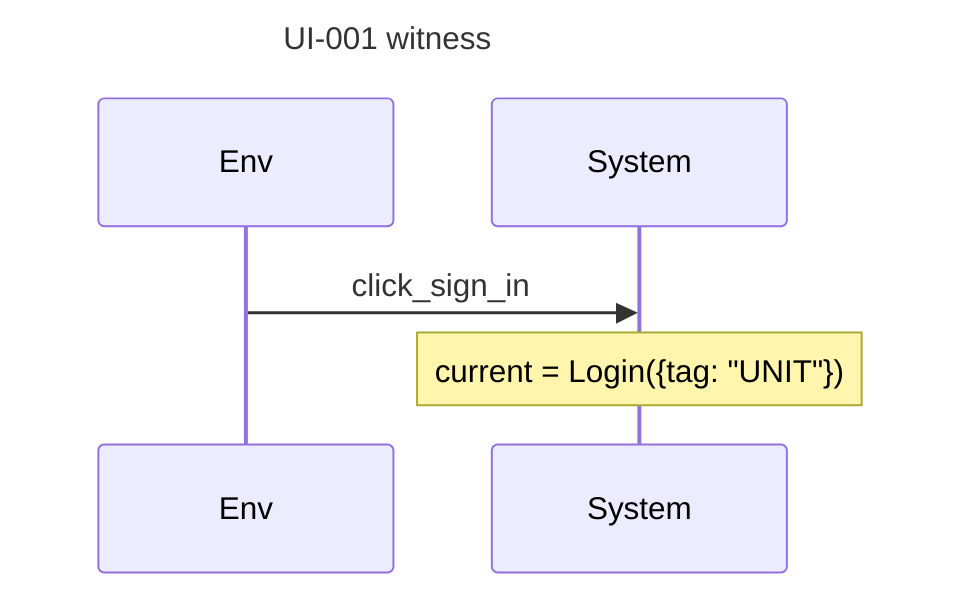
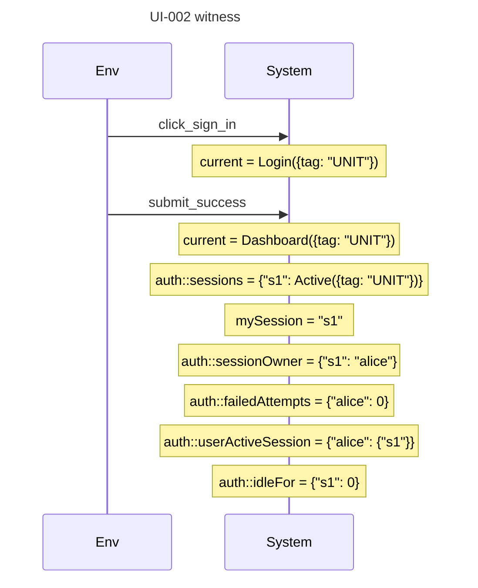
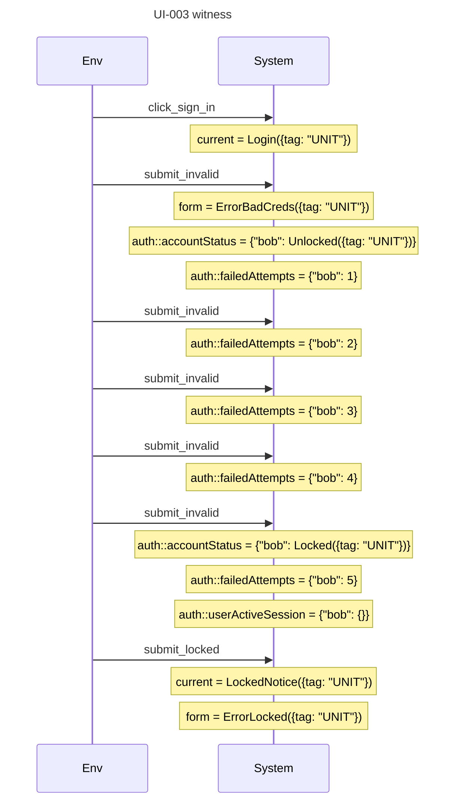
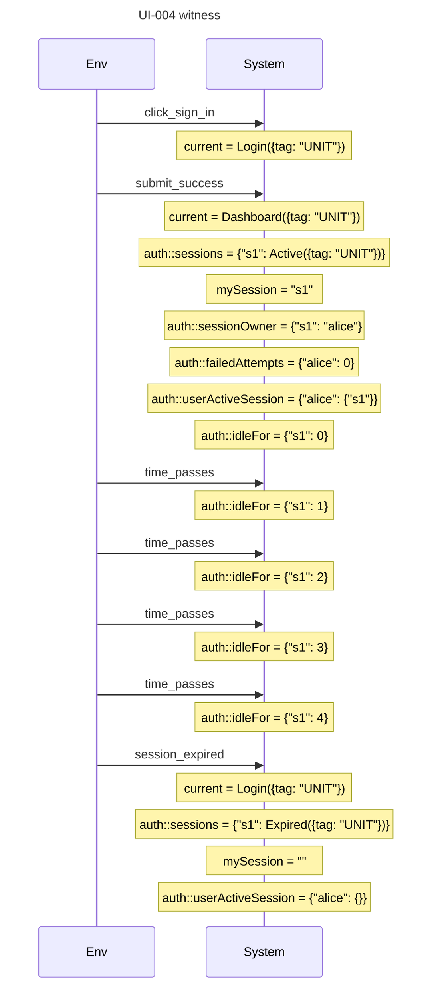
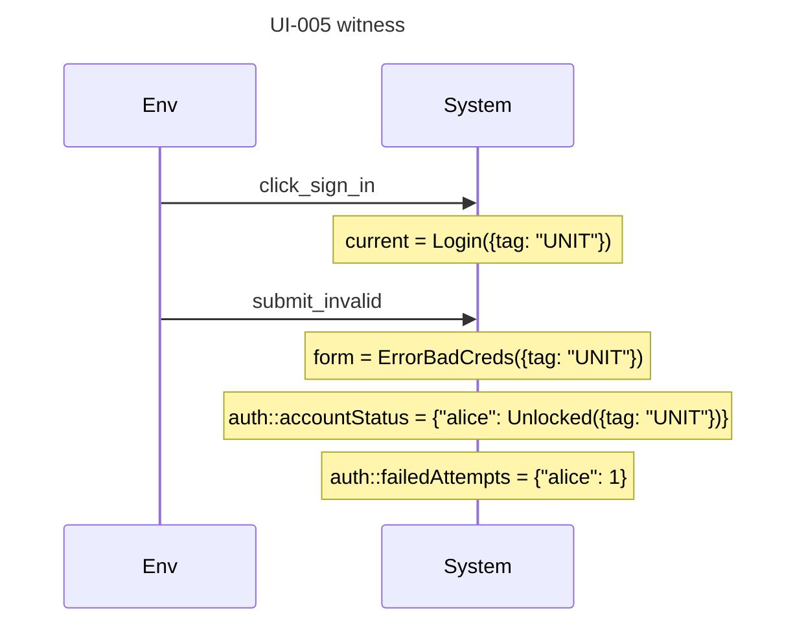
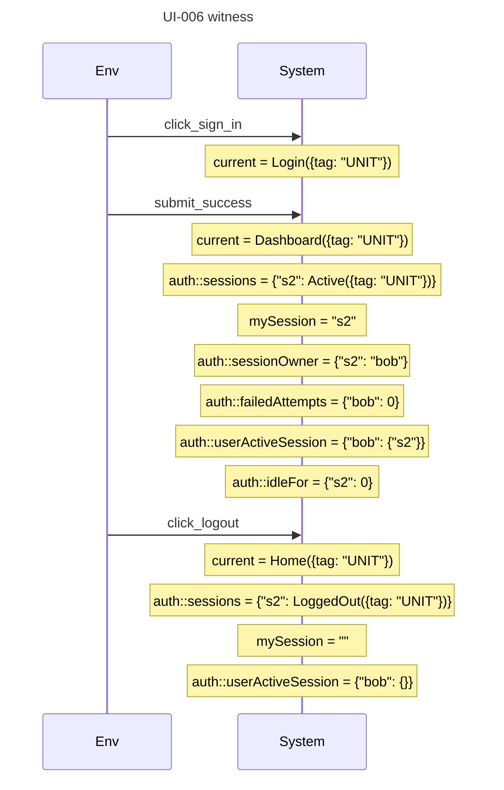
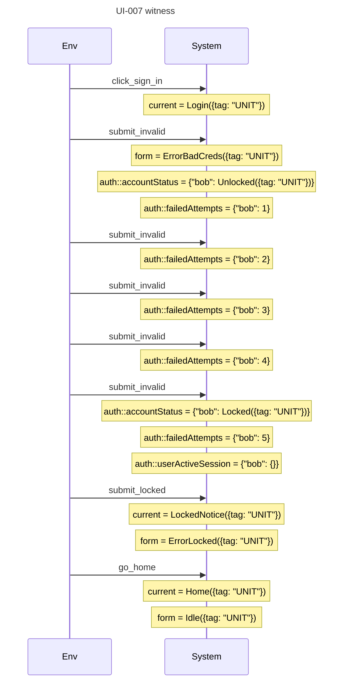

# Spec Readback: auth-ui — v0.1.0

> Auto-generated by `tools/spec-readback.py` from `specs/auth-ui.qnt` + `specs/auth-ui.intent.json` + `specs/auth-ui.records.json`. Do not edit; regenerate after spec changes.

**⚠ NOT READY** — 7 of 7 requirement(s) not verified against code; 1 of 1 invariant(s) not holding.

**Status:** formalized  |  **Requirements:** 0/7 verified, 7/7 witnessed  |  **Invariants:** 0 proven + 0 bounded (≤10) / 1  |  **Coverage:** 7/7 actions covered, 17/17 changes explained  |  **Extraction:** n/a (no code)  |  **Mutation:** 62% pinned by examples, 11 question(s) open  |  **Open questions:** 0  |  **Last verified:** never

*Legend: ✓ verified — witness trace replayed green against real code · ◐ witnessed — proven possible in the model, not yet demonstrated in code · ✗ no witness — claimed behavior is UNREACHABLE in the model · ⏳ not checked yet · ⊘ nothing to witness (a forbidden step, whose proof is its obligation, or a computed value, checked by the unit test it names) · ∀ checked on every reachable step, ∀✗ a step that breaks it was found*

## Purpose

Login flow UI: Home screen, Login form, Dashboard (auth-required), LockedNotice. The navigation graph is model-checked — Dashboard is provably unreachable without an Active session.

## ⚠ Needs Your Attention

- **Check error** — INV-001 (`guardedDashboard`): Picked up JAVA_TOOL_OPTIONS: -Djavax.net.ssl.trustStore=/etc/ssl/certs/java/cacerts -Djavax.net.ssl.trustStoreType=JKS -Dhttps.proxyHost=127.0.0.1 -Dhttps.proxyPort=34101 -Dhttp.nonProxyHosts=localhost|127.0.0.1|::1|127.*|0.*|::|169.254.*|api.anthropic.com|api-staging.anthropic.com|api-pr-preview.anthropic.com|mcp-proxy.anthropic.com|mcp-proxy-staging.anthropic.com|registry.npmjs.org|jsr.io|npm.jsr.io|pypi.org|files.pythonhosted.org|index.crates.io|proxy.golang.org|host.docker.internal|10.*|172.16.*|172.17.*|172.18.*|172.19.*|172.20.*|172.21.*|172.22.*|172.23.*|172.24.*|172.25.*|172.26.*|172.27.*|172.28.*|172.29.*|172.30.*|172.31.*|192.168.*|100.64.0.0/10|*.svc.cluster.local|*.svc.cluster.local -Djdk.http.auth.tunneling.disabledSchemes= -Djdk.http.auth.proxying.disabledSchemes=
Oct 11, 2026 4:10:39 PM com.google.protobuf.GeneratedMessage warnPre22Gencode
WARNING: Vulnerable protobuf generated type in use: io.grpc.reflection.v1alpha.ServerReflectionRequest
As of 2022/09/29 (release 21.7) makeExtensionsImmutable should not be called from protobuf gencode. If you are seeing this message, your gencode is vulnerable to a denial of service attack. You should regenerate your code using protobuf 25.6 or later. Use the latest version that meets your needs. However, if you understand the risks and wish to continue with vulnerable gencode, you can set the system property `-Dcom.google.protobuf.use_unsafe_pre22_gencode` on the command line to silence this warning. You also can set `-Dcom.google.protobuf.error_on_unsafe_pre22_gencode` to throw an error instead. See security vulnerability: https://github.com/protocolbuffers/protobuf/security/advisories/GHSA-h4h5-3hr4-j3g2
error: current is used before it is assigned. You need to have either `current == <expr>` or `current.in(<set>)` before doing anything else with `current` in your predicate.
- **The examples leave 11 behavior(s) open** — the model decides them and no example does. Answer the [questions](#questions-the-examples-leave-open): yes adds an example, no finds a model bug.
- **Mutation results are for an older model** — rerun `tools/spec-questions.py <area> --record` before answering.

## Questions the Examples Leave Open

_Small changes to the model that every example and invariant still pass: 13 of 40 tried (`tools/spec-questions.py`, 4340c15). Each is a behavior the model chose and nobody approved. **Yes** pins it: add the run as an example. **No** means the model is wrong here._

> ⚠ These were raised against an older model — rerun before answering.

### b79923fe · [UI-001](#ui-001)

**Given** click_sign_in **When** click_sign_in

> After click_sign_in, should click_sign_in be refused? The model refuses it; a model that allows it passes every example too.

Yes → add as an example of UI-001:

```quint
run q_b79923fe = init.then(click_sign_in).then(click_sign_in.fail())
```

<sub>Raised by the variant: click_sign_in: drop the guard `current == Home`.</sub>

### d5442974 · [UI-002](#ui-002)

**Given** the initial state **When** submit_success(alice, s1)

> From the start, should submit_success(alice, s1) be refused? The model refuses it; a model that allows it passes every example too.

Yes → add as an example of UI-002:

```quint
run q_d5442974 = init.then(submit_success("alice", "s1").fail())
```

<sub>Raised by the variant: submit_success: drop the guard `current == Login`.</sub>

### f8263eaa · [UI-002](#ui-002)

**Given** click_sign_in **When** submit_success(bob, s1)

> After click_sign_in, when submit_success(bob, s1): should form = Idle hold? The model says so; a model where it does not passes every example too.

Yes → add as an example of UI-002:

```quint
run q_f8263eaa = init.then(click_sign_in).then(submit_success("bob", "s1")).expect(form == Idle)
```

<sub>Raised by the variant: submit_success: `form` gets `Submitting` where the model writes `Idle`.</sub>

### e20334a7 · [UI-002](#ui-002)

**Given** click_sign_in; then submit_invalid(alice) **When** submit_success(bob, s2)

> After click_sign_in; then submit_invalid(alice), when submit_success(bob, s2): should form = Idle hold? The model says so; a model where it does not passes every example too.

Yes → add as an example of UI-002:

```quint
run q_e20334a7 = init.then(click_sign_in).then(submit_invalid("alice")).then(submit_success("bob", "s2")).expect(form == Idle)
```

<sub>Raised by the variant: submit_success: drop the effect on `form` (keep it as it was).</sub>

### aaa2ce5e · [UI-003](#ui-003)

**Given** click_sign_in **When** submit_locked(bob)

> After click_sign_in, should submit_locked(bob) be refused? The model refuses it; a model that allows it passes every example too.

Yes → add as an example of UI-003:

```quint
run q_aaa2ce5e = init.then(click_sign_in).then(submit_locked("bob").fail())
```

<sub>Raised by the variant: submit_locked: drop the guard `accountLocked(u)`.</sub>

### 20ee0d29

**Given** the initial state **When** submit_invalid(alice)

> From the start, should submit_invalid(alice) be refused? The model refuses it; a model that allows it passes every example too.

Yes → add as an example:

```quint
run q_20ee0d29 = init.then(submit_invalid("alice").fail())
```

<sub>Raised by the variant: submit_invalid: drop the guard `current == Login`.</sub>

### 8e18e124

**Given** click_sign_in **When** submit_invalid(bob)

> After click_sign_in, when submit_invalid(bob): should form = ErrorBadCreds hold? The model says so; a model where it does not passes every example too.

Yes → add as an example:

```quint
run q_8e18e124 = init.then(click_sign_in).then(submit_invalid("bob")).expect(form == ErrorBadCreds)
```

<sub>Raised by the variant: submit_invalid: `form` gets `ErrorLocked` where the model writes `ErrorBadCreds`.</sub>

### 9c56ae3d

**Given** click_sign_in; then submit_success(alice, s1) **When** click_logout

> After click_sign_in; then submit_success(alice, s1), when click_logout: should form = Idle hold? The model says so; a model where it does not passes every example too.

Yes → add as an example:

```quint
run q_9c56ae3d = init.then(click_sign_in).then(submit_success("alice", "s1")).then(click_logout).expect(form == Idle)
```

<sub>Raised by the variant: click_logout: `form` gets `Submitting` where the model writes `Idle`.</sub>

### b222972a

**Given** click_sign_in; then submit_success(alice, s1) **When** click_logout

> After click_sign_in; then submit_success(alice, s1), when click_logout: should mySession = "" hold? The model says so; a model where it does not passes every example too.

Yes → add as an example:

```quint
run q_b222972a = init.then(click_sign_in).then(submit_success("alice", "s1")).then(click_logout).expect(mySession == "")
```

<sub>Raised by the variant: click_logout: drop the effect on `mySession` (keep it as it was).</sub>

### efa51944

**Given** the initial state **When** go_home

> From the start, should go_home be refused? The model refuses it; a model that allows it passes every example too.

Yes → add as an example:

```quint
run q_efa51944 = init.then(go_home.fail())
```

<sub>Raised by the variant: go_home: drop the guard `current == LockedNotice`.</sub>

### 7ef96d74

**At the start**

> Initially, should form = Idle hold? The model says so; a model where it does not passes every example too.

Yes → add as an example:

```quint
run q_7ef96d74 = init.expect(form == Idle)
```

<sub>Raised by the variant: init: `form` gets `Submitting` where the model writes `Idle`.</sub>

## Navigation

```mermaid
graph TB
  Home --> |click 'Sign in'| Login
  Login --> |submit valid credentials| Dashboard
  Login --> |submit invalid credentials (stays, shows error)| Login
  Login --> |submit when account locked| LockedNotice
  Dashboard --> |click logout| Home
  Dashboard --> |the session expires (sign in again)| Login
  LockedNotice --> |back to Home| Home
  classDef auth_required fill:#fff5b1
  class Dashboard auth_required
```

| From | To | Trigger | Guard | Action |
|---|---|---|---|---|
| Home | Login | click 'Sign in' | — | `click_sign_in` |
| Login | Dashboard | submit valid credentials | auth::login succeeds | `submit_success` |
| Login | Login | submit invalid credentials (stays, shows error) | — | `submit_invalid` |
| Login | LockedNotice | submit when account locked | auth::isLocked(user) | `submit_locked` |
| Dashboard | Home | click logout | auth::logout succeeds | `click_logout` |
| Dashboard | Login | the session expires (sign in again) | auth::expire_session succeeds | `session_expired` |
| LockedNotice | Home | back to Home | — | `go_home` |

## Screens

| Screen | Auth required | Purpose | Components |
|---|---|---|---|
| Home | no | Public landing; shows 'Sign in' for unauthenticated users. | Header |
| Login | no | Email/password form. | Header, LoginForm |
| Dashboard | yes | Logged-in landing. | Header |
| LockedNotice | no | Shown when login fails because the account is locked. | Header |

## UI Components

- **LoginForm** — fields: email, password; states: idle, submitting, error
- **Header** — visible when: always

## At a Glance

| | ID | Behavior | Modality |
|---|---|---|---|
| ◐ | [UI-001](#ui-001) | While on Home, when the user clicks 'Sign in', the system shall navigate to Login. | must |
| ◐ | [UI-002](#ui-002) | While on Login, when the user submits valid credentials, the system shall navigate to D… | must |
| ◐ | [UI-003](#ui-003) | If the user submits credentials for a Locked account, then the system shall navigate to… | must |
| ◐ | [UI-004](#ui-004) | While on Dashboard, when the session expires, the system shall return to Login. | must |
| ◐ | [UI-005](#ui-005) | If the user submits invalid credentials, then the system shall stay on Login and show t… | must |
| ◐ | [UI-006](#ui-006) | While on Dashboard, when the user clicks logout, the system shall sign the user out and… | must |
| ◐ | [UI-007](#ui-007) | While on LockedNotice, when the user goes back, the system shall show Home with the for… | must |

## What the System Does

### Sign in

> **Who** · User<br>
> **Story** · User opens the login screen, signs in, and lands on the Dashboard — including the lockout failure branch.<br>
> **Route** · ◐ [UI-001](#ui-001) → [auth.REQ-001](auth.readback.md#req-001) → ◐ [UI-002](#ui-002) → [auth.REQ-003](auth.readback.md#req-003) → ◐ [UI-003](#ui-003)<br>
> **Runs as** · ✓ `auth-ui.signInJourney` — `quint test` runs it; it walks 5 of 5 step(s) in order.

**Step 1 of 5**

#### UI-001

◐ ∀ While on Home, when the user clicks 'Sign in', the system shall navigate to Login.

| Example | Given | When | Then |
|---|---|---|---|
| EX-001 — Sign in opens the login page | the initial state | click_sign_in | `current == Login and form == Idle` |

> **Guarded by** · [INV-001](#what-must-always-be-true) `guardedDashboard` ⏳

> **Left open** · [b79923fe](#b79923fe) click_sign_in — the model decides, no example does

> **Witness:** 2 steps: click_sign_in → current = Login({tag: "UNIT"})

> **∀ Every step:** checked on every reachable step (≤4 steps).

<details><summary>EARS sentence, Quint action `click_sign_in`, formal claim + trace</summary>

**As specified (EARS):** While `current == Home`, when the user clicks 'Sign in', the system shall make `current == Login and form == Idle` hold.

`specs/auth-ui.qnt:L109-L115` · model `3cfd8a684ad0`

```quint
  action click_sign_in: bool = all {
    current == Home,
    current'   = Login,
    form'      = Idle,
    mySession' = mySession,
    authUnchanged,
  }
```

**Formal claim** (pre-state for while/old, post-state for shall):
- **while** `current == Home`
- **shall** `current == Login and form == Idle`

**Record:** `specs/auth-ui.qnt:102` — the doc comment this requirement is read from.



</details>

**Step 2 of 5** · [auth.REQ-001](auth.readback.md#req-001) — specified in area *auth*

**Step 3 of 5**

#### UI-002

◐ ∀ While on Login, when the user submits valid credentials, the system shall navigate to Dashboard.

| Example | Given | When | Then |
|---|---|---|---|
| EX-002 — Valid credentials land on the Dashboard | click_sign_in | submit_success(alice, s1) | `current == Dashboard and authenticated` |

> **Guarded by** · [INV-001](#what-must-always-be-true) `guardedDashboard` ⏳

> **Left open** · [d5442974](#d5442974) submit_success(alice, s1) · [f8263eaa](#f8263eaa) submit_success(bob, s1) · [e20334a7](#e20334a7) submit_success(bob, s2) — the model decides, no example does

> **Witness:** 3 steps: click_sign_in → submit_success(s1, alice) → current = Dashboard({tag: "UNIT"}); auth::sessions = {"s1": Active({tag: "UNIT"})}; mySession = "s1"; auth::sessionOwner = {"s1": "alice"}; auth::failedAttempts = {"alice": 0}; auth::userActiveSession = {"alice": {"s1"}}; auth::idleFor = {"s1": 0}

> **∀ Every step:** checked on every reachable step (≤4 steps).

<details><summary>EARS sentence, Quint action `submit_success`, formal claim + trace</summary>

**As specified (EARS):** While `current == Login`, when the user submits valid credentials, the system shall make `current == Dashboard and form == Idle and authenticated and mySession == s` hold.

`specs/auth-ui.qnt:L132-L138` · model `3cfd8a684ad0`

```quint
  action submit_success(u: UserId, s: SessionId): bool = all {
    current == Login,
    auth::login(u, s),
    current'   = Dashboard,
    form'      = Idle,
    mySession' = s,
  }
```

**Formal claim** (pre-state for while/old, post-state for shall):
- **while** `current == Login`
- **shall** `current == Dashboard and form == Idle and authenticated and mySession == s`

**Record:** `specs/auth-ui.qnt:124` — the doc comment this requirement is read from.



</details>

**Step 4 of 5** · [auth.REQ-003](auth.readback.md#req-003) — specified in area *auth*

*failure branch: repeated bad credentials lock the account*

**Step 5 of 5**

*locked-account counterpart of the submit step*

#### UI-003

◐ ∀  *(failure path)* If the user submits credentials for a Locked account, then the system shall navigate to LockedNotice.

| Example | Given | When | Then |
|---|---|---|---|
| EX-003 — Five bad passwords lock the account; the next submit shows the locked notice | click_sign_in; then submit_invalid(bob) × 5 | submit_locked(bob) | `current == LockedNotice and form == ErrorLocked` |

> **Guarded by** · [INV-001](#what-must-always-be-true) `guardedDashboard` ⏳

> **Left open** · [aaa2ce5e](#aaa2ce5e) submit_locked(bob) — the model decides, no example does

> **Witness:** 8 steps: click_sign_in → submit_invalid(bob) ×5 → submit_locked(bob) → current = LockedNotice({tag: "UNIT"}); form = ErrorLocked({tag: "UNIT"})

> **∀ Every step:** checked on every reachable step (≤4 steps).

<details><summary>EARS sentence, Quint action `submit_locked`, formal claim + trace</summary>

**As specified (EARS):** While `current == Login`, if the user submits credentials for a Locked account, then the system shall make `current == LockedNotice and form == ErrorLocked and accountLocked(u)` hold.

`specs/auth-ui.qnt:L175-L182` · model `3cfd8a684ad0`

```quint
  action submit_locked(u: UserId): bool = all {
    current == Login,
    accountLocked(u),
    current'   = LockedNotice,
    form'      = ErrorLocked,
    mySession' = mySession,
    authUnchanged,
  }
```

**Formal claim** (pre-state for while/old, post-state for shall):
- **while** `current == Login`
- **shall** `current == LockedNotice and form == ErrorLocked and accountLocked(u)`

**Record:** `specs/auth-ui.qnt:167` — the doc comment this requirement is read from.



</details>

### Other behaviors

> _Specified here, but not yet placed in any journey above._

#### UI-004

◐ ∀ While on Dashboard, when the session expires, the system shall return to Login.

| Example | Given | When | Then |
|---|---|---|---|
| EX-004 — An idle session on the Dashboard expires back to the login form | click_sign_in; then submit_success(alice, s1); then time_passes × 4 | session_expired | `current == Login and not(authenticated)` |

> **Guarded by** · [INV-001](#what-must-always-be-true) `guardedDashboard` ⏳

> **Witness:** 8 steps: click_sign_in → submit_success(s1, alice) → time_passes(s1, alice) ×4 → session_expired(s1, alice) → current = Login({tag: "UNIT"}); auth::sessions = {"s1": Expired({tag: "UNIT"})}; mySession = ""; auth::userActiveSession = {"alice": {}}

> **∀ Every step:** checked on every reachable step (≤4 steps).

<details><summary>EARS sentence, Quint action `session_expired`, formal claim + trace</summary>

**As specified (EARS):** While `current == Dashboard`, when the session expires, the system shall make `current == Login and form == Idle and not(authenticated)` hold.

`specs/auth-ui.qnt:L216-L222` · model `3cfd8a684ad0`

```quint
  action session_expired: bool = all {
    current == Dashboard,
    auth::expire_session(mySession),
    current'   = Login,
    form'      = Idle,
    mySession' = "",
  }
```

**Formal claim** (pre-state for while/old, post-state for shall):
- **while** `current == Dashboard`
- **shall** `current == Login and form == Idle and not(authenticated)`

**Record:** `specs/auth-ui.qnt:209` — the doc comment this requirement is read from.



</details>

#### UI-005

◐ ∀  *(failure path)* If the user submits invalid credentials, then the system shall stay on Login and show the bad-credentials error.

> _No example rows yet — nothing concrete shows this behavior._

> **Guarded by** · [INV-001](#what-must-always-be-true) `guardedDashboard` ⏳

> **Witness:** 3 steps: click_sign_in → submit_invalid(alice) → form = ErrorBadCreds({tag: "UNIT"}); auth::accountStatus = {"alice": Unlocked({tag: "UNIT"})}; auth::failedAttempts = {"alice": 1}

> **∀ Every step:** checked on every reachable step (≤4 steps).

<details><summary>EARS sentence, Quint action `submit_invalid`, formal claim + trace</summary>

**As specified (EARS):** While `current == Login`, if the user submits invalid credentials, then the system shall make `current == Login and form == ErrorBadCreds` hold.

`specs/auth-ui.qnt:L153-L159` · model `3cfd8a684ad0`

```quint
  action submit_invalid(u: UserId): bool = all {
    current == Login,
    auth::login_failed(u),
    current'   = Login,
    form'      = ErrorBadCreds,
    mySession' = mySession,
  }
```

**Formal claim** (pre-state for while/old, post-state for shall):
- **while** `current == Login`
- **shall** `current == Login and form == ErrorBadCreds`

**Record:** `specs/auth-ui.qnt:145` — the doc comment this requirement is read from.



</details>

#### UI-006

◐ ∀ While on Dashboard, when the user clicks logout, the system shall sign the user out and return to Home.

> _No example rows yet — nothing concrete shows this behavior._

> **Guarded by** · [INV-001](#what-must-always-be-true) `guardedDashboard` ⏳

> **Witness:** 4 steps: click_sign_in → submit_success(s2, bob) → click_logout(s2, bob) → current = Home({tag: "UNIT"}); auth::sessions = {"s2": LoggedOut({tag: "UNIT"})}; mySession = ""; auth::userActiveSession = {"bob": {}}

> **∀ Every step:** checked on every reachable step (≤4 steps).

<details><summary>EARS sentence, Quint action `click_logout`, formal claim + trace</summary>

**As specified (EARS):** While `current == Dashboard`, when the user clicks logout, the system shall make `current == Home and form == Idle and mySession == ""` hold.

`specs/auth-ui.qnt:L195-L201` · model `3cfd8a684ad0`

```quint
  action click_logout: bool = all {
    current == Dashboard,
    auth::logout(mySession),
    current'   = Home,
    form'      = Idle,
    mySession' = "",
  }
```

**Formal claim** (pre-state for while/old, post-state for shall):
- **while** `current == Dashboard`
- **shall** `current == Home and form == Idle and mySession == ""`

**Record:** `specs/auth-ui.qnt:188` — the doc comment this requirement is read from.



</details>

#### UI-007

◐ ∀ While on LockedNotice, when the user goes back, the system shall show Home with the form cleared.

> _No example rows yet — nothing concrete shows this behavior._

> **Guarded by** · [INV-001](#what-must-always-be-true) `guardedDashboard` ⏳

> **Witness:** 9 steps: click_sign_in → submit_invalid(bob) ×5 → submit_locked(bob) → go_home(bob) → current = Home({tag: "UNIT"}); form = Idle({tag: "UNIT"})

> **∀ Every step:** checked on every reachable step (≤4 steps).

<details><summary>EARS sentence, Quint action `go_home`, formal claim + trace</summary>

**As specified (EARS):** While `current == LockedNotice`, when the user goes back to Home, the system shall make `current == Home and form == Idle` hold.

`specs/auth-ui.qnt:L234-L240` · model `3cfd8a684ad0`

```quint
  action go_home: bool = all {
    current == LockedNotice,
    current'   = Home,
    form'      = Idle,
    mySession' = mySession,
    authUnchanged,
  }
```

**Formal claim** (pre-state for while/old, post-state for shall):
- **while** `current == LockedNotice`
- **shall** `current == Home and form == Idle`

**Record:** `specs/auth-ui.qnt:227` — the doc comment this requirement is read from.



</details>

## What Each Action Does

_One table per step the model can take. Each row is a requirement or verdict on it, with the condition it applies under; each column is a variable the step can change, and the cell is what the row says about it. A step no row covers is a gap; a change no row names is behavior nobody asked for. /spec-check proves both (coverage, explanation)._

### `click_sign_in`

| Row | Applies when | `current` | `form` |
|---|---|---|---|
| UI-001 | `current == Home` | `current == Login` | `form == Idle` |

_✓ coverage (≤4) · ✓ `current` explained (≤4) · ✓ `form` explained (≤4)_

### `submit_success`

| Row | Applies when | `current` | `form` | `mySession` |
|---|---|---|---|---|
| UI-002 | `current == Login` | `current == Dashboard` | `form == Idle` | `authenticated` ∧ `mySession == s` |

_✓ coverage (≤4) · ✓ `current` explained (≤4) · ✓ `form` explained (≤4) · ✓ `mySession` explained (≤4)_

### `submit_invalid`

| Row | Applies when | `current` | `form` |
|---|---|---|---|
| UI-005 | `current == Login` | `current == Login` | `form == ErrorBadCreds` |

_✓ coverage (≤4) · ✓ `current` explained (≤4) · ✓ `form` explained (≤4)_

### `submit_locked`

| Row | Applies when | `current` | `form` |
|---|---|---|---|
| UI-003 | `current == Login` | `current == LockedNotice` | `form == ErrorLocked` |

_✓ coverage (≤4) · ✓ `current` explained (≤4) · ✓ `form` explained (≤4)_

### `click_logout`

| Row | Applies when | `current` | `form` | `mySession` |
|---|---|---|---|---|
| UI-006 | `current == Dashboard` | `current == Home` | `form == Idle` | `mySession == ""` |

_✓ coverage (≤4) · ✓ `current` explained (≤4) · ✓ `form` explained (≤4) · ✓ `mySession` explained (≤4)_

### `session_expired`

| Row | Applies when | `current` | `form` | `mySession` |
|---|---|---|---|---|
| UI-004 | `current == Dashboard` | `current == Login` | `form == Idle` | `not(authenticated)` |

_✓ coverage (≤4) · ✓ `current` explained (≤4) · ✓ `form` explained (≤4) · ✓ `mySession` explained (≤4)_

### `go_home`

| Row | Applies when | `current` | `form` |
|---|---|---|---|
| UI-007 | `current == LockedNotice` | `current == Home` | `form == Idle` |

_✓ coverage (≤4) · ✓ `current` explained (≤4) · ✓ `form` explained (≤4)_

### `time_passes`

| Row | Applies when |
|---|---|
| NO-OP #1 | always |  |

_✓ coverage: time_passes #1 NO-OP applies to every step · ✓ verdict #1 (≤4)_

## What Must Always Be True

_Invariant legend: ✓ proven — inductive, holds in ALL reachable states · ✓ (≤N steps) — bounded model check to depth N; no counterexample found within N, NOT a proof · ✗ counterexample · ⚠ accepted-risk · ⏳ not checked. Upgrade a bounded ✓ by raising the bound or marking the invariant `proof: inductive`._

- **INV-001** (`guardedDashboard`) — Dashboard is shown only while the session this browser holds is Active in auth. ('Shall always' statements are invariants, not requirements — Apalache proves them across all reachable states.) Criticality: critical. ⏳

## Examples

_Concrete cases, each a Quint `run` that `quint test` executes and the code's conformance harness replays. A witness trace shows a behavior is reachable at all; an example pins the one case it states._

| Example | Given | When | Then | Illustrates |
|---|---|---|---|---|
| EX-001 — Sign in opens the login page | the initial state | click_sign_in | `current == Login and form == Idle` | UI-001 |
| EX-002 — Valid credentials land on the Dashboard | click_sign_in | submit_success(alice, s1) | `current == Dashboard and authenticated` | UI-002 |
| EX-003 — Five bad passwords lock the account; the next submit shows the locked notice | click_sign_in; then submit_invalid(bob) × 5 | submit_locked(bob) | `current == LockedNotice and form == ErrorLocked` | UI-003 |
| EX-004 — An idle session on the Dashboard expires back to the login form | click_sign_in; then submit_success(alice, s1); then time_passes × 4 | session_expired | `current == Login and not(authenticated)` | UI-004 |

## Completeness by Dimension

_One number would hide which half is missing. Each row is derived from declared obligations: ✓ discharged, ! outstanding, — nothing declared (which may itself be the gap)._

| Dimension | | Obligations |
|---|---|---|
| Data model | — | no entities declared |
| Coverage | ✓ | 7/7 action(s) proven covered |
| Explanation | ✓ | 17/17 change(s) proven explained by a requirement |
| Operations | ✓ | 7/7 requirements with a discharged witness |
| Failure behavior | — | 2 unwanted-path requirement(s); no external outcomes declared — unmeasured |
| External systems | — | none declared — if the area calls anything, this is a gap |
| Assumptions | — | none recorded |
| Temporal behavior | — | none declared |
| Extraction coverage | — | n/a (no code) |
| Substitutability | — | not measured — needs a parallel build and `spec-record equiv` |
| Refusal coverage | — | no rejection requirements |
| Examples | ✓ | 4 worked example(s) |
| Behavior the examples pin | ! | 62% pinned by examples, 11 question(s) open |
| Invariants | ! | 0/1 holding |
| Adversarial review | — | never run — `/spec-check --reality` |

## Reference

<details><summary>Concepts, architecture, decisions, resolved questions, traceability, verification history</summary>

**Actors:** User

**Architecture (resolved project ⊕ area):** TypeScript 5.4 Node.js 20 React Vitest pnpm · persistence: sql postgres Prisma

**Decisions:**

- **DEC-001** (accepted, 2026-05-15) — Model the navigation as a Quint state machine. Encode screens as a variant type, navigation as Quint actions, auth gating as invariants checked by Apalache. Rationale: Lets us prove 'Dashboard unreachable without auth' rather than relying on convention. Visual design stays in the design tooling — not formalized.

_No code generated yet. Run /spec-code-generate._

_Approval lives in PR history — audit trail: `git log -- specs/auth-ui.qnt specs/auth-ui.intent.json specs/auth-ui.records.json`_

</details>
