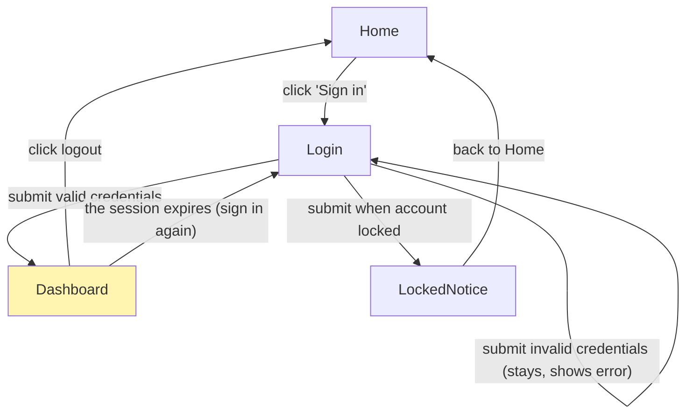
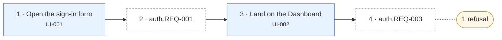
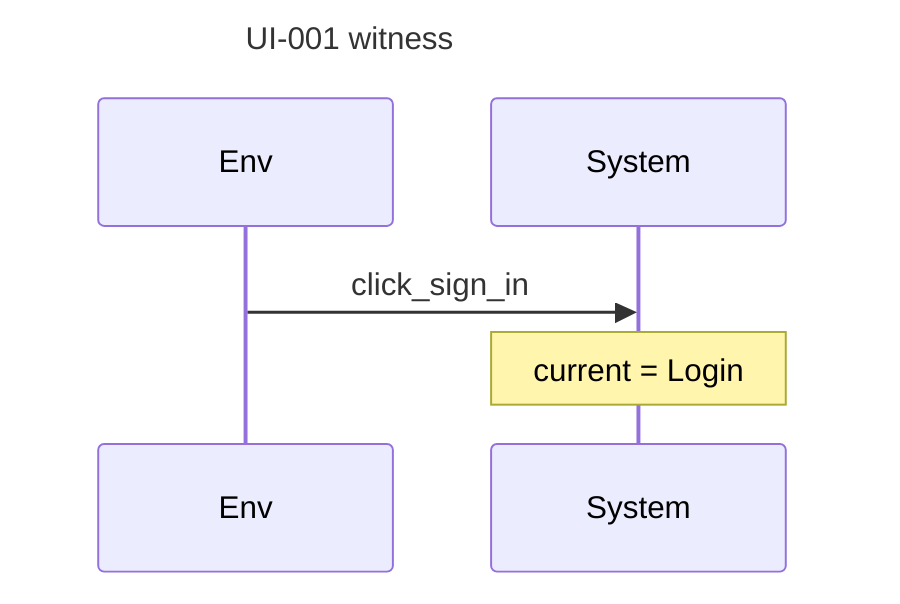
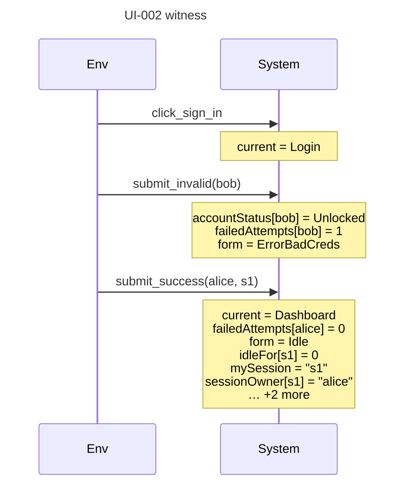
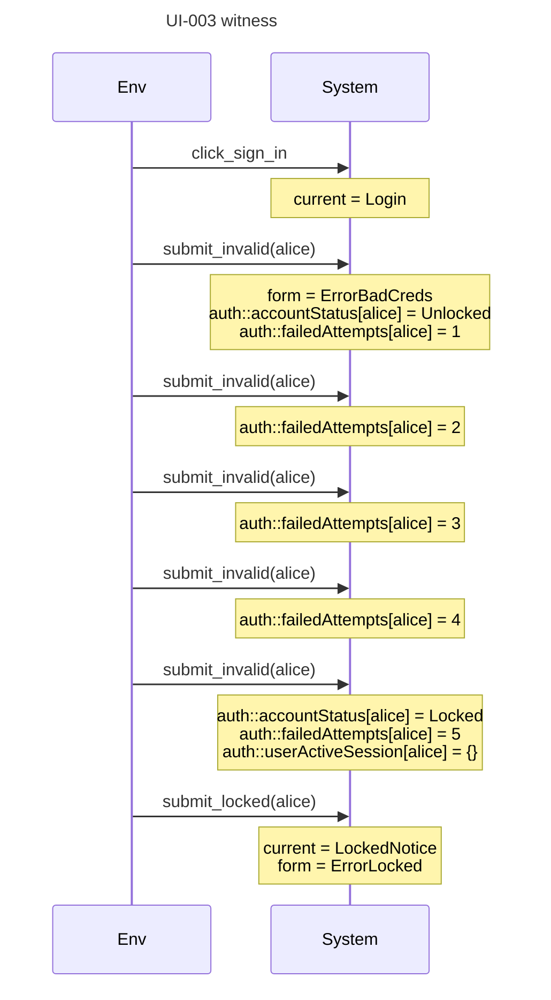
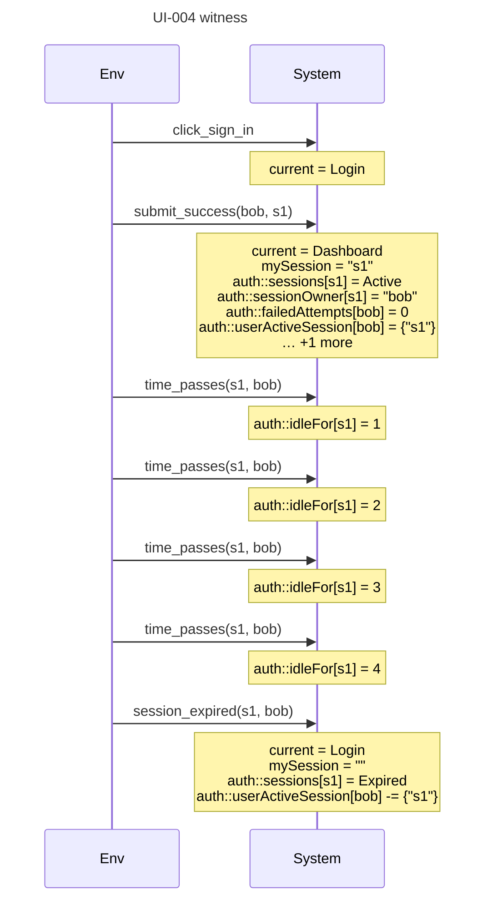
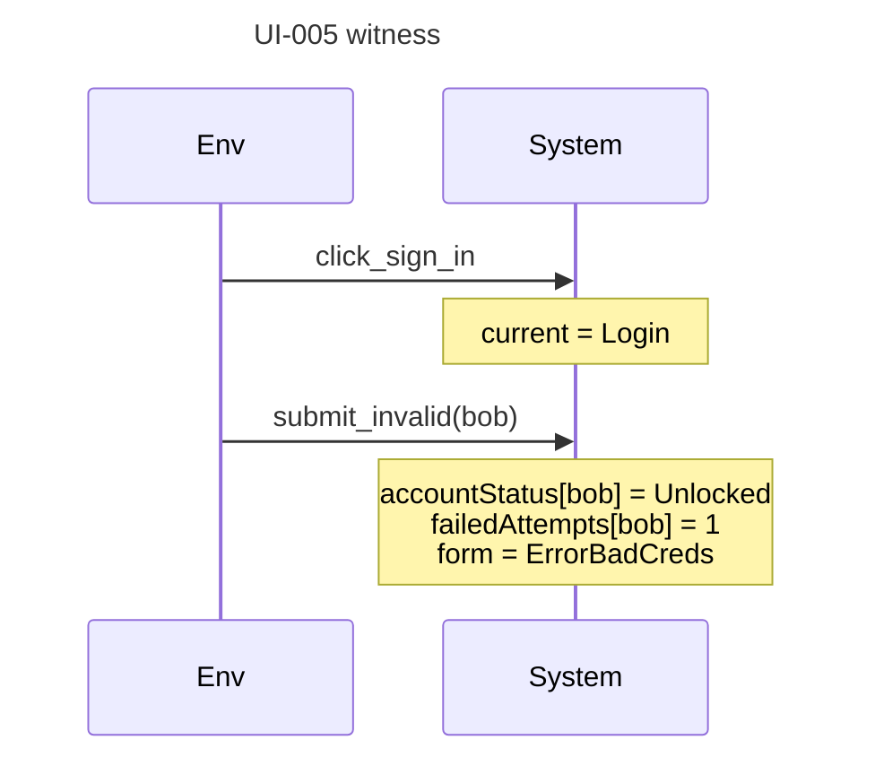
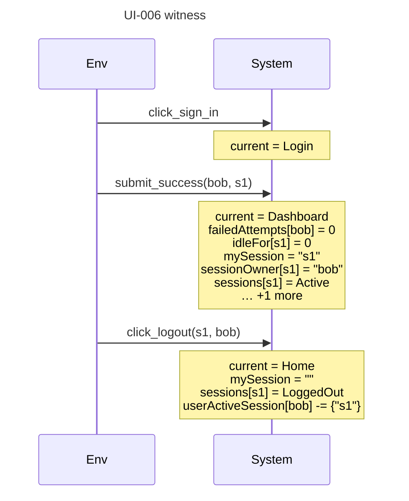
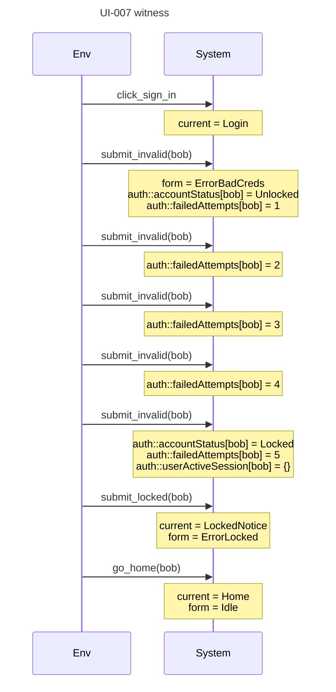

# Spec Readback: auth-ui — v0.1.0

> Auto-generated by `tools/spec-readback.py` from `specs/auth-ui.qnt` + `specs/auth-ui.intent.json` + `specs/auth-ui.records.json`. Do not edit; regenerate after spec changes.

**⚠ NOT READY** — 7 of 7 requirement(s) not verified against code; 1 of 1 invariant(s) not holding.

**Status:** formalized  |  **Requirements:** 0/7 verified, 7/7 witnessed  |  **Invariants:** 0 proven + 0 bounded (≤10) / 1  |  **Coverage:** 7/7 actions covered, 17/17 changes explained  |  **Extraction:** n/a (no code)  |  **Mutation:** 62% pinned by examples, 11 question(s) open  |  **Open questions:** 0  |  **Last verified:** never

*Legend: ✓ verified — witness trace replayed green against real code · ◐ witnessed — proven possible in the model, not yet demonstrated in code · ✗ no witness — claimed behavior is UNREACHABLE in the model · ⏳ not checked yet · ⊘ nothing to witness (a forbidden step, whose proof is its obligation, or a computed value, checked by the unit test it names) · ∀ checked on every reachable step, ∀✗ a step that breaks it was found*

## Purpose

Login flow UI: Home screen, Login form, Dashboard (auth-required), LockedNotice. The navigation graph is model-checked — Dashboard is provably unreachable without an Active session.

## ⚠ Needs Your Attention

- **Check error** — INV-001 (`guardedDashboard`): WARNING: java.lang.System::load has been called by tools.aqua.turnkey.support.TurnKey in an unnamed module (file:/Users/akracik/.quint/apalache-dist-0.56.1/apalache/lib/apalache.jar)
WARNING: Use --enable-native-access=ALL-UNNAMED to avoid a warning for callers in this module
WARNING: Restricted methods will be blocked in a future release unless native access is enabled

error: current is used before it is assigned. You need to have either `current == <expr>` or `current.in(<set>)` before doing anything else with `current` in your predicate.
- **Deep pass not reached** — 22 check(s) rest on the shallow bound only: pass 1 took 27s against a 180s run budget. Raise apalache.budget_seconds, run with more --parallel, or cut the model's checking cost (spec-lint's cost/* warnings say where).
- **The examples leave 11 behavior(s) open** — the model decides them and no example does. Answer the [questions](#questions-the-examples-leave-open): yes adds an example, no finds a model bug.
- **Mutation results are for an older model** — rerun `tools/spec-questions.py <area> --record` before answering.

## Questions the Examples Leave Open

_Small changes to the model that every example and invariant still pass: 13 of 40 tried (`tools/spec-questions.py`, 4340c15). Each is a behavior the model chose and nobody approved. **Yes** pins it: add the run as an example. **No** means the model is wrong here._

> ⚠ These were raised against an older model — rerun before answering.

### b79923fe · [UI-001](#ui-001)

**Given** click_sign_in **When** click_sign_in

> After click_sign_in, should click_sign_in be refused? The model refuses it; a model that allows it passes every example too.

Yes → add as an example of UI-001:

```quint
run q_b79923fe = init.then(click_sign_in).then(click_sign_in.fail())
```

<sub>Raised by the variant: click_sign_in: drop the guard `current == Home`.</sub>

### d5442974 · [UI-002](#ui-002)

**Given** the initial state **When** submit_success(alice, s1)

> From the start, should submit_success(alice, s1) be refused? The model refuses it; a model that allows it passes every example too.

Yes → add as an example of UI-002:

```quint
run q_d5442974 = init.then(submit_success("alice", "s1").fail())
```

<sub>Raised by the variant: submit_success: drop the guard `current == Login`.</sub>

### f8263eaa · [UI-002](#ui-002)

**Given** click_sign_in **When** submit_success(bob, s1)

> After click_sign_in, when submit_success(bob, s1): should form = Idle hold? The model says so; a model where it does not passes every example too.

Yes → add as an example of UI-002:

```quint
run q_f8263eaa = init.then(click_sign_in).then(submit_success("bob", "s1")).expect(form == Idle)
```

<sub>Raised by the variant: submit_success: `form` gets `Submitting` where the model writes `Idle`.</sub>

### e20334a7 · [UI-002](#ui-002)

**Given** click_sign_in; then submit_invalid(alice) **When** submit_success(bob, s2)

> After click_sign_in; then submit_invalid(alice), when submit_success(bob, s2): should form = Idle hold? The model says so; a model where it does not passes every example too.

Yes → add as an example of UI-002:

```quint
run q_e20334a7 = init.then(click_sign_in).then(submit_invalid("alice")).then(submit_success("bob", "s2")).expect(form == Idle)
```

<sub>Raised by the variant: submit_success: drop the effect on `form` (keep it as it was).</sub>

### aaa2ce5e · [UI-003](#ui-003)

**Given** click_sign_in **When** submit_locked(bob)

> After click_sign_in, should submit_locked(bob) be refused? The model refuses it; a model that allows it passes every example too.

Yes → add as an example of UI-003:

```quint
run q_aaa2ce5e = init.then(click_sign_in).then(submit_locked("bob").fail())
```

<sub>Raised by the variant: submit_locked: drop the guard `accountLocked(u)`.</sub>

### 20ee0d29

**Given** the initial state **When** submit_invalid(alice)

> From the start, should submit_invalid(alice) be refused? The model refuses it; a model that allows it passes every example too.

Yes → add as an example:

```quint
run q_20ee0d29 = init.then(submit_invalid("alice").fail())
```

<sub>Raised by the variant: submit_invalid: drop the guard `current == Login`.</sub>

### 8e18e124

**Given** click_sign_in **When** submit_invalid(bob)

> After click_sign_in, when submit_invalid(bob): should form = ErrorBadCreds hold? The model says so; a model where it does not passes every example too.

Yes → add as an example:

```quint
run q_8e18e124 = init.then(click_sign_in).then(submit_invalid("bob")).expect(form == ErrorBadCreds)
```

<sub>Raised by the variant: submit_invalid: `form` gets `ErrorLocked` where the model writes `ErrorBadCreds`.</sub>

### 9c56ae3d

**Given** click_sign_in; then submit_success(alice, s1) **When** click_logout

> After click_sign_in; then submit_success(alice, s1), when click_logout: should form = Idle hold? The model says so; a model where it does not passes every example too.

Yes → add as an example:

```quint
run q_9c56ae3d = init.then(click_sign_in).then(submit_success("alice", "s1")).then(click_logout).expect(form == Idle)
```

<sub>Raised by the variant: click_logout: `form` gets `Submitting` where the model writes `Idle`.</sub>

### b222972a

**Given** click_sign_in; then submit_success(alice, s1) **When** click_logout

> After click_sign_in; then submit_success(alice, s1), when click_logout: should mySession = "" hold? The model says so; a model where it does not passes every example too.

Yes → add as an example:

```quint
run q_b222972a = init.then(click_sign_in).then(submit_success("alice", "s1")).then(click_logout).expect(mySession == "")
```

<sub>Raised by the variant: click_logout: drop the effect on `mySession` (keep it as it was).</sub>

### efa51944

**Given** the initial state **When** go_home

> From the start, should go_home be refused? The model refuses it; a model that allows it passes every example too.

Yes → add as an example:

```quint
run q_efa51944 = init.then(go_home.fail())
```

<sub>Raised by the variant: go_home: drop the guard `current == LockedNotice`.</sub>

### 7ef96d74

**At the start**

> Initially, should form = Idle hold? The model says so; a model where it does not passes every example too.

Yes → add as an example:

```quint
run q_7ef96d74 = init.expect(form == Idle)
```

<sub>Raised by the variant: init: `form` gets `Submitting` where the model writes `Idle`.</sub>

## Navigation



| From | To | Trigger | Guard | Action |
|---|---|---|---|---|
| Home | Login | click 'Sign in' | — | `click_sign_in` |
| Login | Dashboard | submit valid credentials | auth::login succeeds | `submit_success` |
| Login | Login | submit invalid credentials (stays, shows error) | — | `submit_invalid` |
| Login | LockedNotice | submit when account locked | auth::isLocked(user) | `submit_locked` |
| Dashboard | Home | click logout | auth::logout succeeds | `click_logout` |
| Dashboard | Login | the session expires (sign in again) | auth::expire_session succeeds | `session_expired` |
| LockedNotice | Home | back to Home | — | `go_home` |

## Screens

| Screen | Auth required | Purpose | Components |
|---|---|---|---|
| Home | no | Public landing; shows 'Sign in' for unauthenticated users. | Header |
| Login | no | Email/password form. | Header, LoginForm |
| Dashboard | yes | Logged-in landing. | Header |
| LockedNotice | no | Shown when login fails because the account is locked. | Header |

## UI Components

- **LoginForm** — fields: email, password; states: idle, submitting, error
- **Header** — visible when: always

## At a Glance

| | ID | Behavior | Kind |
|---|---|---|---|
| | | **Sign in** — 3 · ◐3 | |
| ◐ | [UI-001](#ui-001) | **Open the sign-in form** — While on Home, when the user clicks 'Sign in', the system shall navigate to Login. | happy path |
| ◐ | [UI-002](#ui-002) | **Land on the Dashboard** — While on Login, when the user submits valid credentials, the system shall navigate to D… | happy path |
| ◐ | [UI-003](#ui-003) | **Show the locked notice** — If the user submits credentials for a Locked account, then the system shall navigate to… | refusal |
| | | **Not in any journey** — 4 | |
| ◐ | [UI-004](#ui-004) | **Expired session returns to Login** — While on Dashboard, when the session expires, the system shall return to Login. | happy path |
| ◐ | [UI-005](#ui-005) | **Bad credentials stay on Login** — If the user submits invalid credentials, then the system shall stay on Login and show t… | refusal |
| ◐ | [UI-006](#ui-006) | **Log out to Home** — While on Dashboard, when the user clicks logout, the system shall sign the user out and… | happy path |
| ◐ | [UI-007](#ui-007) | **Leave the locked notice** — While on LockedNotice, when the user goes back, the system shall show Home with the for… | happy path |

## What the System Does

### Sign in

> **Who** · User<br>
> **Story** · User opens the login screen, signs in, and lands on the Dashboard — including the lockout failure branch.<br>
> **Route** · ◐ [UI-001 Open the sign-in form](#ui-001) → [auth.REQ-001](auth.readback.md#req-001) → ◐ [UI-002 Land on the Dashboard](#ui-002) → [auth.REQ-003](auth.readback.md#req-003)<br>
> **Runs as** · ✓ `auth-ui.signInJourney` — `quint test` runs it; it walks 5 of 5 step(s) in order.



<details open><summary><b>Steps</b> — 4 steps, 1 refusal folded under them</summary>

**Step 1 of 4**

#### UI-001

◐ ∀ **Open the sign-in form** — While on Home, when the user clicks 'Sign in', the system shall navigate to Login.

| Example | Given | When | Then |
|---|---|---|---|
| EX-001 — Sign in opens the login page | the initial state | click_sign_in | `current == Login and form == Idle` |

> **Left open** · [b79923fe](#b79923fe) click_sign_in — the model decides, no example does

> **Proof** · reachable (1-step trace) · ∀ holds on every reachable step (≤3 steps)

<details><summary>guarded by, witness, EARS sentence, Quint action `click_sign_in`, formal claim + trace</summary>

> **Guarded by** · [INV-001](#what-must-always-be-true) `guardedDashboard` ⏳

> **Witness:** 2 steps: click_sign_in → `current = Login`

**As specified (EARS):** While `current == Home`, when the user clicks 'Sign in', the system shall make `current == Login and form == Idle` hold.

`specs/auth-ui.qnt:L110-L116` · model `bf77620b3a24`

```quint
  action click_sign_in: bool = all {
    current == Home,
    current'   = Login,
    form'      = Idle,
    mySession' = mySession,
    authUnchanged,
  }
```

**Formal claim** (pre-state for while/old, post-state for shall):
- **while** `current == Home`
- **shall** `current == Login and form == Idle`

**Record:** `specs/auth-ui.qnt:102` — the doc comment this requirement is read from.



</details>

**Step 2 of 4** · [auth.REQ-001](auth.readback.md#req-001) — specified in area *auth*

**Step 3 of 4**

#### UI-002

◐ ∀ **Land on the Dashboard** — While on Login, when the user submits valid credentials, the system shall navigate to Dashboard.

| Example | Given | When | Then |
|---|---|---|---|
| EX-002 — Valid credentials land on the Dashboard | click_sign_in | submit_success(alice, s1) | `current == Dashboard and authenticated` |

> **Left open** · [d5442974](#d5442974) submit_success(alice, s1) · [f8263eaa](#f8263eaa) submit_success(bob, s1) · [e20334a7](#e20334a7) submit_success(bob, s2) — the model decides, no example does

> **Proof** · reachable (3-step trace) · ∀ holds on every reachable step (≤3 steps)

<details><summary>guarded by, witness, EARS sentence, Quint action `submit_success`, formal claim + trace</summary>

> **Guarded by** · [INV-001](#what-must-always-be-true) `guardedDashboard` ⏳

> **Witness:** 4 steps: click_sign_in → submit_invalid(bob) → submit_success(alice, s1) → `current = Dashboard` · `failedAttempts[alice] = 0` · `form = Idle` · `idleFor[s1] = 0` · `mySession = "s1"` · `sessionOwner[s1] = "alice"` · `sessions[s1] = Active` · `userActiveSession[alice] = {"s1"}`

**As specified (EARS):** While `current == Login`, when the user submits valid credentials, the system shall make `current == Dashboard and form == Idle and authenticated and mySession == s` hold.

`specs/auth-ui.qnt:L134-L140` · model `608841f3362a`

```quint
  action submit_success(u: UserId, s: SessionId): bool = all {
    current == Login,
    auth::login(u, s),
    current'   = Dashboard,
    form'      = Idle,
    mySession' = s,
  }
```

**Formal claim** (pre-state for while/old, post-state for shall):
- **while** `current == Login`
- **shall** `current == Dashboard and form == Idle and authenticated and mySession == s`

**Record:** `specs/auth-ui.qnt:125` — the doc comment this requirement is read from.



</details>

**Step 4 of 4** · [auth.REQ-003](auth.readback.md#req-003) — specified in area *auth*

*failure branch: repeated bad credentials lock the account*

<details><summary>↳ Step 4 is refused in 1 case: UI-003 Show the locked notice</summary>

*locked-account counterpart of the submit step*

#### UI-003

◐ ∀  *(failure path)* **Show the locked notice** — If the user submits credentials for a Locked account, then the system shall navigate to LockedNotice.

| Example | Given | When | Then |
|---|---|---|---|
| EX-003 — Five bad passwords lock the account; the next submit shows the locked notice | click_sign_in; then submit_invalid(bob) × 5 | submit_locked(bob) | `current == LockedNotice and form == ErrorLocked` |

> **Left open** · [aaa2ce5e](#aaa2ce5e) submit_locked(bob) — the model decides, no example does

> **Proof** · reachable (7-step trace) · ∀ holds on every reachable step (≤3 steps)

<details><summary>guarded by, witness, EARS sentence, Quint action `submit_locked`, formal claim + trace</summary>

> **Guarded by** · [INV-001](#what-must-always-be-true) `guardedDashboard` ⏳

> **Witness:** 8 steps: click_sign_in → submit_invalid(alice) ×5 → submit_locked(alice) → `current = LockedNotice` · `form = ErrorLocked`

**As specified (EARS):** While `current == Login`, if the user submits credentials for a Locked account, then the system shall make `current == LockedNotice and form == ErrorLocked and accountLocked(u)` hold.

`specs/auth-ui.qnt:L179-L186` · model `a6cc137426d7`

```quint
  action submit_locked(u: UserId): bool = all {
    current == Login,
    accountLocked(u),
    current'   = LockedNotice,
    form'      = ErrorLocked,
    mySession' = mySession,
    authUnchanged,
  }
```

**Formal claim** (pre-state for while/old, post-state for shall):
- **while** `current == Login`
- **shall** `current == LockedNotice and form == ErrorLocked and accountLocked(u)`

**Record:** `specs/auth-ui.qnt:170` — the doc comment this requirement is read from.



</details>

</details>

</details>

### Other behaviors

> _Specified here, but not yet placed in any journey above._

#### UI-004

◐ ∀ **Expired session returns to Login** — While on Dashboard, when the session expires, the system shall return to Login.

| Example | Given | When | Then |
|---|---|---|---|
| EX-004 — An idle session on the Dashboard expires back to the login form | click_sign_in; then submit_success(alice, s1); then time_passes × 4 | session_expired | `current == Login and not(authenticated)` |

> **Proof** · reachable (7-step trace) · ∀ holds on every reachable step (≤3 steps)

<details><summary>guarded by, witness, EARS sentence, Quint action `session_expired`, formal claim + trace</summary>

> **Guarded by** · [INV-001](#what-must-always-be-true) `guardedDashboard` ⏳

> **Witness:** 8 steps: click_sign_in → submit_success(bob, s1) → time_passes(s1, bob) ×4 → session_expired(s1, bob) → `current = Login` · `mySession = ""` · `auth::sessions[s1] = Expired` · `auth::userActiveSession[bob] -= {"s1"}`

**As specified (EARS):** While `current == Dashboard`, when the session expires, the system shall make `current == Login and form == Idle and not(authenticated)` hold.

`specs/auth-ui.qnt:L222-L228` · model `e192c072c24e`

```quint
  action session_expired: bool = all {
    current == Dashboard,
    auth::expire_session(mySession),
    current'   = Login,
    form'      = Idle,
    mySession' = "",
  }
```

**Formal claim** (pre-state for while/old, post-state for shall):
- **while** `current == Dashboard`
- **shall** `current == Login and form == Idle and not(authenticated)`

**Record:** `specs/auth-ui.qnt:214` — the doc comment this requirement is read from.



</details>

#### UI-005

◐ ∀  *(failure path)* **Bad credentials stay on Login** — If the user submits invalid credentials, then the system shall stay on Login and show the bad-credentials error.

> _No example rows yet — nothing concrete shows this behavior._

> **Proof** · reachable (2-step trace) · ∀ holds on every reachable step (≤3 steps)

<details><summary>guarded by, witness, EARS sentence, Quint action `submit_invalid`, formal claim + trace</summary>

> **Guarded by** · [INV-001](#what-must-always-be-true) `guardedDashboard` ⏳

> **Witness:** 3 steps: click_sign_in → submit_invalid(bob) → `accountStatus[bob] = Unlocked` · `failedAttempts[bob] = 1` · `form = ErrorBadCreds`

**As specified (EARS):** While `current == Login`, if the user submits invalid credentials, then the system shall make `current == Login and form == ErrorBadCreds` hold.

`specs/auth-ui.qnt:L156-L162` · model `428933fcd490`

```quint
  action submit_invalid(u: UserId): bool = all {
    current == Login,
    auth::login_failed(u),
    current'   = Login,
    form'      = ErrorBadCreds,
    mySession' = mySession,
  }
```

**Formal claim** (pre-state for while/old, post-state for shall):
- **while** `current == Login`
- **shall** `current == Login and form == ErrorBadCreds`

**Record:** `specs/auth-ui.qnt:147` — the doc comment this requirement is read from.



</details>

#### UI-006

◐ ∀ **Log out to Home** — While on Dashboard, when the user clicks logout, the system shall sign the user out and return to Home.

> _No example rows yet — nothing concrete shows this behavior._

> **Proof** · reachable (3-step trace) · ∀ holds on every reachable step (≤3 steps)

<details><summary>guarded by, witness, EARS sentence, Quint action `click_logout`, formal claim + trace</summary>

> **Guarded by** · [INV-001](#what-must-always-be-true) `guardedDashboard` ⏳

> **Witness:** 4 steps: click_sign_in → submit_success(bob, s1) → click_logout(s1, bob) → `current = Home` · `mySession = ""` · `sessions[s1] = LoggedOut` · `userActiveSession[bob] -= {"s1"}`

**As specified (EARS):** While `current == Dashboard`, when the user clicks logout, the system shall make `current == Home and form == Idle and mySession == ""` hold.

`specs/auth-ui.qnt:L200-L206` · model `ba1dcce1ac0f`

```quint
  action click_logout: bool = all {
    current == Dashboard,
    auth::logout(mySession),
    current'   = Home,
    form'      = Idle,
    mySession' = "",
  }
```

**Formal claim** (pre-state for while/old, post-state for shall):
- **while** `current == Dashboard`
- **shall** `current == Home and form == Idle and mySession == ""`

**Record:** `specs/auth-ui.qnt:192` — the doc comment this requirement is read from.



</details>

#### UI-007

◐ ∀ **Leave the locked notice** — While on LockedNotice, when the user goes back, the system shall show Home with the form cleared.

> _No example rows yet — nothing concrete shows this behavior._

> **Proof** · reachable (8-step trace) · ∀ holds on every reachable step (≤3 steps)

<details><summary>guarded by, witness, EARS sentence, Quint action `go_home`, formal claim + trace</summary>

> **Guarded by** · [INV-001](#what-must-always-be-true) `guardedDashboard` ⏳

> **Witness:** 9 steps: click_sign_in → submit_invalid(bob) ×5 → submit_locked(bob) → go_home(bob) → `current = Home` · `form = Idle`

**As specified (EARS):** While `current == LockedNotice`, when the user goes back to Home, the system shall make `current == Home and form == Idle` hold.

`specs/auth-ui.qnt:L241-L247` · model `32baa05fed39`

```quint
  action go_home: bool = all {
    current == LockedNotice,
    current'   = Home,
    form'      = Idle,
    mySession' = mySession,
    authUnchanged,
  }
```

**Formal claim** (pre-state for while/old, post-state for shall):
- **while** `current == LockedNotice`
- **shall** `current == Home and form == Idle`

**Record:** `specs/auth-ui.qnt:233` — the doc comment this requirement is read from.



</details>

## What Each Action Does

_One table per step the model can take. Each row is a requirement or verdict on it, with the condition it applies under; each column is a variable the step can change, and the cell is what the row says about it. A step no row covers is a gap; a change no row names is behavior nobody asked for. /spec-check proves both (coverage, explanation)._

### `click_sign_in`

> **Guarded by** · [INV-001](#what-must-always-be-true) `guardedDashboard` ⏳

<details><summary>Decision table — 1 row</summary>

| Row | Applies when | `current` | `form` |
|---|---|---|---|
| UI-001 | `current == Home` | `current == Login` | `form == Idle` |

</details>

_✓ coverage (≤3) · ✓ `current` explained (≤3) · ✓ `form` explained (≤3)_

### `submit_success`

> **Guarded by** · [INV-001](#what-must-always-be-true) `guardedDashboard` ⏳

<details><summary>Decision table — 1 row</summary>

| Row | Applies when | `current` | `form` | `mySession` |
|---|---|---|---|---|
| UI-002 | `current == Login` | `current == Dashboard` | `form == Idle` | `authenticated` ∧ `mySession == s` |

</details>

_✓ coverage (≤3) · ✓ `current` explained (≤3) · ✓ `form` explained (≤3) · ✓ `mySession` explained (≤3)_

### `submit_invalid`

> **Guarded by** · [INV-001](#what-must-always-be-true) `guardedDashboard` ⏳

<details><summary>Decision table — 1 row</summary>

| Row | Applies when | `current` | `form` |
|---|---|---|---|
| UI-005 | `current == Login` | `current == Login` | `form == ErrorBadCreds` |

</details>

_✓ coverage (≤3) · ✓ `current` explained (≤3) · ✓ `form` explained (≤3)_

### `submit_locked`

> **Guarded by** · [INV-001](#what-must-always-be-true) `guardedDashboard` ⏳

<details><summary>Decision table — 1 row</summary>

| Row | Applies when | `current` | `form` |
|---|---|---|---|
| UI-003 | `current == Login` | `current == LockedNotice` | `form == ErrorLocked` |

</details>

_✓ coverage (≤3) · ✓ `current` explained (≤3) · ✓ `form` explained (≤3)_

### `click_logout`

> **Guarded by** · [INV-001](#what-must-always-be-true) `guardedDashboard` ⏳

<details><summary>Decision table — 1 row</summary>

| Row | Applies when | `current` | `form` | `mySession` |
|---|---|---|---|---|
| UI-006 | `current == Dashboard` | `current == Home` | `form == Idle` | `mySession == ""` |

</details>

_✓ coverage (≤3) · ✓ `current` explained (≤3) · ✓ `form` explained (≤3) · ✓ `mySession` explained (≤3)_

### `session_expired`

> **Guarded by** · [INV-001](#what-must-always-be-true) `guardedDashboard` ⏳

<details><summary>Decision table — 1 row</summary>

| Row | Applies when | `current` | `form` | `mySession` |
|---|---|---|---|---|
| UI-004 | `current == Dashboard` | `current == Login` | `form == Idle` | `not(authenticated)` |

</details>

_✓ coverage (≤3) · ✓ `current` explained (≤3) · ✓ `form` explained (≤3) · ✓ `mySession` explained (≤3)_

### `go_home`

> **Guarded by** · [INV-001](#what-must-always-be-true) `guardedDashboard` ⏳

<details><summary>Decision table — 1 row</summary>

| Row | Applies when | `current` | `form` |
|---|---|---|---|
| UI-007 | `current == LockedNotice` | `current == Home` | `form == Idle` |

</details>

_✓ coverage (≤3) · ✓ `current` explained (≤3) · ✓ `form` explained (≤3)_

### `time_passes`

<details><summary>Decision table — 1 row</summary>

| Row | Applies when |
|---|---|
| NO-OP #1 | always |  |

</details>

_✓ coverage: time_passes #1 NO-OP applies to every step · ✓ verdict #1 (≤3)_

## What Must Always Be True

_Invariant legend: ✓ proven — inductive, holds in ALL reachable states · ✓ (≤N steps) — bounded model check to depth N; no counterexample found within N, NOT a proof · ✗ counterexample · ⚠ accepted-risk · ⏳ not checked. Upgrade a bounded ✓ by raising the bound or marking the invariant `proof: inductive`._

- **INV-001** (`guardedDashboard`) — Dashboard is shown only while the session this browser holds is Active in auth. ('Shall always' statements are invariants, not requirements — Apalache proves them across all reachable states.) Criticality: critical. ⏳

## Examples

<details><summary>4 worked examples</summary>

_Concrete cases, each a Quint `run` that `quint test` executes and the code's conformance harness replays. A witness trace shows a behavior is reachable at all; an example pins the one case it states._

| Example | Given | When | Then | Illustrates |
|---|---|---|---|---|
| EX-001 — Sign in opens the login page | the initial state | click_sign_in | `current == Login and form == Idle` | UI-001 |
| EX-002 — Valid credentials land on the Dashboard | click_sign_in | submit_success(alice, s1) | `current == Dashboard and authenticated` | UI-002 |
| EX-003 — Five bad passwords lock the account; the next submit shows the locked notice | click_sign_in; then submit_invalid(bob) × 5 | submit_locked(bob) | `current == LockedNotice and form == ErrorLocked` | UI-003 |
| EX-004 — An idle session on the Dashboard expires back to the login form | click_sign_in; then submit_success(alice, s1); then time_passes × 4 | session_expired | `current == Login and not(authenticated)` | UI-004 |

</details>

## Completeness by Dimension

_One number would hide which half is missing. Each row is derived from declared obligations: ✓ discharged, ! outstanding, — nothing declared (which may itself be the gap)._

| Dimension | | Obligations |
|---|---|---|
| Data model | — | no entities declared |
| Coverage | ✓ | 7/7 action(s) proven covered |
| Explanation | ✓ | 17/17 change(s) proven explained by a requirement |
| Operations | ✓ | 7/7 requirements with a discharged witness |
| Failure behavior | — | 2 unwanted-path requirement(s); no external outcomes declared — unmeasured |
| External systems | — | none declared — if the area calls anything, this is a gap |
| Assumptions | — | none recorded |
| Temporal behavior | — | none declared |
| Extraction coverage | — | n/a (no code) |
| Substitutability | — | not measured — needs a parallel build and `spec-record equiv` |
| Refusal coverage | — | no rejection requirements |
| Examples | ✓ | 4 worked example(s) |
| Behavior the examples pin | ! | 62% pinned by examples, 11 question(s) open |
| Invariants | ! | 0/1 holding |
| Adversarial review | — | never run — `/spec-check --reality` |

## Reference

<details><summary>Concepts, architecture, decisions, resolved questions, traceability, verification history</summary>

**Actors:** User

**Architecture (resolved project ⊕ area):** TypeScript 5.4 Node.js 20 React Vitest pnpm · persistence: sql postgres Prisma

**Decisions:**

- **DEC-001** (accepted, 2026-05-15) — Model the navigation as a Quint state machine. Encode screens as a variant type, navigation as Quint actions, auth gating as invariants checked by Apalache. Rationale: Lets us prove 'Dashboard unreachable without auth' rather than relying on convention. Visual design stays in the design tooling — not formalized.

_No code generated yet. Run /spec-code-generate._

_Approval lives in PR history — audit trail: `git log -- specs/auth-ui.qnt specs/auth-ui.intent.json specs/auth-ui.records.json`_

</details>
