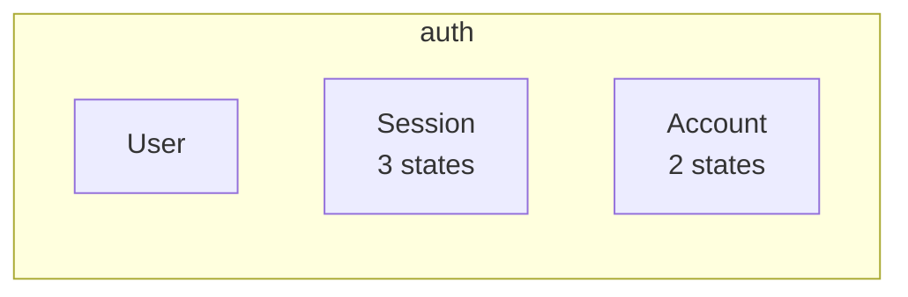
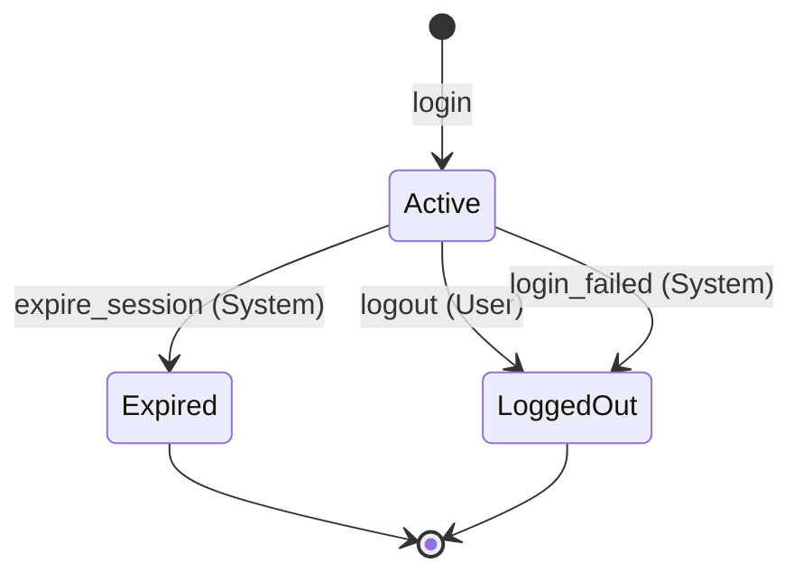
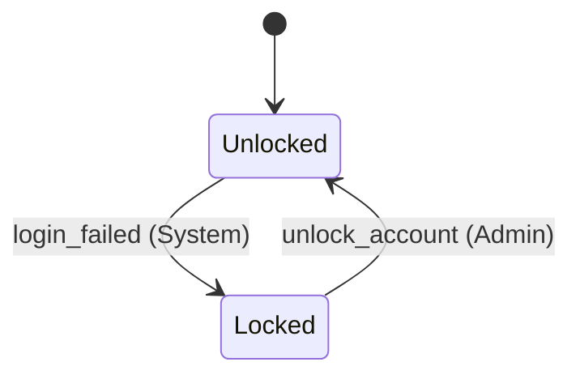

# Spec Readback: auth — v0.3.0

> Auto-generated by `tools/spec-readback.py` from `specs/auth.qnt` + `specs/auth.intent.json` + `specs/auth.records.json`. Do not edit; regenerate after spec changes.

**⚠ NOT READY** — 5 of 5 requirement(s) not verified against code; 5 of 5 invariant(s) not holding; 3 open question(s).

**Status:** formalized  |  **Requirements:** 0/5 verified, 0/5 witnessed  |  **Invariants:** 0 proven + 0 bounded / 5  |  **Coverage:** 18 cells, 5 covered, 13 triaged, 0 untriaged  |  **Extraction:** n/a (no code)  |  **Open questions:** 3  |  **Last verified:** never

*Legend: ✓ verified — witness trace replayed green against real code · ◐ witnessed — proven possible in the model, not yet demonstrated in code · ✗ no witness — claimed behavior is UNREACHABLE in the model · ⏳ not checked yet · ⊘ skipped with justification (a refusal — an invariant carries the proof and an example shows the refused call — or a computed value, checked by the unit test it names)*

## Purpose

Authenticate users; manage session lifecycle; lock accounts after repeated failed attempts.

## In Brief

Auth owns exactly three things: who is signed in, for how long, and when to stop letting someone try. Everything here is a consequence of one of those, and anything that is not one of them (passwords resets, machine identities, a second factor) is deliberately somewhere else — see Scope.

**How it fits together.** A **Session** is the unit of "signed in", and an **Account** is the unit of "allowed to try". They move independently: a session expires on its own clock (REQ-004), while an account locks on a counter that only failed logins touch (REQ-003). The pair meets in one place — a locked account may hold no active session — which is INV-002, and it is the invariant most of the other rules exist to keep true.

**Why it is this way.** Lockout counts attempts rather than rate-limiting time because the threshold has to be reviewable as a number (CON-001 = 5) rather than argued about as a policy. One active session per user (INV-001) is a deliberate narrowing: multi-device was cheaper to add later than to remove once anything depended on it.

**What to watch out for.** The counter and the lock are two facts, not one, and REQ-003 is the only thing that keeps them consistent — read it before changing either. Q-003 is open on what a failed login against an already-locked account should do, so the Locked row of the matrix is a triaged gap rather than a settled answer.

*Written by human; prose, not machine-checked. Spec pin: `7391396e5686`. Every section below is derived from the spec itself.*

## Shape



## Scope

**In scope:** password login, session lifecycle, account lockout

**Deliberately out of scope** — these are decisions, not oversights:

- **service-accounts** — Machine identities authenticate via mTLS, not passwords; resolved in Q-001. _(owned by platform)_
- **password-reset** — Owned by the account-recovery area; this area only consumes the resulting credential change.
- **mfa** — Deferred until after the first release; no requirement here may assume a second factor.

## ⚠ Needs Your Attention

- **Unchecked requirement** — REQ-001: When a registered user submits valid credentials, the system shall create an Active session owned by that user.
- **Unchecked requirement** — REQ-002: While the user's session is Active, when the user requests logout, the system shall transition that session to LoggedOut.
- **Unchecked requirement** — REQ-003: While the account is Unlocked, if a login attempt fails, then the system shall increment failedAttempts and lock the account when it reaches MAX_FAILED_ATTEMPTS (= 5, CON-001).
- **Unchecked requirement** — REQ-004: While the session is Active and has been inactive for longer than MAX_SESSION_AGE (= 3 ticks, CON-002), the system shall transition it to Expired.
- **Open coverage GAPs** — Q-003 (spec is silent on triaged-real cells).
- **Open question** — Q-001: Should unlock_account be available to a self-service flow (e.g. password reset) or only to Admin?
- **Open question** — Q-002: Session expiration: is it strictly time-based (inactivity timeout), or also bounded by absolute session age?
- **Open question** — Q-003: State×event gap: when Account=Locked and login_failed fires, the spec is silent (REQ-003 covers Unlocked only). Should attempts against a locked account be counted toward anything, ignored, or raise an alert? _(source: matrix)_

## At a Glance

| | ID | Behavior | Modality |
|---|---|---|---|
| ⏳ | [REQ-001](#req-001) | create an Active session owned by that user | must |
| ⏳ | [REQ-002](#req-002) | transition that session to LoggedOut | must |
| ⏳ | [REQ-003](#req-003) | increment failedAttempts and lock the account when it reaches MAX_FAILED_ATTEMPTS | must |
| ⏳ | [REQ-004](#req-004) | transition it to Expired | must |
| ⊘ | [REQ-005](#req-005) | refuse the login and leave every session and counter untouched | forbidden |

## What the System Does

### Sign in

> **Who** · User<br>
> **Story** · User opens the login screen, signs in, and lands on the Dashboard — including the lockout failure branch.<br>
> **Route** · [auth-ui.UI-001](auth-ui.readback.md#ui-001) → ⏳ [REQ-001](#req-001) → [auth-ui.UI-002](auth-ui.readback.md#ui-002) → ⏳ [REQ-003](#req-003) → [auth-ui.UI-003](auth-ui.readback.md#ui-003)<br>
> **Runs as** · ✓ `auth-ui.signInJourney` — `quint test` runs it; it walks 5 of 5 step(s) in order.

**Step 1 of 5** · [auth-ui.UI-001](auth-ui.readback.md#ui-001) — specified in area *auth-ui*

**Step 2 of 5**

#### REQ-001

⏳ When a registered user submits valid credentials, the system shall create an Active session owned by that user.

| Example | Given | When | Then |
|---|---|---|---|
| EX-001 — Sign in | the initial state | login(alice, s1) | `isActive("s1") and activeSessionsOf("alice") == Set("s1")` |

> **Guarded by** · [INV-001](#what-must-always-be-true) `atMostOneActiveSession` ⏳ · [INV-002](#what-must-always-be-true) `noSessionWhileLocked` ⏳ · [INV-003](#what-must-always-be-true) `noAccessWithInvalidToken` ⏳ · [INV-004](#what-must-always-be-true) `noEarlyLockout` ⏳ · [INV-005](#what-must-always-be-true) `noEarlyExpiry` ⏳

<details><summary>Quint action `login`, witness predicate + trace</summary>

`specs/auth.qnt:L102-L115` · model `ca0993f4795f`

```quint
  action login(uid: UserId, sid: SessionId): bool = all {
    not(isLocked(uid)),
    not(sessions.keys().contains(sid)),
    activeSessionsOf(uid).size() == 0,          // INV-001 guard
    sessions'          = sessions.put(sid, Active),
    sessionOwner'      = sessionOwner.put(sid, uid),
    accountStatus'     = accountStatus,
    failedAttempts'    = failedAttempts.put(uid, 0),
    userActiveSession' = userActiveSession.put(
      uid,
      activeSessionsOf(uid).union(Set(sid))
    ),
    idleFor'           = idleFor.put(sid, 0),
  }
```

**Witness predicate:** `sessions.keys().contains(_lastSid) and statusOf(sessions, _lastSid) == Active and activeSessionsOf(_lastUid).contains(_lastSid)` — true exactly when the behavior has happened.

**Record:** `specs/auth.qnt:368` — the doc comment this requirement is read from.

</details>

**Step 3 of 5** · [auth-ui.UI-002](auth-ui.readback.md#ui-002) — specified in area *auth-ui*

**Step 4 of 5**

*failure branch: repeated bad credentials lock the account*

#### REQ-003

⏳  *(failure path)* While the account is Unlocked, if a login attempt fails, then the system shall increment failedAttempts and lock the account when it reaches MAX_FAILED_ATTEMPTS (= 5, CON-001).

| Example | Given | When | Then |
|---|---|---|---|
| EX-003 — The fifth failure locks the account | login_failed(bob) × 4 | login_failed(bob) | `isLocked("bob")` |
| EX-004 — Four failures do not lock it | login_failed(bob) × 3 | login_failed(bob) | `not(isLocked("bob"))` |

> **Guarded by** · [INV-001](#what-must-always-be-true) `atMostOneActiveSession` ⏳ · [INV-002](#what-must-always-be-true) `noSessionWhileLocked` ⏳ · [INV-003](#what-must-always-be-true) `noAccessWithInvalidToken` ⏳ · [INV-004](#what-must-always-be-true) `noEarlyLockout` ⏳ · [INV-005](#what-must-always-be-true) `noEarlyExpiry` ⏳

<details><summary>Quint action `login_failed`, witness predicate + trace</summary>

`specs/auth.qnt:L141-L158` · model `ca0993f4795f`

```quint
  action login_failed(uid: UserId): bool = {
    val nextCount = attemptsOf(uid) + 1
    val locking = nextCount >= MAX_FAILED_ATTEMPTS
    val doomed = activeSessionsOf(uid)
    all {
      not(isLocked(uid)),
      sessions' = if (locking)
                    doomed.fold(sessions, (acc, s) => acc.put(s, LoggedOut))
                  else sessions,
      sessionOwner'      = sessionOwner,
      accountStatus'     = accountStatus.put(uid, if (locking) Locked else Unlocked),
      failedAttempts'    = failedAttempts.put(uid, nextCount),
      userActiveSession' = if (locking)
                             userActiveSession.put(uid, Set())
                           else userActiveSession,
      idleFor'           = idleFor,
    }
  }
```

**Witness predicate:** `accountStatus.keys().contains(_lastUid) and accountStatus.get(_lastUid) == Locked` — true exactly when the behavior has happened.

**Record:** `specs/auth.qnt:393` — the doc comment this requirement is read from.

</details>

**Step 5 of 5** · [auth-ui.UI-003](auth-ui.readback.md#ui-003) — specified in area *auth-ui*

*locked-account counterpart of the submit step*

### Other behaviors

> _Specified here, but not yet placed in any journey above._

#### REQ-002

⏳ While the user's session is Active, when the user requests logout, the system shall transition that session to LoggedOut.

| Example | Given | When | Then |
|---|---|---|---|
| EX-002 — Sign in, then out | login(alice, s1) | logout(s1) | `statusOf(sessions, "s1") == LoggedOut` |

> **Guarded by** · [INV-001](#what-must-always-be-true) `atMostOneActiveSession` ⏳ · [INV-002](#what-must-always-be-true) `noSessionWhileLocked` ⏳ · [INV-003](#what-must-always-be-true) `noAccessWithInvalidToken` ⏳ · [INV-005](#what-must-always-be-true) `noEarlyExpiry` ⏳

<details><summary>Quint action `logout`, witness predicate + trace</summary>

`specs/auth.qnt:L118-L133` · model `ca0993f4795f`

```quint
  action logout(sid: SessionId): bool = {
    val uid = if (sessionOwner.keys().contains(sid)) sessionOwner.get(sid) else ""
    all {
      sessions.keys().contains(sid),
      isActive(sid),
      sessions'          = sessions.put(sid, LoggedOut),
      sessionOwner'      = sessionOwner,
      accountStatus'     = accountStatus,
      failedAttempts'    = failedAttempts,
      userActiveSession' = userActiveSession.put(
        uid,
        activeSessionsOf(uid).exclude(Set(sid))
      ),
      idleFor'           = idleFor,
    }
  }
```

**Witness predicate:** `statusOf(sessions, _lastSid) == LoggedOut` — true exactly when the behavior has happened.

**Record:** `specs/auth.qnt:380` — the doc comment this requirement is read from.

</details>

#### REQ-004

⏳ While the session is Active and has been inactive for longer than MAX_SESSION_AGE (= 3 ticks, CON-002), the system shall transition it to Expired.

| Example | Given | When | Then |
|---|---|---|---|
| EX-005 — A session idle for four ticks expires | login(alice, s1); then tick × 4 | expire_session(s1) | `statusOf(sessions, "s1") == Expired` |
| EX-007 — Three idle ticks are not enough to expire | login(alice, s1); then tick × 3, so `isActive("s1") and idleOf("s1") == 3` | expire_session(s1) — refused | refused — nothing changes |

> **Guarded by** · [INV-001](#what-must-always-be-true) `atMostOneActiveSession` ⏳ · [INV-002](#what-must-always-be-true) `noSessionWhileLocked` ⏳ · [INV-003](#what-must-always-be-true) `noAccessWithInvalidToken` ⏳ · [INV-005](#what-must-always-be-true) `noEarlyExpiry` ⏳

<details><summary>Quint action `expire_session`, witness predicate + trace</summary>

`specs/auth.qnt:L162-L178` · model `ca0993f4795f`

```quint
  action expire_session(sid: SessionId): bool = {
    val uid = if (sessionOwner.keys().contains(sid)) sessionOwner.get(sid) else ""
    all {
      sessions.keys().contains(sid),
      isActive(sid),
      idleOf(sid) > MAX_SESSION_AGE,
      sessions'          = sessions.put(sid, Expired),
      sessionOwner'      = sessionOwner,
      accountStatus'     = accountStatus,
      failedAttempts'    = failedAttempts,
      userActiveSession' = userActiveSession.put(
        uid,
        activeSessionsOf(uid).exclude(Set(sid))
      ),
      idleFor'           = idleFor,
    }
  }
```

**Witness predicate:** `statusOf(sessions, _lastSid) == Expired` — true exactly when the behavior has happened.

**Record:** `specs/auth.qnt:412` — the doc comment this requirement is read from.

</details>

#### REQ-005

⊘  *(failure path)* While the Account is Locked, if the user submits valid credentials, then the system shall refuse the login and leave every session and counter untouched.

> **Forbidden** — this must never happen, so there is no trace to find. The proof is the invariant that stays true: **INV-002**. The examples below show the call being refused.

| Example | Given | When | Then |
|---|---|---|---|
| EX-006 — A locked account cannot sign in | login_failed(bob) × 5, so `isLocked("bob") and attemptsOf("bob") == 5` | login(bob, s2) — refused | refused — nothing changes |

> **Guarded by** · [INV-001](#what-must-always-be-true) `atMostOneActiveSession` ⏳ · [INV-002](#what-must-always-be-true) `noSessionWhileLocked` ⏳ · [INV-003](#what-must-always-be-true) `noAccessWithInvalidToken` ⏳ · [INV-004](#what-must-always-be-true) `noEarlyLockout` ⏳ · [INV-005](#what-must-always-be-true) `noEarlyExpiry` ⏳

> **Witness skipped:** A prohibition has no reachable state to witness — there is no step in which 'the login did not happen' becomes visible. INV-002 (noSessionWhileLocked) carries the model-side proof.

<details><summary>Quint action `login`</summary>

`specs/auth.qnt:L102-L115` · model `ca0993f4795f`

```quint
  action login(uid: UserId, sid: SessionId): bool = all {
    not(isLocked(uid)),
    not(sessions.keys().contains(sid)),
    activeSessionsOf(uid).size() == 0,          // INV-001 guard
    sessions'          = sessions.put(sid, Active),
    sessionOwner'      = sessionOwner.put(sid, uid),
    accountStatus'     = accountStatus,
    failedAttempts'    = failedAttempts.put(uid, 0),
    userActiveSession' = userActiveSession.put(
      uid,
      activeSessionsOf(uid).union(Set(sid))
    ),
    idleFor'           = idleFor.put(sid, 0),
  }
```

**Record:** `specs/auth.qnt:89` — the doc comment this requirement is read from.

</details>

## What Must Always Be True

_Invariant legend: ✓ proven — inductive, holds in ALL reachable states · ✓ (≤N steps) — bounded model check to depth N; no counterexample found within N, NOT a proof · ✗ counterexample · ⚠ accepted-risk · ⏳ not checked. Upgrade a bounded ✓ by raising the bound or marking the invariant `proof: inductive`._

- **INV-001** (`atMostOneActiveSession`) — At most one Active session per user. Criticality: critical. ⏳
- **INV-002** (`noSessionWhileLocked`) — A Locked account has no Active session. Criticality: critical. ⏳
- **INV-003** (`noAccessWithInvalidToken`) — Expired/LoggedOut sessions never appear in any user's active set. Criticality: high. ⏳
- **INV-004** (`noEarlyLockout`) — Below MAX_FAILED_ATTEMPTS, the account stays unlocked. Criticality: high. ⏳
- **INV-005** (`noEarlyExpiry`) — No session expires before it has been idle longer than MAX_SESSION_AGE. Criticality: high. ⏳

## Examples

_Concrete cases, each a Quint `run` that `quint test` executes and the code's conformance harness replays. A witness trace shows a behavior is reachable at all; an example pins the one case it states._

| Example | Given | When | Then | Illustrates |
|---|---|---|---|---|
| EX-001 — Sign in | the initial state | login(alice, s1) | `isActive("s1") and activeSessionsOf("alice") == Set("s1")` | REQ-001 |
| EX-002 — Sign in, then out | login(alice, s1) | logout(s1) | `statusOf(sessions, "s1") == LoggedOut` | REQ-002 |
| EX-003 — The fifth failure locks the account | login_failed(bob) × 4 | login_failed(bob) | `isLocked("bob")` | REQ-003 |
| EX-004 — Four failures do not lock it | login_failed(bob) × 3 | login_failed(bob) | `not(isLocked("bob"))` | REQ-003, INV-004 |
| EX-005 — A session idle for four ticks expires | login(alice, s1); then tick × 4 | expire_session(s1) | `statusOf(sessions, "s1") == Expired` | REQ-004 |
| EX-006 — A locked account cannot sign in | login_failed(bob) × 5, so `isLocked("bob") and attemptsOf("bob") == 5` | login(bob, s2) — refused | refused — nothing changes | REQ-005 |
| EX-007 — Three idle ticks are not enough to expire | login(alice, s1); then tick × 3, so `isActive("s1") and idleOf("s1") == 3` | expire_session(s1) — refused | refused — nothing changes | REQ-004, INV-005 |

## Limits and Bounds

| ID | Name | Value | Unit | What it is | Referenced by | History |
|---|---|---|---|---|---|---|
| CON-001 | `MAX_FAILED_ATTEMPTS` | 5 | — | Failed-login threshold before locking. | REQ-003, INV-004 | initial-auth |
| CON-002 | `MAX_SESSION_AGE` | 3 | ticks | How long a session may sit idle before it expires, in ticks of the model's clock. Kept small so the checker reaches an expiry within its step bound; the production timeout is this many clock units. | REQ-004, INV-005 | initial-auth |

_Confirm every number AND its boundary semantics (on the Nth, or after N?) — off-by-one is the classic wrong-rule bug; the witness one-liners above show the machine-found count._

## State Machines

### Session



### Account



## Completeness by Dimension

_One number would hide which half is missing. Each row is derived from declared obligations: ✓ discharged, ! outstanding, — nothing declared (which may itself be the gap)._

| Dimension | | Obligations |
|---|---|---|
| Data model | — | 3 entities, 2 stateful, 0 closed |
| State space | ✓ | 5/18 cells covered, 13 triaged, 0 untriaged |
| Operations | ! | 1/5 requirements with a discharged witness |
| Failure behavior | — | 2 unwanted-path requirement(s); no external outcome matrix — unmeasured |
| External systems | — | none declared — if the area calls anything, this is a gap |
| Assumptions | — | none recorded |
| Temporal behavior | — | none declared |
| Extraction coverage | — | n/a (no code) |
| Substitutability | — | not measured — needs a parallel build and `spec-record equiv` |
| Refusal coverage | ✓ | 1/1 rejection(s) shown by an example |
| Examples | ✓ | 7 worked example(s) |
| Invariants | ! | 0/5 holding |
| Adversarial review | — | never run — `/spec-check --reality` |

## Reference

<details><summary>Concepts, architecture, decisions, resolved questions, traceability, verification history</summary>

**Entities:**

- **User** — Registered actor with login credentials.
- **Session** (Active / Expired / LoggedOut) — A logged-in instance of a User.
- **Account** (Unlocked / Locked) — Lockout state derived from failed attempts.

**Actors:** User, System, Admin

**Architecture (resolved project ⊕ area):** TypeScript 5.4 Node.js 20 Express Vitest pnpm · persistence: sql postgres Prisma

**Components:** **service** (transport) implements login, logout, login_failed, unlock_account · **worker** (async) implements expire_session

**Decisions:**

- **DEC-001** (accepted, 2026-04-12) — JWT (RS256) over session cookies. Use JWT signed with RS256 for session tokens. Rationale: Asymmetric signing lets the edge verify with the public key; private key stays in the auth service. Alternatives: Cookie-based sessions (rejected: Edge can't validate without a network hop.); Opaque tokens with introspection (rejected: Extra request per call adds latency and ops cost.).

_No code generated yet. Run /spec-code-generate._

_Approval lives in PR history — audit trail: `git log -- specs/auth.qnt specs/auth.intent.json specs/auth.records.json`_

</details>
