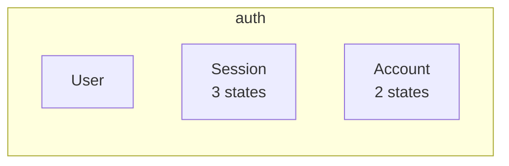
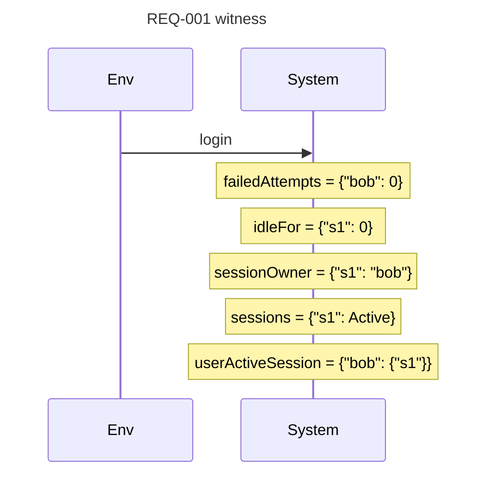
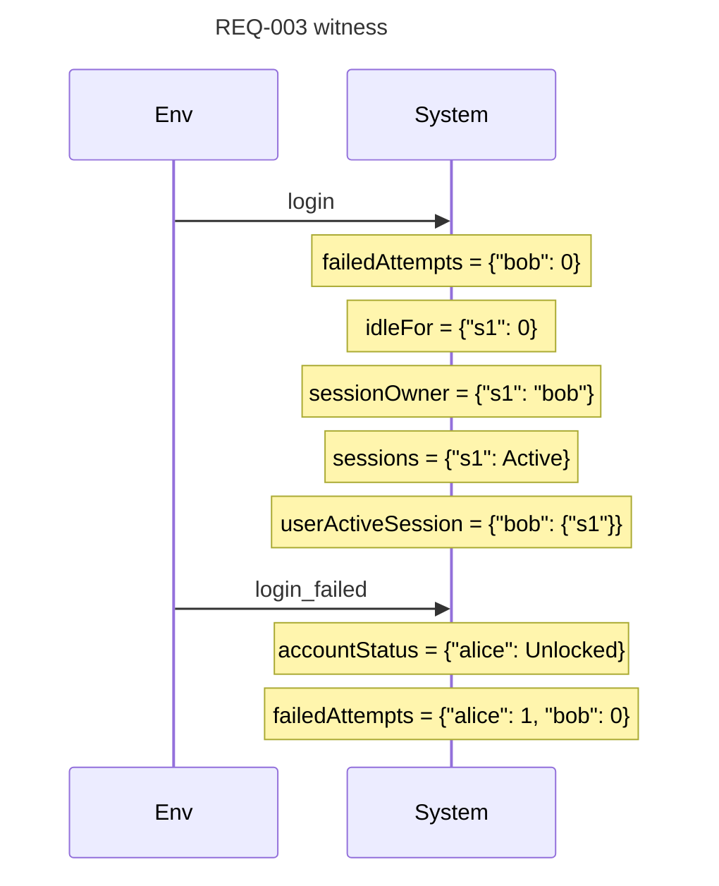
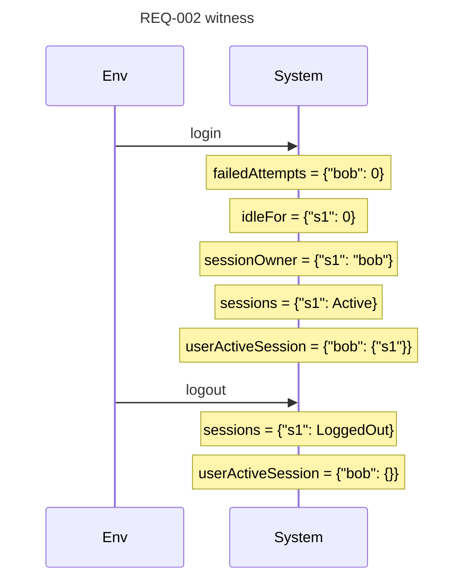
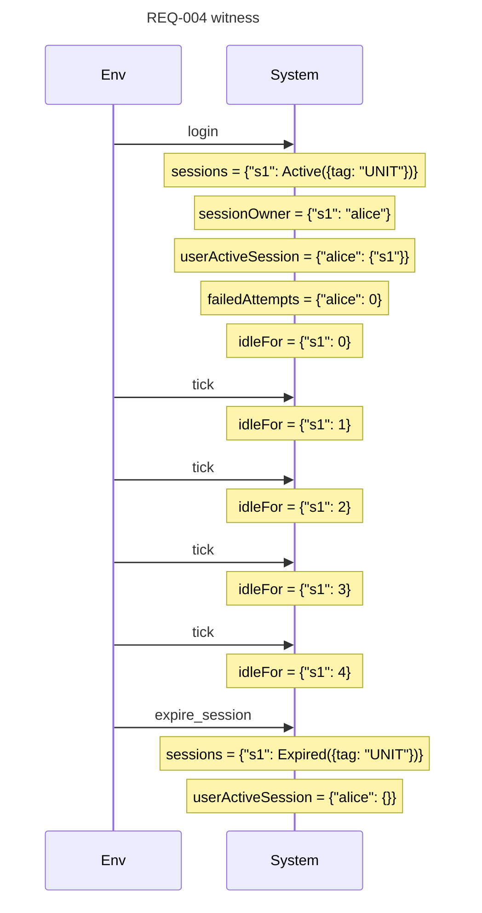
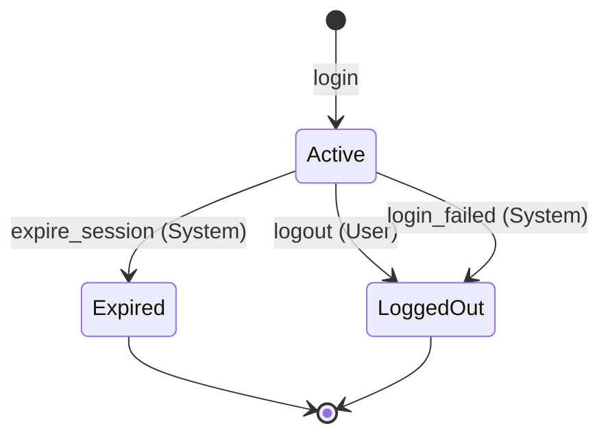
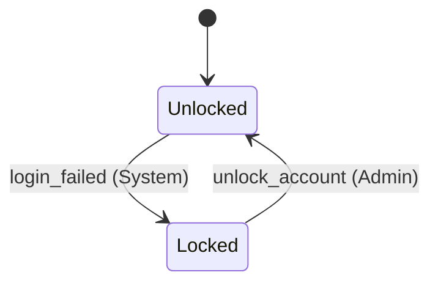

# Spec Readback: auth — v0.3.0

> Auto-generated by `tools/spec-readback.py` from `specs/auth.qnt` + `specs/auth.intent.json` + `specs/auth.records.json`. Do not edit; regenerate after spec changes.

**⚠ NOT READY** — 6 of 6 requirement(s) not verified against code; 3 open question(s); 1 open GAP verdict(s).

**Status:** formalized  |  **Requirements:** 0/6 verified, 5/6 witnessed  |  **Invariants:** 0 proven + 5 bounded (≤3) / 5  |  **Coverage:** 3/3 actions covered, 5/5 changes explained  |  **Extraction:** n/a (no code)  |  **Mutation:** 64% pinned by examples, 6 question(s) open  |  **Open questions:** 3  |  **Last verified:** never

*Legend: ✓ verified — witness trace replayed green against real code · ◐ witnessed — proven possible in the model, not yet demonstrated in code · ✗ no witness — claimed behavior is UNREACHABLE in the model · ⏳ not checked yet · ⊘ nothing to witness (a forbidden step, whose proof is its obligation, or a computed value, checked by the unit test it names) · ∀ checked on every reachable step, ∀✗ a step that breaks it was found*

## Purpose

Authenticate users; manage session lifecycle; lock accounts after repeated failed attempts.

## In Brief

Auth owns exactly three things: who is signed in, for how long, and when to stop letting someone try. Everything here is a consequence of one of those, and anything that is not one of them (passwords resets, machine identities, a second factor) is deliberately somewhere else — see Scope.

**How it fits together.** A **Session** is the unit of "signed in", and an **Account** is the unit of "allowed to try". They move independently: a session expires on its own clock (REQ-004), while an account locks on a counter that only failed logins touch (REQ-003). The pair meets in one place — a locked account may hold no active session — which is INV-002, and it is the invariant most of the other rules exist to keep true.

**Why it is this way.** Lockout counts attempts rather than rate-limiting time because the threshold has to be reviewable as a number (CON-001 = 5) rather than argued about as a policy. One active session per user (INV-001) is a deliberate narrowing: multi-device was cheaper to add later than to remove once anything depended on it.

**What to watch out for.** The counter and the lock are two facts, not one, and REQ-003 is the only thing that keeps them consistent — read it before changing either. Q-003 is open on what a failed login against an already-locked account should do, so that case is an open question rather than a settled answer.

*Written by human; prose, not machine-checked. Spec pin: `9f655086599a`. Every section below is derived from the spec itself.*

## Shape



## Scope

**In scope:** password login, session lifecycle, account lockout

**Deliberately out of scope** — these are decisions, not oversights:

- **service-accounts** — Machine identities authenticate via mTLS, not passwords; resolved in Q-001. _(owned by platform)_
- **password-reset** — Owned by the account-recovery area; this area only consumes the resulting credential change.
- **mfa** — Deferred until after the first release; no requirement here may assume a second factor.

## ⚠ Needs Your Attention

- **Deep pass not reached** — 10 check(s) rest on the shallow bound only: pass 1 took 24s against a 180s run budget. Raise apalache.budget_seconds, run with more --parallel, or cut the model's checking cost (spec-lint's cost/* warnings say where).
- **Open GAP** — `unlock_account`: An admin can unlock a Locked account, but no requirement says who may or what the unlock resets. (Q-001)
- **Open question** — Q-001: Should unlock_account be available to a self-service flow (e.g. password reset) or only to Admin?
- **Open question** — Q-002: Session expiration: is it strictly time-based (inactivity timeout), or also bounded by absolute session age?
- **Open question** — Q-003: Coverage gap hidden by a guard: login_failed refuses to fire on a Locked account, so no check sees that case and the spec is silent on it (REQ-003 covers Unlocked only). Should attempts against a locked account be counted toward anything, ignored, or raise an alert? _(source: coverage)_
- **The examples leave 6 behavior(s) open** — the model decides them and no example does. Answer the [questions](#questions-the-examples-leave-open): yes adds an example, no finds a model bug.
- **Mutation results are for an older model** — rerun `tools/spec-questions.py <area> --record` before answering.

## Questions the Examples Leave Open

_Small changes to the model that every example and invariant still pass: 6 of 40 tried (`tools/spec-questions.py`, ca0993f). Each is a behavior the model chose and nobody approved. **Yes** pins it: add the run as an example. **No** means the model is wrong here._

> ⚠ These were raised against an older model — rerun before answering.

### 3b71c867 · [REQ-001](#req-001), [REQ-005](#req-005)

**Given** the initial state **When** login(charlie, s3)

> From the start, when login(charlie, s3): should failedAttempts[charlie] = 0 hold? The model says so; a model where it does not passes every example too.

Yes → add as an example of REQ-001, REQ-005:

```quint
run q_3b71c867 = init.then(login("charlie", "s3")).expect(failedAttempts.get("charlie") == 0)
```

<sub>Raised by the variant: login: drop the effect on `failedAttempts` (keep it as it was).</sub>

### 249ef86b · [REQ-002](#req-002)

**Given** login(charlie, s3); then logout(s3) **When** logout(s3)

> After login(charlie, s3); then logout(s3), should logout(s3) be refused? The model refuses it; a model that allows it passes every example too.

Yes → add as an example of REQ-002:

```quint
run q_249ef86b = init.then(login("charlie", "s3")).then(logout("s3")).then(logout("s3").fail())
```

<sub>Raised by the variant: logout: drop the guard `isActive(sid)`.</sub>

### 0faf1af0 · [REQ-003](#req-003)

**Given** login_failed(bob) × 5 **When** login_failed(bob)

> After login_failed(bob) × 5, should login_failed(bob) be refused? The model refuses it; a model that allows it passes every example too.

Yes → add as an example of REQ-003:

```quint
run q_0faf1af0 = init.then(login_failed("bob")).then(login_failed("bob")).then(login_failed("bob")).then(login_failed("bob")).then(login_failed("bob")).then(login_failed("bob").fail())
```

<sub>Raised by the variant: login_failed: drop the guard `not(isLocked(uid))`.</sub>

### 07a48908 · [REQ-004](#req-004)

**Given** login(charlie, s1); then tick × 4; then expire_session(s1) **When** expire_session(s1)

> After login(charlie, s1); then tick × 4; then expire_session(s1), should expire_session(s1) be refused? The model refuses it; a model that allows it passes every example too.

Yes → add as an example of REQ-004:

```quint
run q_07a48908 = init.then(login("charlie", "s1")).then(tick).then(tick).then(tick).then(tick).then(expire_session("s1")).then(expire_session("s1").fail())
```

<sub>Raised by the variant: expire_session: drop the guard `isActive(sid)`.</sub>

### d7e85e1c

**Given** the initial state **When** unlock_account(charlie)

> From the start, should unlock_account(charlie) be refused? The model refuses it; a model that allows it passes every example too.

Yes → add as an example:

```quint
run q_d7e85e1c = init.then(unlock_account("charlie").fail())
```

<sub>Raised by the variant: unlock_account: drop the guard `isLocked(uid)`.</sub>

### 6b84d96d

**Given** the initial state **When** tick

> From the start, should tick be refused? The model refuses it; a model that allows it passes every example too.

Yes → add as an example:

```quint
run q_6b84d96d = init.then(tick.fail())
```

<sub>Raised by the variant: tick: drop the guard `sessions.keys().exists(sid => isActive(sid))`.</sub>

## At a Glance

| | ID | Behavior | Modality |
|---|---|---|---|
| ◐ | [REQ-001](#req-001) | When a registered user submits valid credentials, the system shall create an Active ses… | must |
| ◐ | [REQ-002](#req-002) | While a user's session is Active, when the user requests logout, the system shall trans… | must |
| ◐ | [REQ-003](#req-003) | If a login attempt fails while the account is Unlocked, then the system shall increment… | must |
| ◐ | [REQ-004](#req-004) | While a session is Active and has been inactive for longer than MAX_SESSION_AGE, the sy… | must |
| ⊘ | [REQ-005](#req-005) | While the account is Locked, if the user submits valid credentials, then the system sha… | forbidden |
| ◐ | [REQ-006](#req-006) | If a failed login locks the account, then the system shall end the user's Active sessio… | must |

## What the System Does

### Sign in

> **Who** · User<br>
> **Story** · User opens the login screen, signs in, and lands on the Dashboard — including the lockout failure branch.<br>
> **Route** · [auth-ui.UI-001](auth-ui.readback.md#ui-001) → ◐ [REQ-001](#req-001) → [auth-ui.UI-002](auth-ui.readback.md#ui-002) → ◐ [REQ-003](#req-003) → [auth-ui.UI-003](auth-ui.readback.md#ui-003)<br>
> **Runs as** · ✓ `auth-ui.signInJourney` — `quint test` runs it; it walks 5 of 5 step(s) in order.

**Step 1 of 5** · [auth-ui.UI-001](auth-ui.readback.md#ui-001) — specified in area *auth-ui*

**Step 2 of 5**

#### REQ-001

◐ ∀ When a registered user submits valid credentials, the system shall create an Active session owned by that user.

| Example | Given | When | Then |
|---|---|---|---|
| EX-001 — Sign in | the initial state | login(alice, s1) | `isActive("s1") and activeSessionsOf("alice") == Set("s1")` |

> **Guarded by** · [INV-001](#what-must-always-be-true) `atMostOneActiveSession` ✓ (≤3 steps) · [INV-002](#what-must-always-be-true) `noSessionWhileLocked` ✓ (≤3 steps) · [INV-003](#what-must-always-be-true) `noAccessWithInvalidToken` ✓ (≤3 steps) · [INV-004](#what-must-always-be-true) `noEarlyLockout` ✓ (≤3 steps) · [INV-005](#what-must-always-be-true) `noEarlyExpiry` ✓ (≤3 steps)

> **Left open** · [3b71c867](#3b71c867) login(charlie, s3) — the model decides, no example does

> **Witness:** 2 steps: login(bob, s1) → failedAttempts = {"bob": 0}; idleFor = {"s1": 0}; sessionOwner = {"s1": "bob"}; sessions = {"s1": Active}; userActiveSession = {"bob": {"s1"}}

> **∀ Every step:** checked on every reachable step (≤3 steps).

<details><summary>EARS sentence, Quint action `login`, formal claim + trace</summary>

**As specified (EARS):** When a registered user submits valid credentials, the system shall make `isActive(sid) and sessionOwner.get(sid) == uid and activeSessionsOf(uid).contains(sid) and attemptsOf(uid) == 0` hold.

`specs/auth.qnt:L112-L125` · model `a2f6619b36cb`

```quint
  action login(uid: UserId, sid: SessionId): bool = all {
    not(isLocked(uid)),
    not(sessions.keys().contains(sid)),
    activeSessionsOf(uid).size() == 0,          // INV-001 guard
    sessions'          = sessions.put(sid, Active),
    sessionOwner'      = sessionOwner.put(sid, uid),
    accountStatus'     = accountStatus,
    failedAttempts'    = failedAttempts.put(uid, 0),
    userActiveSession' = userActiveSession.put(
      uid,
      activeSessionsOf(uid).union(Set(sid))
    ),
    idleFor'           = idleFor.put(sid, 0),
  }
```

**Formal claim** (pre-state for while/old, post-state for shall):
- **shall** `isActive(sid) and sessionOwner.get(sid) == uid and activeSessionsOf(uid).contains(sid) and attemptsOf(uid) == 0`

**Record:** `specs/auth.qnt:95` — the doc comment this requirement is read from.



</details>

**Step 3 of 5** · [auth-ui.UI-002](auth-ui.readback.md#ui-002) — specified in area *auth-ui*

**Step 4 of 5**

*failure branch: repeated bad credentials lock the account*

#### REQ-003

◐ ∀  *(failure path)* If a login attempt fails while the account is Unlocked, then the system shall increment failedAttempts and lock the account when it reaches MAX_FAILED_ATTEMPTS (= 5, CON-001).

| Example | Given | When | Then |
|---|---|---|---|
| EX-003 — The fifth failure locks the account | login_failed(bob) × 4 | login_failed(bob) | `isLocked("bob")` |
| EX-004 — Four failures do not lock it | login_failed(bob) × 3 | login_failed(bob) | `not(isLocked("bob"))` |

> **Guarded by** · [INV-001](#what-must-always-be-true) `atMostOneActiveSession` ✓ (≤3 steps) · [INV-002](#what-must-always-be-true) `noSessionWhileLocked` ✓ (≤3 steps) · [INV-003](#what-must-always-be-true) `noAccessWithInvalidToken` ✓ (≤3 steps) · [INV-004](#what-must-always-be-true) `noEarlyLockout` ✓ (≤3 steps) · [INV-005](#what-must-always-be-true) `noEarlyExpiry` ✓ (≤3 steps)

> **Left open** · [0faf1af0](#0faf1af0) login_failed(bob) — the model decides, no example does

> **Witness:** 3 steps: login(bob, s1) → login_failed(alice) → accountStatus = {"alice": Unlocked}; failedAttempts = {"alice": 1, "bob": 0}

> **∀ Every step:** checked on every reachable step (≤3 steps).

<details><summary>EARS sentence, Quint action `login_failed`, formal claim + trace</summary>

**As specified (EARS):** While `not(isLocked(uid))`, if a login attempt fails, then the system shall make `attemptsOf(uid) == before + 1 and (isLocked(uid) iff attemptsOf(uid) >= MAX_FAILED_ATTEMPTS (= 5, CON-001))` hold.

`specs/auth.qnt:L183-L200` · model `a2f6619b36cb`

```quint
  action login_failed(uid: UserId): bool = {
    val nextCount = attemptsOf(uid) + 1
    val locking = nextCount >= MAX_FAILED_ATTEMPTS
    val doomed = activeSessionsOf(uid)
    all {
      not(isLocked(uid)),
      sessions' = if (locking)
                    doomed.fold(sessions, (acc, s) => acc.put(s, LoggedOut))
                  else sessions,
      sessionOwner'      = sessionOwner,
      accountStatus'     = accountStatus.put(uid, if (locking) Locked else Unlocked),
      failedAttempts'    = failedAttempts.put(uid, nextCount),
      userActiveSession' = if (locking)
                             userActiveSession.put(uid, Set())
                           else userActiveSession,
      idleFor'           = idleFor,
    }
  }
```

**Formal claim** (pre-state for while/old, post-state for shall):
- **old** `before: int = attemptsOf(uid)`
- **while** `not(isLocked(uid))`
- **shall** `attemptsOf(uid) == before + 1 and (isLocked(uid) iff attemptsOf(uid) >= MAX_FAILED_ATTEMPTS)`

**Record:** `specs/auth.qnt:161` — the doc comment this requirement is read from.



</details>

**Step 5 of 5** · [auth-ui.UI-003](auth-ui.readback.md#ui-003) — specified in area *auth-ui*

*locked-account counterpart of the submit step*

### Other behaviors

> _Specified here, but not yet placed in any journey above._

#### REQ-002

◐ ∀ While a user's session is Active, when the user requests logout, the system shall transition that session to LoggedOut.

| Example | Given | When | Then |
|---|---|---|---|
| EX-002 — Sign in, then out | login(alice, s1) | logout(s1) | `statusOf(sessions, "s1") == LoggedOut` |

> **Guarded by** · [INV-001](#what-must-always-be-true) `atMostOneActiveSession` ✓ (≤3 steps) · [INV-002](#what-must-always-be-true) `noSessionWhileLocked` ✓ (≤3 steps) · [INV-003](#what-must-always-be-true) `noAccessWithInvalidToken` ✓ (≤3 steps) · [INV-005](#what-must-always-be-true) `noEarlyExpiry` ✓ (≤3 steps)

> **Left open** · [249ef86b](#249ef86b) logout(s3) — the model decides, no example does

> **Witness:** 3 steps: login(bob, s1) → logout(s1) → sessions = {"s1": LoggedOut}; userActiveSession = {"bob": {}}

> **∀ Every step:** checked on every reachable step (≤3 steps).

<details><summary>EARS sentence, Quint action `logout`, formal claim + trace</summary>

**As specified (EARS):** While `isActive(sid)`, when the user requests logout, the system shall make `statusOf(sessions, sid) == LoggedOut` hold.

`specs/auth.qnt:L134-L149` · model `a2f6619b36cb`

```quint
  action logout(sid: SessionId): bool = {
    val uid = if (sessionOwner.keys().contains(sid)) sessionOwner.get(sid) else ""
    all {
      sessions.keys().contains(sid),
      isActive(sid),
      sessions'          = sessions.put(sid, LoggedOut),
      sessionOwner'      = sessionOwner,
      accountStatus'     = accountStatus,
      failedAttempts'    = failedAttempts,
      userActiveSession' = userActiveSession.put(
        uid,
        activeSessionsOf(uid).exclude(Set(sid))
      ),
      idleFor'           = idleFor,
    }
  }
```

**Formal claim** (pre-state for while/old, post-state for shall):
- **while** `isActive(sid)`
- **shall** `statusOf(sessions, sid) == LoggedOut`

**Record:** `specs/auth.qnt:127` — the doc comment this requirement is read from.



</details>

#### REQ-004

◐ ∀ While a session is Active and has been inactive for longer than MAX_SESSION_AGE (= 3 ticks, CON-002), the system shall transition it to Expired.

| Example | Given | When | Then |
|---|---|---|---|
| EX-005 — A session idle for four ticks expires | login(alice, s1); then tick × 4 | expire_session(s1) | `statusOf(sessions, "s1") == Expired` |
| EX-007 — Three idle ticks are not enough to expire | login(alice, s1); then tick × 3, so `isActive("s1") and idleOf("s1") == 3` | expire_session(s1) — refused | refused — nothing changes |

> **Guarded by** · [INV-001](#what-must-always-be-true) `atMostOneActiveSession` ✓ (≤3 steps) · [INV-002](#what-must-always-be-true) `noSessionWhileLocked` ✓ (≤3 steps) · [INV-003](#what-must-always-be-true) `noAccessWithInvalidToken` ✓ (≤3 steps) · [INV-005](#what-must-always-be-true) `noEarlyExpiry` ✓ (≤3 steps)

> **Left open** · [07a48908](#07a48908) expire_session(s1) — the model decides, no example does

> **Witness:** 7 steps: login(alice, s1) → tick(s1, alice) ×4 → expire_session(s1) → sessions = {"s1": Expired({tag: "UNIT"})}; userActiveSession = {"alice": {}}

> **∀ Every step:** checked on every reachable step (≤3 steps).

<details><summary>EARS sentence, Quint action `expire_session`, formal claim + trace</summary>

**As specified (EARS):** While `isActive(sid) and idleOf(sid) > MAX_SESSION_AGE (= 3 ticks, CON-002)`, when the session's idle time runs out, the system shall make `statusOf(sessions, sid) == Expired` hold.

`specs/auth.qnt:L211-L227` · model `a2f6619b36cb`

```quint
  action expire_session(sid: SessionId): bool = {
    val uid = if (sessionOwner.keys().contains(sid)) sessionOwner.get(sid) else ""
    all {
      sessions.keys().contains(sid),
      isActive(sid),
      idleOf(sid) > MAX_SESSION_AGE,
      sessions'          = sessions.put(sid, Expired),
      sessionOwner'      = sessionOwner,
      accountStatus'     = accountStatus,
      failedAttempts'    = failedAttempts,
      userActiveSession' = userActiveSession.put(
        uid,
        activeSessionsOf(uid).exclude(Set(sid))
      ),
      idleFor'           = idleFor,
    }
  }
```

**Formal claim** (pre-state for while/old, post-state for shall):
- **while** `isActive(sid) and idleOf(sid) > MAX_SESSION_AGE`
- **shall** `statusOf(sessions, sid) == Expired`

**Record:** `specs/auth.qnt:204` — the doc comment this requirement is read from.



</details>

#### REQ-005

⊘ ∀  *(failure path)* While the account is Locked, if the user submits valid credentials, then the system shall refuse the login.

> **Forbidden** — this must never happen, so there is no trace to find. The proof is the check that no reachable step of the action starts where it is forbidden. The examples below show the call being refused.

| Example | Given | When | Then |
|---|---|---|---|
| EX-006 — A locked account cannot sign in | login_failed(bob) × 5, so `isLocked("bob") and attemptsOf("bob") == 5` | login(bob, s2) — refused | refused — nothing changes |

> **Guarded by** · [INV-001](#what-must-always-be-true) `atMostOneActiveSession` ✓ (≤3 steps) · [INV-002](#what-must-always-be-true) `noSessionWhileLocked` ✓ (≤3 steps) · [INV-003](#what-must-always-be-true) `noAccessWithInvalidToken` ✓ (≤3 steps) · [INV-004](#what-must-always-be-true) `noEarlyLockout` ✓ (≤3 steps) · [INV-005](#what-must-always-be-true) `noEarlyExpiry` ✓ (≤3 steps)

> **Left open** · [3b71c867](#3b71c867) login(charlie, s3) — the model decides, no example does

> **∀ Every step:** checked on every reachable step (≤3 steps).

<details><summary>EARS sentence, Quint action `login`, formal claim + trace</summary>

**As specified (EARS):** While `isLocked(uid)`, if the user submits valid credentials, then the system shall never let it happen.

`specs/auth.qnt:L112-L125` · model `a2f6619b36cb`

```quint
  action login(uid: UserId, sid: SessionId): bool = all {
    not(isLocked(uid)),
    not(sessions.keys().contains(sid)),
    activeSessionsOf(uid).size() == 0,          // INV-001 guard
    sessions'          = sessions.put(sid, Active),
    sessionOwner'      = sessionOwner.put(sid, uid),
    accountStatus'     = accountStatus,
    failedAttempts'    = failedAttempts.put(uid, 0),
    userActiveSession' = userActiveSession.put(
      uid,
      activeSessionsOf(uid).union(Set(sid))
    ),
    idleFor'           = idleFor.put(sid, 0),
  }
```

**Formal claim** (pre-state for while/old, post-state for shall):
- **while** `isLocked(uid)`

**Record:** `specs/auth.qnt:103` — the doc comment this requirement is read from.

</details>

#### REQ-006

◐ ∀  *(failure path)* If a failed login locks the account, then the system shall end the user's Active sessions.

> _No example rows yet — nothing concrete shows this behavior._

> **Guarded by** · [INV-001](#what-must-always-be-true) `atMostOneActiveSession` ✓ (≤3 steps) · [INV-002](#what-must-always-be-true) `noSessionWhileLocked` ✓ (≤3 steps) · [INV-003](#what-must-always-be-true) `noAccessWithInvalidToken` ✓ (≤3 steps) · [INV-004](#what-must-always-be-true) `noEarlyLockout` ✓ (≤3 steps) · [INV-005](#what-must-always-be-true) `noEarlyExpiry` ✓ (≤3 steps)

> **Witness:** 3 steps: login(bob, s1) → login_failed(alice) → accountStatus = {"alice": Unlocked}; failedAttempts = {"alice": 1, "bob": 0}

> **∀ Every step:** checked on every reachable step (≤3 steps).

<details><summary>EARS sentence, Quint action `login_failed`, formal claim + trace</summary>

**As specified (EARS):** While `not(isLocked(uid))`, if a failed login locks the account, then the system shall make `isLocked(uid) implies sessions.keys().forall(s => sessionOwner.get(s) != uid or not(isActive(s)))` hold.

`specs/auth.qnt:L183-L200` · model `a2f6619b36cb`

```quint
  action login_failed(uid: UserId): bool = {
    val nextCount = attemptsOf(uid) + 1
    val locking = nextCount >= MAX_FAILED_ATTEMPTS
    val doomed = activeSessionsOf(uid)
    all {
      not(isLocked(uid)),
      sessions' = if (locking)
                    doomed.fold(sessions, (acc, s) => acc.put(s, LoggedOut))
                  else sessions,
      sessionOwner'      = sessionOwner,
      accountStatus'     = accountStatus.put(uid, if (locking) Locked else Unlocked),
      failedAttempts'    = failedAttempts.put(uid, nextCount),
      userActiveSession' = if (locking)
                             userActiveSession.put(uid, Set())
                           else userActiveSession,
      idleFor'           = idleFor,
    }
  }
```

**Formal claim** (pre-state for while/old, post-state for shall):
- **while** `not(isLocked(uid))`
- **shall** `isLocked(uid) implies sessions.keys().forall(s => sessionOwner.get(s) != uid or not(isActive(s)))`

**Record:** `specs/auth.qnt:173` — the doc comment this requirement is read from.


</details>

## What Each Action Does

_One table per step the model can take. Each row is a requirement or verdict on it, with the condition it applies under; each column is a variable the step can change, and the cell is what the row says about it. A step no row covers is a gap; a change no row names is behavior nobody asked for. /spec-check proves both (coverage, explanation)._

### `login`

| Row | Applies when | `sessions` | `sessionOwner` | `failedAttempts` |
|---|---|---|---|---|
| REQ-001 | always | `isActive(sid)` | `sessionOwner.get(sid) == uid` | `attemptsOf(uid) == 0` |
| REQ-005 | `isLocked(uid)` | _never happens_ | _never happens_ | _never happens_ |

_✓ coverage: REQ-001 applies to every step_

### `logout`

| Row | Applies when | `sessions` |
|---|---|---|
| REQ-002 | `isActive(sid)` | `statusOf(sessions, sid) == LoggedOut` |

_✓ coverage (≤3) · ✓ `sessions` explained (≤3)_

### `login_failed`

| Row | Applies when | `sessions` | `accountStatus` | `failedAttempts` |
|---|---|---|---|---|
| REQ-003 | `not(isLocked(uid))` |  | `(isLocked(uid) iff attemptsOf(uid) >= MAX_FAILED_ATTEMPTS)` | `attemptsOf(uid) == before + 1` ∧ `(isLocked(uid) iff attemptsOf(uid) >= MAX_FAILED_ATTEMPTS)` |
| REQ-006 | `not(isLocked(uid))` | `isLocked(uid) implies sessions.keys().forall(s => sessionOwner.get(s) != uid or not(isActive(s)))` | `isLocked(uid) implies sessions.keys().forall(s => sessionOwner.get(s) != uid or not(isActive(s)))` |  |

_✓ coverage (≤3) · ✓ `sessions` explained (≤3) · ✓ `accountStatus` explained (≤3) · ✓ `failedAttempts` explained (≤3)_

### `expire_session`

| Row | Applies when | `sessions` |
|---|---|---|
| REQ-004 | `isActive(sid) and idleOf(sid) > MAX_SESSION_AGE` | `statusOf(sessions, sid) == Expired` |

_✓ coverage (≤3) · ✓ `sessions` explained (≤3)_

### `unlock_account`

| Row | Applies when | `accountStatus` | `failedAttempts` |
|---|---|---|---|
| GAP #1 | always | _unspecified (Q-001)_ | _unspecified (Q-001)_ |

_✓ coverage: unlock_account #1 GAP applies to every step_

### `tick`

| Row | Applies when |
|---|---|
| NO-OP #1 | always |  |

_✓ coverage: tick #1 NO-OP applies to every step · ✓ verdict #1 (≤3)_

**Bookkeeping, not behavior** (`@internal`, not explained):

- `userActiveSession` — An index of each user's Active sessions, kept in step with `sessions` so INV-001 can be stated per user. It says nothing `sessions` does not.
- `idleFor` — The model's clock, per session. REQ-004 reads it to decide when a session may expire; no requirement promises its value.

## What Must Always Be True

_Invariant legend: ✓ proven — inductive, holds in ALL reachable states · ✓ (≤N steps) — bounded model check to depth N; no counterexample found within N, NOT a proof · ✗ counterexample · ⚠ accepted-risk · ⏳ not checked. Upgrade a bounded ✓ by raising the bound or marking the invariant `proof: inductive`._

- **INV-001** (`atMostOneActiveSession`) — At most one Active session per user. Criticality: critical. ✓ (≤3 steps)
- **INV-002** (`noSessionWhileLocked`) — A Locked account has no Active session. Criticality: critical. ✓ (≤3 steps)
- **INV-003** (`noAccessWithInvalidToken`) — Expired/LoggedOut sessions never appear in any user's active set. Criticality: high. ✓ (≤3 steps)
- **INV-004** (`noEarlyLockout`) — Below MAX_FAILED_ATTEMPTS, the account stays unlocked. Criticality: high. ✓ (≤3 steps)
- **INV-005** (`noEarlyExpiry`) — No session expires before it has been idle longer than MAX_SESSION_AGE. Criticality: high. ✓ (≤3 steps)

## Examples

_Concrete cases, each a Quint `run` that `quint test` executes and the code's conformance harness replays. A witness trace shows a behavior is reachable at all; an example pins the one case it states._

| Example | Given | When | Then | Illustrates |
|---|---|---|---|---|
| EX-001 — Sign in | the initial state | login(alice, s1) | `isActive("s1") and activeSessionsOf("alice") == Set("s1")` | REQ-001 |
| EX-002 — Sign in, then out | login(alice, s1) | logout(s1) | `statusOf(sessions, "s1") == LoggedOut` | REQ-002 |
| EX-003 — The fifth failure locks the account | login_failed(bob) × 4 | login_failed(bob) | `isLocked("bob")` | REQ-003 |
| EX-004 — Four failures do not lock it | login_failed(bob) × 3 | login_failed(bob) | `not(isLocked("bob"))` | REQ-003, INV-004 |
| EX-005 — A session idle for four ticks expires | login(alice, s1); then tick × 4 | expire_session(s1) | `statusOf(sessions, "s1") == Expired` | REQ-004 |
| EX-006 — A locked account cannot sign in | login_failed(bob) × 5, so `isLocked("bob") and attemptsOf("bob") == 5` | login(bob, s2) — refused | refused — nothing changes | REQ-005 |
| EX-007 — Three idle ticks are not enough to expire | login(alice, s1); then tick × 3, so `isActive("s1") and idleOf("s1") == 3` | expire_session(s1) — refused | refused — nothing changes | REQ-004, INV-005 |

## Limits and Bounds

| ID | Name | Value | Unit | What it is | Referenced by | History |
|---|---|---|---|---|---|---|
| CON-001 | `MAX_FAILED_ATTEMPTS` | 5 | — | Failed-login threshold before locking. | REQ-003, INV-004 | initial-auth |
| CON-002 | `MAX_SESSION_AGE` | 3 | ticks | How long a session may sit idle before it expires, in ticks of the model's clock. Kept small so the checker reaches an expiry within its step bound; the production timeout is this many clock units. | REQ-004, INV-005 | initial-auth |

_Confirm every number AND its boundary semantics (on the Nth, or after N?) — off-by-one is the classic wrong-rule bug; the witness one-liners above show the machine-found count._

## State Machines

### Session



### Account



## Completeness by Dimension

_One number would hide which half is missing. Each row is derived from declared obligations: ✓ discharged, ! outstanding, — nothing declared (which may itself be the gap)._

| Dimension | | Obligations |
|---|---|---|
| Data model | — | 3 entities, 2 stateful, 0 closed |
| Coverage | ✓ | 3/3 action(s) proven covered |
| Explanation | ✓ | 5/5 change(s) proven explained by a requirement |
| Operations | ✓ | 6/6 requirements with a discharged witness |
| Failure behavior | — | 3 unwanted-path requirement(s); no external outcomes declared — unmeasured |
| External systems | — | none declared — if the area calls anything, this is a gap |
| Assumptions | — | none recorded |
| Temporal behavior | — | none declared |
| Extraction coverage | — | n/a (no code) |
| Substitutability | — | not measured — needs a parallel build and `spec-record equiv` |
| Refusal coverage | ✓ | 1/1 rejection(s) shown by an example |
| Examples | ✓ | 7 worked example(s) |
| Behavior the examples pin | ! | 64% pinned by examples, 6 question(s) open |
| Invariants | ✓ | 5/5 holding |
| Adversarial review | — | never run — `/spec-check --reality` |

## Reference

<details><summary>Concepts, architecture, decisions, resolved questions, traceability, verification history</summary>

**Entities:**

- **User** — Registered actor with login credentials.
- **Session** (Active / Expired / LoggedOut) — A logged-in instance of a User.
- **Account** (Unlocked / Locked) — Lockout state derived from failed attempts.

**Actors:** User, System, Admin

**Architecture (resolved project ⊕ area):** TypeScript 5.4 Node.js 20 Express Vitest pnpm · persistence: sql postgres Prisma

**Components:** **service** (transport) implements login, logout, login_failed, unlock_account · **worker** (async) implements expire_session

**Decisions:**

- **DEC-001** (accepted, 2026-04-12) — JWT (RS256) over session cookies. Use JWT signed with RS256 for session tokens. Rationale: Asymmetric signing lets the edge verify with the public key; private key stays in the auth service. Alternatives: Cookie-based sessions (rejected: Edge can't validate without a network hop.); Opaque tokens with introspection (rejected: Extra request per call adds latency and ops cost.).

_No code generated yet. Run /spec-code-generate._

_Approval lives in PR history — audit trail: `git log -- specs/auth.qnt specs/auth.intent.json specs/auth.records.json`_

</details>
