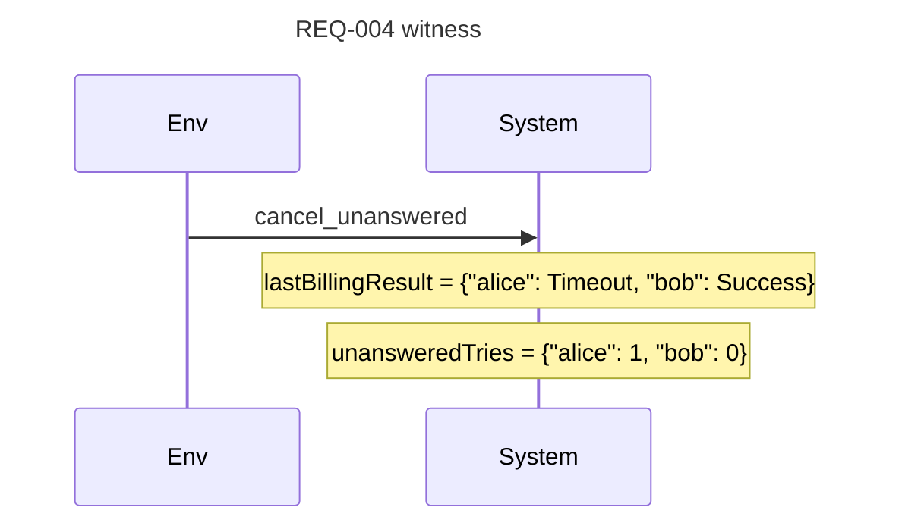
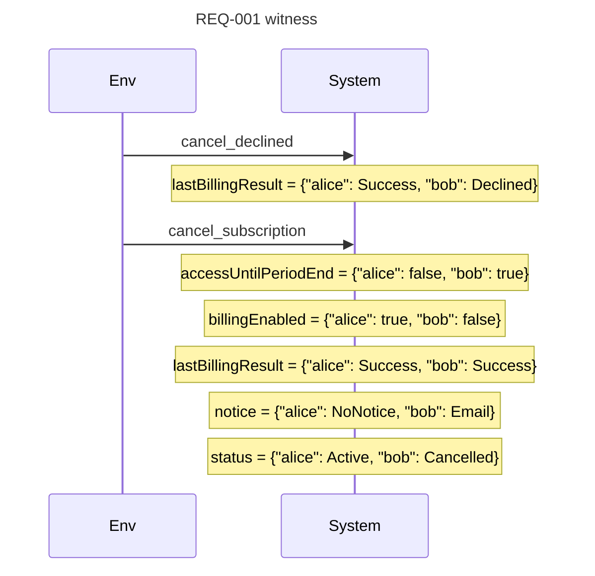
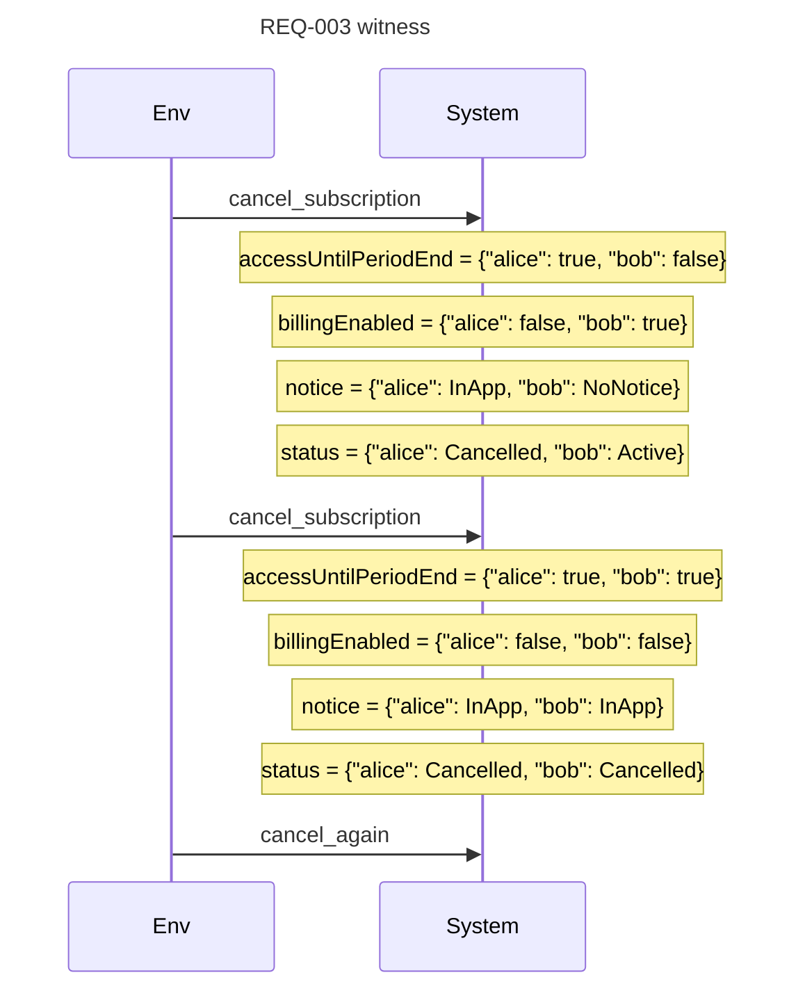
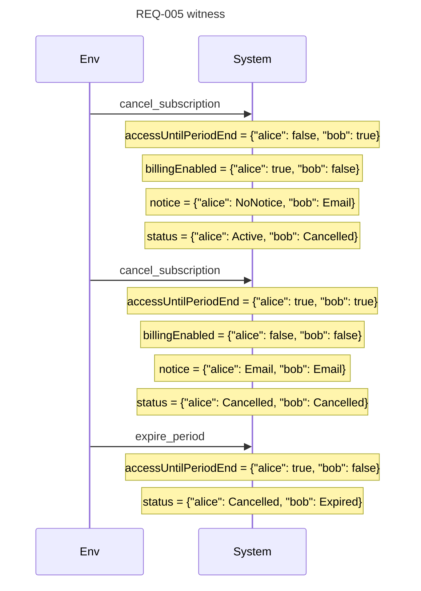
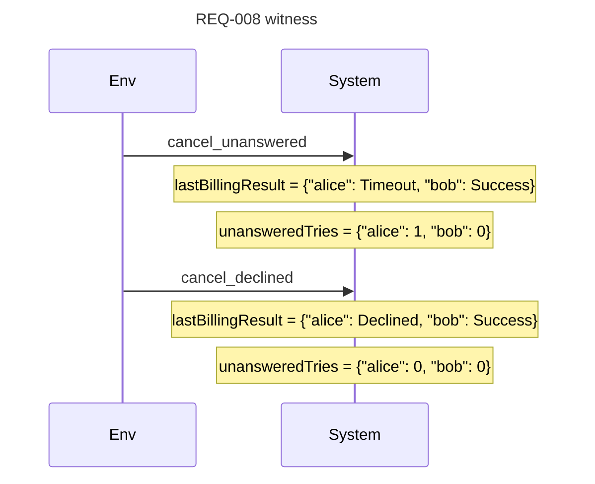
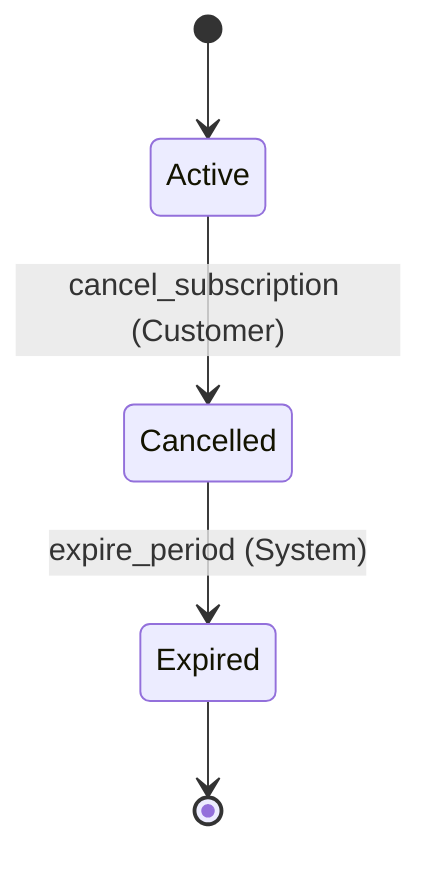

# Spec Readback: subscription — v0.1.0

> Auto-generated by `tools/spec-readback.py` from `specs/subscription.qnt` + `specs/subscription.intent.json` + `specs/subscription.records.json`. Do not edit; regenerate after spec changes.

**⚠ NOT READY** — 8 of 8 requirement(s) not verified against code; 1 of 4 invariant(s) not holding; 1 open question(s).

**Status:** formalized  |  **Requirements:** 0/8 verified, 7/8 witnessed  |  **Invariants:** 0 proven + 3 bounded (≤10) / 4  |  **Coverage:** 5/5 actions covered, 9/9 changes explained  |  **Extraction:** n/a (no code)  |  **Mutation:** 68% pinned by examples, 6 question(s) open  |  **Open questions:** 1  |  **Last verified:** never

*Legend: ✓ verified — witness trace replayed green against real code · ◐ witnessed — proven possible in the model, not yet demonstrated in code · ✗ no witness — claimed behavior is UNREACHABLE in the model · ⏳ not checked yet · ⊘ nothing to witness (a forbidden step, whose proof is its obligation, or a computed value, checked by the unit test it names) · ∀ checked on every reachable step, ∀✗ a step that breaks it was found*

## Purpose

Subscription cancellation: stop future billing, preserve access to the end of the paid period, survive a flaky billing provider. This is the methodology's acceptance case — five sentences of prose turned into the decisions the prose leaves open.

## Shape


*Rounded nodes are outside systems this area depends on; each declared outcome needs an answer: a requirement's or a verdict's @error.*

## Scope

**In scope:** cancellation, billing suppression, access until period end

**Deliberately out of scope** — these are decisions, not oversights:

- **refunds** — Product policy: no refunds for the unused period (DEC-001). Nothing here may issue one.
- **proration** — No mid-period price adjustment exists in this product.
- **reactivation** — Resubscribing creates a new subscription; owned by the signup area. _(owned by signup)_
- **dunning** — Retry-and-chase on failed renewal payments is the billing area's job.

## ⚠ Needs Your Attention

- **Check error** — INV-001 (`noBillingAfterCancel`): WARNING: java.lang.System::load has been called by tools.aqua.turnkey.support.TurnKey in an unnamed module (file:/Users/akracik/.quint/apalache-dist-0.56.1/apalache/lib/apalache.jar)
WARNING: Use --enable-native-access=ALL-UNNAMED to avoid a warning for callers in this module
WARNING: Restricted methods will be blocked in a future release unless native access is enabled

error: status is used before it is assigned. You need to have either `status == <expr>` or `status.in(<set>)` before doing anything else with `status` in your predicate.
- **Open question** — Q-001: After MAX_CANCEL_RETRIES exhausted TIMEOUTs, does the subscription stay Active forever, or does an operator get paged? ASM-001 assumes the provider answers eventually; nothing here says what happens if it does not. _(source: elicitation)_
- **The examples leave 6 behavior(s) open** — the model decides them and no example does. Answer the [questions](#questions-the-examples-leave-open): yes adds an example, no finds a model bug.
- **Mutation results are for an older model** — rerun `tools/spec-questions.py <area> --record` before answering.

## Questions the Examples Leave Open

_Small changes to the model that every example and invariant still pass: 7 of 38 tried (`tools/spec-questions.py`, 702fd47). Each is a behavior the model chose and nobody approved. **Yes** pins it: add the run as an example. **No** means the model is wrong here._

> ⚠ These were raised against an older model — rerun before answering.

### 1d0a35d2 · [REQ-001](#req-001), [REQ-002](#req-002), [REQ-007](#req-007)

**Given** cancel_subscription(alice, InApp) **When** cancel_subscription(alice, Email)

> After cancel_subscription(alice, InApp), should cancel_subscription(alice, Email) be refused? The model refuses it; a model that allows it passes every example too.

Yes → add as an example of REQ-001, REQ-002, REQ-007:

```quint
run q_1d0a35d2 = init.then(cancel_subscription("alice", InApp)).then(cancel_subscription("alice", Email).fail())
```

<sub>Raised by the variant: cancel_subscription: drop the guard `status.get(c) == Active`.</sub>

### 68ef8975 · [REQ-004](#req-004)

**Given** the initial state **When** cancel_unanswered(bob, false)

> From the start, when cancel_unanswered(bob, false): should lastBillingResult[bob] = NetworkError hold? The model says so; a model where it does not passes every example too.

Yes → add as an example of REQ-004:

```quint
run q_68ef8975 = init.then(cancel_unanswered("bob", false)).expect(lastBillingResult.get("bob") == NetworkError)
```

<sub>Raised by the variant: cancel_unanswered: drop the effect on `lastBillingResult` (keep it as it was).</sub>

### 404d46eb · [REQ-004](#req-004)

**Given** the initial state **When** cancel_unanswered(bob, true)

> From the start, when cancel_unanswered(bob, true): should lastBillingResult[bob] = Timeout hold? The model says so; a model where it does not passes every example too.

Yes → add as an example of REQ-004:

```quint
run q_404d46eb = init.then(cancel_unanswered("bob", true)).expect(lastBillingResult.get("bob") == Timeout)
```

<sub>Raised by the variant: cancel_unanswered: `lastBillingResult` gets `NetworkError` where the model writes `Timeout`.</sub>

### 909c2265 · [REQ-003](#req-003)

**Given** the initial state **When** cancel_again(alice)

> From the start, should cancel_again(alice) be refused? The model refuses it; a model that allows it passes every example too.

Yes → add as an example of REQ-003:

```quint
run q_909c2265 = init.then(cancel_again("alice").fail())
```

<sub>Raised by the variant: cancel_again: drop the guard `status.get(c) == Cancelled`.</sub>

### ead78f89

**At the start**

> Initially, should lastBillingResult[alice] = Success and lastBillingResult[bob] = Success hold? The model says so; a model where it does not passes every example too.

Yes → add as an example:

```quint
run q_ead78f89 = init.expect(lastBillingResult.get("alice") == Success and lastBillingResult.get("bob") == Success)
```

<sub>Raised by the variant: init: `lastBillingResult` gets `Declined` where the model writes `Success`.</sub>

### ce72947e

**At the start**

> Initially, should notice[alice] = NoNotice and notice[bob] = NoNotice hold? The model says so; a model where it does not passes every example too.

Yes → add as an example:

```quint
run q_ce72947e = init.expect(notice.get("alice") == NoNotice and notice.get("bob") == NoNotice)
```

<sub>Raised by the variant: init: `notice` gets `Email` where the model writes `NoNotice`.</sub>

## At a Glance

| | ID | Behavior | Modality |
|---|---|---|---|
| ◐ | [REQ-001](#req-001) | When a customer cancels an Active subscription, the system shall stop future billing. | must |
| ◐ | [REQ-002](#req-002) | When a cancellation succeeds, the system shall keep access available until the paid per… | must |
| ◐ | [REQ-003](#req-003) | When a customer cancels an already-Cancelled subscription, the system shall make no fur… | must |
| ◐ | [REQ-004](#req-004) | If the billing provider does not answer a cancellation, then the system shall leave the… | must |
| ◐ | [REQ-005](#req-005) | When the paid period ends for a cancelled subscription, the system shall withdraw acces… | must |
| ⊘ | [REQ-006](#req-006) | The system shall never issue a refund for the unused part of a paid period. | forbidden |
| ◐ | [REQ-007](#req-007) | When a cancellation succeeds, the system shall confirm it to the customer by email or b… | may |
| ◐ | [REQ-008](#req-008) | If the billing provider declines a cancellation, then the system shall leave the subscr… | must |

## What the System Does

### Cancel a subscription

> **Who** · Customer<br>
> **Story** · Customer cancels mid-period. The first try goes unanswered and changes nothing; the retry succeeds, billing stops and access stays; a second cancel is harmless; the paid period ends and access stops.<br>
> **Route** · ◐ [REQ-004](#req-004) → ◐ [REQ-001](#req-001) → ◐ [REQ-002](#req-002) → ◐ [REQ-003](#req-003) → ◐ [REQ-005](#req-005)<br>
> **Runs as** · ✓ `subscription.cancelJourney` — `quint test` runs it; it walks 5 of 5 step(s) in order.

**Step 1 of 5**

*the provider does not answer the first try*

#### REQ-004

◐ ∀  *(failure path)* If the billing provider does not answer a cancellation, then the system shall leave the subscription Active.

> **On BillingProvider/TIMEOUT:** NO_CHANGE — the subscription stays Active and billable; retry (safe to retry)
> **On BillingProvider/NETWORK_ERROR:** NO_CHANGE — the request never landed; retry (safe to retry)

| Example | Given | When | Then |
|---|---|---|---|
| EX-003 — Provider times out: nothing moves | the initial state | cancel_unanswered(alice, true) | `status.get("alice") == Active and billingEnabled.get("alice")` |

> **Guarded by** · [INV-003](#what-must-always-be-true) `unacceptedCancelLeavesActive` ✓ (≤10 steps) · [INV-004](#what-must-always-be-true) `retriesWithinBudget` ✓ (≤10 steps)

> **Left open** · [68ef8975](#68ef8975) cancel_unanswered(bob, false) · [404d46eb](#404d46eb) cancel_unanswered(bob, true) — the model decides, no example does

> **Witness:** 2 steps: cancel_unanswered(alice, true) → lastBillingResult = {"alice": Timeout, "bob": Success}; unansweredTries = {"alice": 1, "bob": 0}

> **∀ Every step:** checked on every reachable step (≤10 steps).

<details><summary>EARS sentence, Quint action `cancel_unanswered`, formal claim + trace</summary>

**As specified (EARS):** While `status.get(c) == Active`, if the billing provider does not answer the cancellation, then the system shall make `(lastBillingResult.get(c) == Timeout or lastBillingResult.get(c) == NetworkError) and status.get(c) == Active and billingEnabled.get(c)` hold.

`specs/subscription.qnt:L170-L179` · model `7597c18d0b46`

```quint
  action cancel_unanswered(c: CustomerId, timedOut: bool): bool = all {
    status.get(c) == Active,
    triesOf(c) < MAX_CANCEL_RETRIES,
    lastBillingResult' = lastBillingResult.set(c, if (timedOut) Timeout else NetworkError),
    unansweredTries' = unansweredTries.set(c, triesOf(c) + 1),
    status' = status,
    billingEnabled' = billingEnabled,
    accessUntilPeriodEnd' = accessUntilPeriodEnd,
    notice' = notice,
  }
```

**Formal claim** (pre-state for while/old, post-state for shall):
- **while** `status.get(c) == Active`
- **shall** `(lastBillingResult.get(c) == Timeout or lastBillingResult.get(c) == NetworkError) and status.get(c) == Active and billingEnabled.get(c)`

**Record:** `specs/subscription.qnt:155` — the doc comment this requirement is read from.



</details>

**Step 2 of 5**

#### REQ-001

◐ ∀ When a customer cancels an Active subscription, the system shall stop future billing.

> **On BillingProvider/SUCCESS:** Cancelled (safe to retry)

| Example | Given | When | Then |
|---|---|---|---|
| EX-001 — Cancel mid-period: billing stops, access stays | the initial state | cancel_subscription(alice, Email) | `status.get("alice") == Cancelled and not(billingEnabled.get("alice")) and accessUntilPeriodEnd.get("alice") and notice.get("alice") == Email` |

> **Guarded by** · [INV-001](#what-must-always-be-true) `noBillingAfterCancel` ⏳ · [INV-002](#what-must-always-be-true) `noRefundIssued` ✓ (≤10 steps) · [INV-003](#what-must-always-be-true) `unacceptedCancelLeavesActive` ✓ (≤10 steps) · [INV-004](#what-must-always-be-true) `retriesWithinBudget` ✓ (≤10 steps)

> **Left open** · [1d0a35d2](#1d0a35d2) cancel_subscription(alice, Email) — the model decides, no example does

> **Witness:** 3 steps: cancel_declined(bob) → cancel_subscription(bob, Email) → accessUntilPeriodEnd = {"alice": false, "bob": true}; billingEnabled = {"alice": true, "bob": false}; lastBillingResult = {"alice": Success, "bob": Success}; notice = {"alice": NoNotice, "bob": Email}; status = {"alice": Active, "bob": Cancelled}

> **∀ Every step:** checked on every reachable step (≤10 steps).

<details><summary>EARS sentence, Quint action `cancel_subscription`, formal claim + trace</summary>

**As specified (EARS):** While `status.get(c) == Active`, when the customer cancels and the provider accepts, the system shall make `status.get(c) == Cancelled and not(billingEnabled.get(c)) and lastBillingResult.get(c) == Success` hold.

`specs/subscription.qnt:L114-L123` · model `6400fc26380d`

```quint
  action cancel_subscription(c: CustomerId, n: Notice): bool = all {
    status.get(c) == Active,
    n != NoNotice,
    lastBillingResult' = lastBillingResult.set(c, Success),
    status' = status.set(c, Cancelled),
    billingEnabled' = billingEnabled.set(c, false),
    accessUntilPeriodEnd' = accessUntilPeriodEnd.set(c, true),
    unansweredTries' = unansweredTries.set(c, 0),
    notice' = notice.set(c, n),
  }
```

**Formal claim** (pre-state for while/old, post-state for shall):
- **while** `status.get(c) == Active`
- **shall** `status.get(c) == Cancelled and not(billingEnabled.get(c)) and lastBillingResult.get(c) == Success`

**Record:** `specs/subscription.qnt:82` — the doc comment this requirement is read from.



</details>

**Step 3 of 5**

*same step as the cancel: access stays until the period ends*

#### REQ-002

◐ ∀ When a cancellation succeeds, the system shall keep access available until the paid period ends.

| Example | Given | When | Then |
|---|---|---|---|
| EX-001 — Cancel mid-period: billing stops, access stays | the initial state | cancel_subscription(alice, Email) | `status.get("alice") == Cancelled and not(billingEnabled.get("alice")) and accessUntilPeriodEnd.get("alice") and notice.get("alice") == Email` |

> **Guarded by** · [INV-001](#what-must-always-be-true) `noBillingAfterCancel` ⏳ · [INV-002](#what-must-always-be-true) `noRefundIssued` ✓ (≤10 steps) · [INV-003](#what-must-always-be-true) `unacceptedCancelLeavesActive` ✓ (≤10 steps) · [INV-004](#what-must-always-be-true) `retriesWithinBudget` ✓ (≤10 steps)

> **Left open** · [1d0a35d2](#1d0a35d2) cancel_subscription(alice, Email) — the model decides, no example does

> **Witness:** 3 steps: cancel_declined(bob) → cancel_subscription(bob, Email) → accessUntilPeriodEnd = {"alice": false, "bob": true}; billingEnabled = {"alice": true, "bob": false}; lastBillingResult = {"alice": Success, "bob": Success}; notice = {"alice": NoNotice, "bob": Email}; status = {"alice": Active, "bob": Cancelled}

> **∀ Every step:** checked on every reachable step (≤3 steps).

<details><summary>EARS sentence, Quint action `cancel_subscription`, formal claim + trace</summary>

**As specified (EARS):** While `status.get(c) == Active`, when the customer cancels and the provider accepts, the system shall make `status.get(c) == Cancelled and accessUntilPeriodEnd.get(c)` hold.

`specs/subscription.qnt:L114-L123` · model `c1a8aa39feb9`

```quint
  action cancel_subscription(c: CustomerId, n: Notice): bool = all {
    status.get(c) == Active,
    n != NoNotice,
    lastBillingResult' = lastBillingResult.set(c, Success),
    status' = status.set(c, Cancelled),
    billingEnabled' = billingEnabled.set(c, false),
    accessUntilPeriodEnd' = accessUntilPeriodEnd.set(c, true),
    unansweredTries' = unansweredTries.set(c, 0),
    notice' = notice.set(c, n),
  }
```

**Formal claim** (pre-state for while/old, post-state for shall):
- **while** `status.get(c) == Active`
- **shall** `status.get(c) == Cancelled and accessUntilPeriodEnd.get(c)`

**Record:** `specs/subscription.qnt:94` — the doc comment this requirement is read from.


</details>

**Step 4 of 5**

#### REQ-003

◐ ∀ When a customer cancels an already-Cancelled subscription, the system shall make no further change.

| Example | Given | When | Then |
|---|---|---|---|
| EX-002 — Cancelling twice is harmless | cancel_subscription(alice, Email) | cancel_again(alice) | `status.get("alice") == Cancelled and accessUntilPeriodEnd.get("alice")` |

> **Left open** · [909c2265](#909c2265) cancel_again(alice) — the model decides, no example does

> **Witness:** 4 steps: cancel_subscription(alice, InApp) → cancel_subscription(bob, InApp) → cancel_again(bob)

> **∀ Every step:** checked on every reachable step (≤3 steps).

<details><summary>EARS sentence, Quint action `cancel_again`, formal claim + trace</summary>

**As specified (EARS):** While `status.get(c) == Cancelled`, when the customer cancels again, the system shall make `status.get(c) == Cancelled and accessUntilPeriodEnd.get(c) and billingEnabled.get(c) == billed and notice.get(c) == told` hold.

`specs/subscription.qnt:L195-L203` · model `e07fa287ca32`

```quint
  action cancel_again(c: CustomerId): bool = all {
    status.get(c) == Cancelled,
    status' = status,
    billingEnabled' = billingEnabled,
    accessUntilPeriodEnd' = accessUntilPeriodEnd,
    lastBillingResult' = lastBillingResult,
    unansweredTries' = unansweredTries,
    notice' = notice,
  }
```

**Formal claim** (pre-state for while/old, post-state for shall):
- **old** `billed: bool = billingEnabled.get(c)`
- **old** `told: Notice = notice.get(c)`
- **while** `status.get(c) == Cancelled`
- **shall** `status.get(c) == Cancelled and accessUntilPeriodEnd.get(c) and billingEnabled.get(c) == billed and notice.get(c) == told`

**Record:** `specs/subscription.qnt:183` — the doc comment this requirement is read from.



</details>

**Step 5 of 5**

#### REQ-005

◐ ∀ When the paid period ends for a cancelled subscription, the system shall withdraw access.

| Example | Given | When | Then |
|---|---|---|---|
| EX-007 — The paid period ends: access stops | cancel_subscription(alice, InApp) | expire_period(alice) | `status.get("alice") == Expired and not(accessUntilPeriodEnd.get("alice"))` |

> **Guarded by** · [INV-001](#what-must-always-be-true) `noBillingAfterCancel` ⏳ · [INV-002](#what-must-always-be-true) `noRefundIssued` ✓ (≤10 steps) · [INV-003](#what-must-always-be-true) `unacceptedCancelLeavesActive` ✓ (≤10 steps) · [INV-004](#what-must-always-be-true) `retriesWithinBudget` ✓ (≤10 steps)

> **Witness:** 4 steps: cancel_subscription(bob, Email) → cancel_subscription(alice, Email) → expire_period(bob) → accessUntilPeriodEnd = {"alice": true, "bob": false}; status = {"alice": Cancelled, "bob": Expired}

> **∀ Every step:** checked on every reachable step (≤3 steps).

<details><summary>EARS sentence, Quint action `expire_period`, formal claim + trace</summary>

**As specified (EARS):** While `status.get(c) == Cancelled`, when the paid period ends, the system shall make `status.get(c) == Expired and not(accessUntilPeriodEnd.get(c))` hold.

`specs/subscription.qnt:L214-L222` · model `00b11b580caa`

```quint
  action expire_period(c: CustomerId): bool = all {
    status.get(c) == Cancelled,
    status' = status.set(c, Expired),
    accessUntilPeriodEnd' = accessUntilPeriodEnd.set(c, false),
    billingEnabled' = billingEnabled,
    lastBillingResult' = lastBillingResult,
    unansweredTries' = unansweredTries,
    notice' = notice,
  }
```

**Formal claim** (pre-state for while/old, post-state for shall):
- **while** `status.get(c) == Cancelled`
- **shall** `status.get(c) == Expired and not(accessUntilPeriodEnd.get(c))`

**Record:** `specs/subscription.qnt:206` — the doc comment this requirement is read from.



</details>

### Other behaviors

> _Specified here, but not yet placed in any journey above._

#### REQ-006

⊘ ∀  *(failure path)* The system shall never issue a refund for the unused part of a paid period.

> **Forbidden** — this must never happen, so there is no trace to find. The proof is the check that no reachable step of the action starts where it is forbidden. The examples below show the call being refused.

| Example | Given | When | Then |
|---|---|---|---|
| EX-006 — A refund request after cancelling is refused | cancel_subscription(alice, InApp), so `status.get("alice") == Cancelled and accessUntilPeriodEnd.get("alice")` | request_refund(alice) — refused | refused — nothing changes |

> **∀ Every step:** checked on every reachable step (≤10 steps).

<details><summary>EARS sentence, Quint action `request_refund`</summary>

**As specified (EARS):** If the customer asks for a refund, then the system shall never let it happen.

`specs/subscription.qnt:L235-L243` · model `d6dde6772bc4`

```quint
  action request_refund(c: CustomerId): bool = all {
    false,   // DEC-001: refunds are never granted
    status' = status,
    billingEnabled' = billingEnabled,
    accessUntilPeriodEnd' = accessUntilPeriodEnd,
    lastBillingResult' = lastBillingResult,
    unansweredTries' = unansweredTries,
    notice' = notice,
  }
```

**Record:** `specs/subscription.qnt:228` — the doc comment this requirement is read from.

</details>

#### REQ-007

◐ ∀ When a cancellation succeeds, the system shall confirm it to the customer by email or by an in-app notice.

> **Permitted, not required** — the system MAY do any of the following, and the choice is not this spec's to make. Each needs its own witness, found with the other outcomes false, or the permission has quietly become a rule:
>   - ◐ **email**: `notice.get(c) == Email` — 3 steps: cancel_declined(bob) → cancel_subscription(bob, Email) → accessUntilPeriodEnd = {"alice": false, "bob": true}; billingEnabled = {"alice": true, "bob": false}; lastBillingResult = {"alice": Success, "bob": Success}; notice = {"alice": NoNotice, "bob": Email}; status = {"alice": Active, "bob": Cancelled}
>   - ◐ **in-app**: `notice.get(c) == InApp` — 4 steps: cancel_declined(bob) → cancel_unanswered(alice, true) → cancel_subscription(bob, InApp) → accessUntilPeriodEnd = {"alice": false, "bob": true}; billingEnabled = {"alice": true, "bob": false}; lastBillingResult = {"alice": Timeout, "bob": Success}; notice = {"alice": NoNotice, "bob": InApp}; status = {"alice": Active, "bob": Cancelled}

| Example | Given | When | Then |
|---|---|---|---|
| EX-001 — Cancel mid-period: billing stops, access stays | the initial state | cancel_subscription(alice, Email) | `status.get("alice") == Cancelled and not(billingEnabled.get("alice")) and accessUntilPeriodEnd.get("alice") and notice.get("alice") == Email` |
| EX-007 — The paid period ends: access stops | cancel_subscription(alice, InApp) | expire_period(alice) | `status.get("alice") == Expired and not(accessUntilPeriodEnd.get("alice"))` |

> **Guarded by** · [INV-001](#what-must-always-be-true) `noBillingAfterCancel` ⏳ · [INV-002](#what-must-always-be-true) `noRefundIssued` ✓ (≤10 steps) · [INV-003](#what-must-always-be-true) `unacceptedCancelLeavesActive` ✓ (≤10 steps) · [INV-004](#what-must-always-be-true) `retriesWithinBudget` ✓ (≤10 steps)

> **Left open** · [1d0a35d2](#1d0a35d2) cancel_subscription(alice, Email) — the model decides, no example does

> **∀ Every step:** checked on every reachable step (≤3 steps).

<details><summary>EARS sentence, Quint action `cancel_subscription`, formal claim + trace</summary>

**As specified (EARS):** While `notice.get(c) == NoNotice`, when the customer cancels and the provider accepts, the system shall end in one of: `notice.get(c) == Email`; `notice.get(c) == InApp`.

`specs/subscription.qnt:L114-L123` · model `1559bf3069ee`

```quint
  action cancel_subscription(c: CustomerId, n: Notice): bool = all {
    status.get(c) == Active,
    n != NoNotice,
    lastBillingResult' = lastBillingResult.set(c, Success),
    status' = status.set(c, Cancelled),
    billingEnabled' = billingEnabled.set(c, false),
    accessUntilPeriodEnd' = accessUntilPeriodEnd.set(c, true),
    unansweredTries' = unansweredTries.set(c, 0),
    notice' = notice.set(c, n),
  }
```

**Formal claim** (pre-state for while/old, post-state for shall):
- **while** `notice.get(c) == NoNotice`
- **outcome email** `notice.get(c) == Email`
- **outcome in-app** `notice.get(c) == InApp`

**Record:** `specs/subscription.qnt:104` — the doc comment this requirement is read from.

</details>

#### REQ-008

◐ ∀  *(failure path)* If the billing provider declines a cancellation, then the system shall leave the subscription Active.

> **On BillingProvider/DECLINED:** NO_CHANGE — the provider refused the change; the subscription stays Active and billable (safe to retry)

| Example | Given | When | Then |
|---|---|---|---|
| EX-004 — Provider declines: the subscription stays Active | the initial state | cancel_declined(alice) | `status.get("alice") == Active and lastBillingResult.get("alice") == Declined` |
| EX-008 — A decline after an unanswered try resets the retry count | cancel_unanswered(alice, false) | cancel_declined(alice) | `unansweredTries.get("alice") == 0` |

> **Guarded by** · [INV-003](#what-must-always-be-true) `unacceptedCancelLeavesActive` ✓ (≤10 steps) · [INV-004](#what-must-always-be-true) `retriesWithinBudget` ✓ (≤10 steps)

> **Witness:** 3 steps: cancel_unanswered(alice, true) → cancel_declined(alice) → lastBillingResult = {"alice": Declined, "bob": Success}; unansweredTries = {"alice": 0, "bob": 0}

> **∀ Every step:** checked on every reachable step (≤10 steps).

<details><summary>EARS sentence, Quint action `cancel_declined`, formal claim + trace</summary>

**As specified (EARS):** While `status.get(c) == Active`, if the billing provider declines the cancellation, then the system shall make `lastBillingResult.get(c) == Declined and status.get(c) == Active and billingEnabled.get(c)` hold.

`specs/subscription.qnt:L140-L148` · model `b2654cbe07f2`

```quint
  action cancel_declined(c: CustomerId): bool = all {
    status.get(c) == Active,
    lastBillingResult' = lastBillingResult.set(c, Declined),
    status' = status,
    billingEnabled' = billingEnabled,
    accessUntilPeriodEnd' = accessUntilPeriodEnd,
    unansweredTries' = unansweredTries.set(c, 0),
    notice' = notice,
  }
```

**Formal claim** (pre-state for while/old, post-state for shall):
- **while** `status.get(c) == Active`
- **shall** `lastBillingResult.get(c) == Declined and status.get(c) == Active and billingEnabled.get(c)`

**Record:** `specs/subscription.qnt:127` — the doc comment this requirement is read from.



</details>

## What Each Action Does

_One table per step the model can take. Each row is a requirement or verdict on it, with the condition it applies under; each column is a variable the step can change, and the cell is what the row says about it. A step no row covers is a gap; a change no row names is behavior nobody asked for. /spec-check proves both (coverage, explanation)._

### `cancel_subscription`

| Row | Applies when | `status` | `billingEnabled` | `accessUntilPeriodEnd` | `lastBillingResult` | `notice` |
|---|---|---|---|---|---|---|
| REQ-001 | `status.get(c) == Active` | `status.get(c) == Cancelled` | `not(billingEnabled.get(c))` |  | `lastBillingResult.get(c) == Success` |  |
| REQ-002 | `status.get(c) == Active` | `status.get(c) == Cancelled` |  | `accessUntilPeriodEnd.get(c)` |  |  |
| REQ-007 | `notice.get(c) == NoNotice` |  |  |  |  | `notice.get(c) == Email` _or_ `notice.get(c) == InApp` |

_✓ coverage (≤10) · ✓ `status` explained (≤10) · ✓ `billingEnabled` explained (≤10) · ✓ `accessUntilPeriodEnd` explained (≤10) · ✓ `lastBillingResult` explained (≤10) · ✓ `notice` explained (≤10)_

### `cancel_declined`

| Row | Applies when | `lastBillingResult` |
|---|---|---|
| REQ-008 | `status.get(c) == Active` | `lastBillingResult.get(c) == Declined` |

_✓ coverage (≤10) · ✓ `lastBillingResult` explained (≤10)_

### `cancel_unanswered`

| Row | Applies when | `lastBillingResult` |
|---|---|---|
| REQ-004 | `status.get(c) == Active` | `(lastBillingResult.get(c) == Timeout or lastBillingResult.get(c) == NetworkError)` |

_✓ coverage (≤10) · ✓ `lastBillingResult` explained (≤10)_

### `cancel_again`

| Row | Applies when |
|---|---|
| REQ-003 | `status.get(c) == Cancelled` |  |

_✓ coverage (≤10)_

### `expire_period`

| Row | Applies when | `status` | `accessUntilPeriodEnd` |
|---|---|---|---|
| REQ-005 | `status.get(c) == Cancelled` | `status.get(c) == Expired` | `not(accessUntilPeriodEnd.get(c))` |

_✓ coverage (≤10) · ✓ `status` explained (≤10) · ✓ `accessUntilPeriodEnd` explained (≤10)_

### `request_refund`

| Row | Applies when |
|---|---|
| REQ-006 | always |  |

_✓ coverage: REQ-006 applies to every step_

**Bookkeeping, not behavior** (`@internal`, not explained):

- `unansweredTries` — The retry budget's counter. It exists so the model can hold ASM-001 (the provider answers within MAX_CANCEL_RETRIES tries); no customer sees it, so no requirement has to say how it moves.

## What Must Always Be True

_Invariant legend: ✓ proven — inductive, holds in ALL reachable states · ✓ (≤N steps) — bounded model check to depth N; no counterexample found within N, NOT a proof · ✗ counterexample · ⚠ accepted-risk · ⏳ not checked. Upgrade a bounded ✓ by raising the bound or marking the invariant `proof: inductive`. · N is PER INVARIANT: the checker runs a shallow pass first and deepens only what it has budget for, so a smaller N here is a weaker claim, not a different kind of one._

- **INV-001** (`noBillingAfterCancel`) — A cancelled or expired subscription is never billed again. Criticality: critical. ⏳
- **INV-002** (`noRefundIssued`) — A cancelled subscriber keeps access until the paid period ends. Criticality: high. ✓ (≤10 steps)
- **INV-003** (`unacceptedCancelLeavesActive`) — A cancellation the provider did not accept leaves the subscription Active and billable. Criticality: critical. ✓ (≤10 steps) · under ASM-001
- **INV-004** (`retriesWithinBudget`) — Unanswered cancellation tries never exceed MAX_CANCEL_RETRIES. Criticality: high. ✓ (≤10 steps)

## What the Outside World Can Do

| Dependency | Outcome | What we do | Where |
|---|---|---|---|
| BillingProvider | SUCCESS | Cancelled (retry-safe) | REQ-001 |
| BillingProvider | DECLINED | NO_CHANGE — the provider refused the change; the subscription stays Active and billable (retry-safe) | REQ-008 |
| BillingProvider | TIMEOUT | NO_CHANGE — the subscription stays Active and billable; retry (retry-safe) | REQ-004 |
| BillingProvider | NETWORK_ERROR | NO_CHANGE — the request never landed; retry (retry-safe) | REQ-004 |

**Assumptions this specification rests on.** Results that depend on them are annotated `under ASM-NNN` — they hold if the assumption does, and not otherwise.

- **ASM-001** — BillingProvider eventually responds to a cancellation request, within at most three retry windows. Bears on: INV-003, REQ-004. Checked in production by: Synthetic cancellation probe every 5 minutes; pages if a request is unanswered for 15.
- **ASM-002** — The paid period end is known locally and does not depend on the provider being reachable. Bears on: REQ-002, REQ-005. _Believed, not checked._

## Examples

_Concrete cases, each a Quint `run` that `quint test` executes and the code's conformance harness replays. A witness trace shows a behavior is reachable at all; an example pins the one case it states._

| Example | Given | When | Then | Illustrates |
|---|---|---|---|---|
| EX-001 — Cancel mid-period: billing stops, access stays | the initial state | cancel_subscription(alice, Email) | `status.get("alice") == Cancelled and not(billingEnabled.get("alice")) and accessUntilPeriodEnd.get("alice") and notice.get("alice") == Email` | REQ-001, REQ-002, REQ-007 |
| EX-002 — Cancelling twice is harmless | cancel_subscription(alice, Email) | cancel_again(alice) | `status.get("alice") == Cancelled and accessUntilPeriodEnd.get("alice")` | REQ-003 |
| EX-003 — Provider times out: nothing moves | the initial state | cancel_unanswered(alice, true) | `status.get("alice") == Active and billingEnabled.get("alice")` | REQ-004, INV-003 |
| EX-004 — Provider declines: the subscription stays Active | the initial state | cancel_declined(alice) | `status.get("alice") == Active and lastBillingResult.get("alice") == Declined` | REQ-008, INV-003 |
| EX-005 — After three unanswered tries there is no fourth | cancel_unanswered(alice, true); then cancel_unanswered(alice, false); then cancel_unanswered(alice, true), so `status.get("alice") == Active and triesOf("alice") == 3` | cancel_unanswered(alice, true) — refused | refused — nothing changes | INV-004, ASM-001 |
| EX-006 — A refund request after cancelling is refused | cancel_subscription(alice, InApp), so `status.get("alice") == Cancelled and accessUntilPeriodEnd.get("alice")` | request_refund(alice) — refused | refused — nothing changes | REQ-006 |
| EX-007 — The paid period ends: access stops | cancel_subscription(alice, InApp) | expire_period(alice) | `status.get("alice") == Expired and not(accessUntilPeriodEnd.get("alice"))` | REQ-005, REQ-007 |
| EX-008 — A decline after an unanswered try resets the retry count | cancel_unanswered(alice, false) | cancel_declined(alice) | `unansweredTries.get("alice") == 0` | REQ-008, INV-004 |
| EX-009 — A successful cancel after an unanswered try resets the retry count | cancel_unanswered(alice, true) | cancel_subscription(alice, InApp) | `unansweredTries.get("alice") == 0` | REQ-001, INV-004 |

## Limits and Bounds

| ID | Name | Value | Unit | What it is | Referenced by | History |
|---|---|---|---|---|---|---|
| CON-002 | `MAX_CANCEL_RETRIES` | 3 | — | Retry budget after TIMEOUT or NETWORK_ERROR. Bounds ASM-001. | INV-004 | — |

_Confirm every number AND its boundary semantics (on the Nth, or after N?) — off-by-one is the classic wrong-rule bug; the witness one-liners above show the machine-found count._

## State Machines

### Subscription



## Completeness by Dimension

_One number would hide which half is missing. Each row is derived from declared obligations: ✓ discharged, ! outstanding, — nothing declared (which may itself be the gap)._

| Dimension | | Obligations |
|---|---|---|
| Data model | ✓ | 1 entities, 1 stateful, 1 closed |
| Coverage | ✓ | 5/5 action(s) proven covered |
| Explanation | ✓ | 9/9 change(s) proven explained by a requirement |
| Operations | ✓ | 8/8 requirements with a discharged witness |
| Failure behavior | ✓ | 4/4 external outcomes answered |
| External systems | ✓ | 1 declared, 4 outcomes |
| Assumptions | ✓ | 2 recorded, 0 open |
| Temporal behavior | — | none declared |
| Extraction coverage | — | n/a (no code) |
| Substitutability | — | not measured — needs a parallel build and `spec-record equiv` |
| Refusal coverage | ✓ | 1/1 rejection(s) shown by an example |
| Examples | ✓ | 9 worked example(s) |
| Behavior the examples pin | ! | 68% pinned by examples, 6 question(s) open |
| Invariants | ! | 3/4 holding |
| Adversarial review | — | never run — `/spec-check --reality` |

## Reference

<details><summary>Concepts, architecture, decisions, resolved questions, traceability, verification history</summary>

**Entities:**

- **Subscription** (Active / Cancelled / Expired) — CLOSED: exactly these three states exist. 'Paused', 'PendingCancellation' and friends are the states an implementation invents when nobody wrote the list down — the marker is what stops that.

**Actors:** Customer, System, BillingProvider

**Architecture (resolved project ⊕ area):** TypeScript 5.4 Node.js 20 Express Vitest pnpm · persistence: sql postgres Prisma

**Decisions:**

- **DEC-001** (accepted, 2026-05-15) — No refunds on cancellation. Cancellation stops future billing and preserves access to the end of the paid period. No money is returned. Rationale: Product policy; the paid period has already been delivered as access. Alternatives: Prorated refund of the unused days (rejected: Support and accounting cost outweighs the churn benefit at this price point.).

_No code generated yet. Run /spec-code-generate._

_Approval lives in PR history — audit trail: `git log -- specs/subscription.qnt specs/subscription.intent.json specs/subscription.records.json`_

</details>
