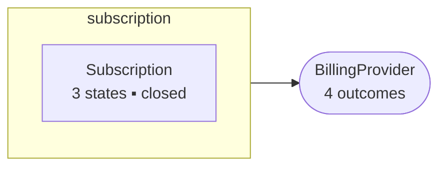
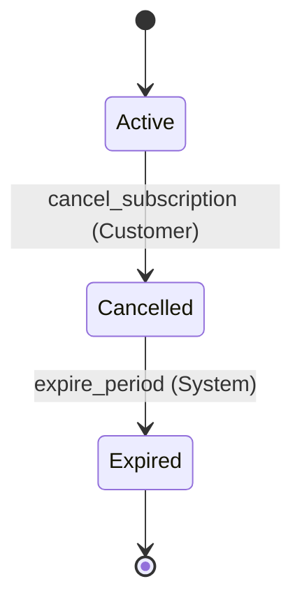

# Spec Readback: subscription — v0.1.0

> Auto-generated by `tools/spec-readback.py` from `specs/subscription.qnt` + `specs/subscription.intent.json` + `specs/subscription.records.json`. Do not edit; regenerate after spec changes.

**⚠ NOT READY** — 8 of 8 requirement(s) not verified against code; 4 of 4 invariant(s) not holding; 1 open question(s).

**Status:** formalized  |  **Requirements:** 0/8 verified, 0/8 witnessed  |  **Invariants:** 0 proven + 0 bounded / 4  |  **Coverage:** 18 cells, 2 covered, 16 triaged, 0 untriaged  |  **Extraction:** n/a (no code)  |  **Mutation:** not run  |  **Open questions:** 1  |  **Last verified:** never

*Legend: ✓ verified — witness trace replayed green against real code · ◐ witnessed — proven possible in the model, not yet demonstrated in code · ✗ no witness — claimed behavior is UNREACHABLE in the model · ⏳ not checked yet · ⊘ skipped with justification (a refusal — an invariant carries the proof and an example shows the refused call — or a computed value, checked by the unit test it names)*

## Purpose

Subscription cancellation: stop future billing, preserve access to the end of the paid period, survive a flaky billing provider. This is the methodology's acceptance case — five sentences of prose turned into the decisions the prose leaves open.

## Shape



*Rounded nodes are outside systems this area depends on; each declared outcome is a cell the coverage matrix requires an answer for.*

## Scope

**In scope:** cancellation, billing suppression, access until period end

**Deliberately out of scope** — these are decisions, not oversights:

- **refunds** — Product policy: no refunds for the unused period (DEC-001). Nothing here may issue one.
- **proration** — No mid-period price adjustment exists in this product.
- **reactivation** — Resubscribing creates a new subscription; owned by the signup area. _(owned by signup)_
- **dunning** — Retry-and-chase on failed renewal payments is the billing area's job.

## ⚠ Needs Your Attention

- **Unchecked requirement** — REQ-001: While the Subscription is Active, when the customer cancels, the system shall stop future billing and mark the Subscription Cancelled.
- **Unchecked requirement** — REQ-002: While the Subscription is Cancelled and the paid period has not ended, the system shall keep access available.
- **Unchecked requirement** — REQ-003: While the Subscription is Cancelled, when the customer cancels again, the system shall make no further change and report success.
- **Unchecked requirement** — REQ-004: While the Subscription is Active, if the billing provider does not answer the cancellation, then the system shall leave the Subscription Active and billing enabled.
- **Unchecked requirement** — REQ-005: While the Subscription is Cancelled, when the paid period ends, the system shall withdraw access and mark the Subscription Expired.
- **Unchecked requirement** — REQ-007: When a cancellation succeeds, the system shall confirm to the customer by email or in-app notice. _(REQ-007/email)_
- **Unchecked requirement** — REQ-008: While the Subscription is Active, if the billing provider declines the cancellation, then the system shall leave the Subscription Active and billing enabled.
- **Open question** — Q-001: After MAX_CANCEL_RETRIES exhausted TIMEOUTs, does the subscription stay Active forever, or does an operator get paged? ASM-001 assumes the provider answers eventually; nothing here says what happens if it does not. _(source: elicitation)_

## At a Glance

| | ID | Behavior | Modality |
|---|---|---|---|
| ⏳ | [REQ-001](#req-001) | stop future billing and mark the Subscription Cancelled | must |
| ⏳ | [REQ-002](#req-002) | keep access available | must |
| ⏳ | [REQ-003](#req-003) | make no further change and report success | must |
| ⏳ | [REQ-004](#req-004) | leave the Subscription Active and billing enabled | must |
| ⏳ | [REQ-005](#req-005) | withdraw access and mark the Subscription Expired | must |
| ⊘ | [REQ-006](#req-006) | refuse the refund and leave the subscription as it is | forbidden |
| ⏳ | [REQ-007](#req-007) | confirm to the customer by email or in-app notice | may |
| ⏳ | [REQ-008](#req-008) | leave the Subscription Active and billing enabled | must |

## What the System Does

### Cancel a subscription

> **Who** · Customer<br>
> **Story** · Customer cancels mid-period. The first try goes unanswered and changes nothing; the retry succeeds, billing stops and access stays; a second cancel is harmless; the paid period ends and access stops.<br>
> **Route** · ⏳ [REQ-004](#req-004) → ⏳ [REQ-001](#req-001) → ⏳ [REQ-002](#req-002) → ⏳ [REQ-003](#req-003) → ⏳ [REQ-005](#req-005)<br>
> **Runs as** · ✓ `subscription.cancelJourney` — `quint test` runs it; it walks 5 of 5 step(s) in order.

**Step 1 of 5**

*the provider does not answer the first try*

#### REQ-004

⏳  *(failure path)* While the Subscription is Active, if the billing provider does not answer the cancellation, then the system shall leave the Subscription Active and billing enabled.

> **On BillingProvider/TIMEOUT:** NO_CHANGE — the subscription stays Active and billable; retry (safe to retry)
> **On BillingProvider/NETWORK_ERROR:** NO_CHANGE — the request never landed; retry (safe to retry)

| Example | Given | When | Then |
|---|---|---|---|
| EX-003 — Provider times out: nothing moves | the initial state | cancel_unanswered(alice, true) | `status.get("alice") == Active and billingEnabled.get("alice")` |

> **Guarded by** · [INV-003](#what-must-always-be-true) `unacceptedCancelLeavesActive` ⏳ · [INV-004](#what-must-always-be-true) `retriesWithinBudget` ⏳

<details><summary>Quint action `cancel_unanswered`, witness predicate + trace</summary>

`specs/subscription.qnt:L115-L124` · model `4eb1600672b8`

```quint
  action cancel_unanswered(c: CustomerId, timedOut: bool): bool = all {
    status.get(c) == Active,
    triesOf(c) < MAX_CANCEL_RETRIES,
    lastBillingResult' = lastBillingResult.set(c, if (timedOut) Timeout else NetworkError),
    unansweredTries' = unansweredTries.set(c, triesOf(c) + 1),
    status' = status,
    billingEnabled' = billingEnabled,
    accessUntilPeriodEnd' = accessUntilPeriodEnd,
    notice' = notice,
  }
```

**Witness predicate:** `(lastBillingResult.get(_lastC) == Timeout or lastBillingResult.get(_lastC) == NetworkError) and status.get(_lastC) == Active and billingEnabled.get(_lastC)` — true exactly when the behavior has happened.

**Record:** `specs/subscription.qnt:368` — the doc comment this requirement is read from.

</details>

**Step 2 of 5**

#### REQ-001

⏳ While the Subscription is Active, when the customer cancels, the system shall stop future billing and mark the Subscription Cancelled.

> **On BillingProvider/SUCCESS:** Cancelled (safe to retry)

| Example | Given | When | Then |
|---|---|---|---|
| EX-001 — Cancel mid-period: billing stops, access stays | the initial state | cancel_subscription(alice, Email) | `status.get("alice") == Cancelled and not(billingEnabled.get("alice")) and accessUntilPeriodEnd.get("alice") and notice.get("alice") == Email` |

> **Guarded by** · [INV-001](#what-must-always-be-true) `noBillingAfterCancel` ⏳ · [INV-002](#what-must-always-be-true) `noRefundIssued` ⏳ · [INV-003](#what-must-always-be-true) `unacceptedCancelLeavesActive` ⏳ · [INV-004](#what-must-always-be-true) `retriesWithinBudget` ⏳

<details><summary>Quint action `cancel_subscription`, witness predicate + trace</summary>

`specs/subscription.qnt:L86-L95` · model `4eb1600672b8`

```quint
  action cancel_subscription(c: CustomerId, n: Notice): bool = all {
    status.get(c) == Active,
    n != NoNotice,
    lastBillingResult' = lastBillingResult.set(c, Success),
    status' = status.set(c, Cancelled),
    billingEnabled' = billingEnabled.set(c, false),
    accessUntilPeriodEnd' = accessUntilPeriodEnd.set(c, true),
    unansweredTries' = unansweredTries.set(c, 0),
    notice' = notice.set(c, n),
  }
```

**Witness predicate:** `status.get(_lastC) == Cancelled and not(billingEnabled.get(_lastC))` — true exactly when the behavior has happened.

**Record:** `specs/subscription.qnt:327` — the doc comment this requirement is read from.

</details>

**Step 3 of 5**

*same step as the cancel: access stays until the period ends*

#### REQ-002

⏳ While the Subscription is Cancelled and the paid period has not ended, the system shall keep access available.

| Example | Given | When | Then |
|---|---|---|---|
| EX-001 — Cancel mid-period: billing stops, access stays | the initial state | cancel_subscription(alice, Email) | `status.get("alice") == Cancelled and not(billingEnabled.get("alice")) and accessUntilPeriodEnd.get("alice") and notice.get("alice") == Email` |

> **Guarded by** · [INV-001](#what-must-always-be-true) `noBillingAfterCancel` ⏳ · [INV-002](#what-must-always-be-true) `noRefundIssued` ⏳ · [INV-003](#what-must-always-be-true) `unacceptedCancelLeavesActive` ⏳ · [INV-004](#what-must-always-be-true) `retriesWithinBudget` ⏳

<details><summary>Quint action `cancel_subscription`, witness predicate + trace</summary>

`specs/subscription.qnt:L86-L95` · model `4eb1600672b8`

```quint
  action cancel_subscription(c: CustomerId, n: Notice): bool = all {
    status.get(c) == Active,
    n != NoNotice,
    lastBillingResult' = lastBillingResult.set(c, Success),
    status' = status.set(c, Cancelled),
    billingEnabled' = billingEnabled.set(c, false),
    accessUntilPeriodEnd' = accessUntilPeriodEnd.set(c, true),
    unansweredTries' = unansweredTries.set(c, 0),
    notice' = notice.set(c, n),
  }
```

**Witness predicate:** `status.get(_lastC) == Cancelled and accessUntilPeriodEnd.get(_lastC)` — true exactly when the behavior has happened.

**Record:** `specs/subscription.qnt:342` — the doc comment this requirement is read from.

</details>

**Step 4 of 5**

#### REQ-003

⏳ While the Subscription is Cancelled, when the customer cancels again, the system shall make no further change and report success.

| Example | Given | When | Then |
|---|---|---|---|
| EX-002 — Cancelling twice is harmless | cancel_subscription(alice, Email) | cancel_again(alice) | `status.get("alice") == Cancelled and accessUntilPeriodEnd.get("alice")` |

<details><summary>Quint action `cancel_again`, witness predicate + trace</summary>

`specs/subscription.qnt:L128-L136` · model `4eb1600672b8`

```quint
  action cancel_again(c: CustomerId): bool = all {
    status.get(c) == Cancelled,
    status' = status,
    billingEnabled' = billingEnabled,
    accessUntilPeriodEnd' = accessUntilPeriodEnd,
    lastBillingResult' = lastBillingResult,
    unansweredTries' = unansweredTries,
    notice' = notice,
  }
```

**Witness predicate:** `status.get(_lastC) == Cancelled and accessUntilPeriodEnd.get(_lastC)` — true exactly when the behavior has happened.

**Record:** `specs/subscription.qnt:354` — the doc comment this requirement is read from.

</details>

**Step 5 of 5**

#### REQ-005

⏳ While the Subscription is Cancelled, when the paid period ends, the system shall withdraw access and mark the Subscription Expired.

| Example | Given | When | Then |
|---|---|---|---|
| EX-007 — The paid period ends: access stops | cancel_subscription(alice, InApp) | expire_period(alice) | `status.get("alice") == Expired and not(accessUntilPeriodEnd.get("alice"))` |

> **Guarded by** · [INV-001](#what-must-always-be-true) `noBillingAfterCancel` ⏳ · [INV-002](#what-must-always-be-true) `noRefundIssued` ⏳ · [INV-003](#what-must-always-be-true) `unacceptedCancelLeavesActive` ⏳ · [INV-004](#what-must-always-be-true) `retriesWithinBudget` ⏳

<details><summary>Quint action `expire_period`, witness predicate + trace</summary>

`specs/subscription.qnt:L139-L147` · model `4eb1600672b8`

```quint
  action expire_period(c: CustomerId): bool = all {
    status.get(c) == Cancelled,
    status' = status.set(c, Expired),
    accessUntilPeriodEnd' = accessUntilPeriodEnd.set(c, false),
    billingEnabled' = billingEnabled,
    lastBillingResult' = lastBillingResult,
    unansweredTries' = unansweredTries,
    notice' = notice,
  }
```

**Witness predicate:** `status.get(_lastC) == Expired and not(accessUntilPeriodEnd.get(_lastC))` — true exactly when the behavior has happened.

**Record:** `specs/subscription.qnt:405` — the doc comment this requirement is read from.

</details>

### Other behaviors

> _Specified here, but not yet placed in any journey above._

#### REQ-006

⊘  *(failure path)* If the customer asks for a refund, then the system shall refuse the refund and leave the subscription as it is.

> **Forbidden** — this must never happen, so there is no trace to find. The proof is the invariant that stays true: **INV-002**. The examples below show the call being refused.

| Example | Given | When | Then |
|---|---|---|---|
| EX-006 — A refund request after cancelling is refused | cancel_subscription(alice, InApp), so `status.get("alice") == Cancelled and accessUntilPeriodEnd.get("alice")` | request_refund(alice) — refused | refused — nothing changes |

> **Guarded by** · [INV-002](#what-must-always-be-true) `noRefundIssued` ⏳

> **Witness skipped:** A prohibition has no witness trace — there is no reachable state in which 'no refund happened' becomes visible. INV-002 carries the model-side proof; EX-006 shows the refusal.

<details><summary>Quint action `request_refund`</summary>

`specs/subscription.qnt:L165-L173` · model `4eb1600672b8`

```quint
  action request_refund(c: CustomerId): bool = all {
    false,   // DEC-001: refunds are never granted
    status' = status,
    billingEnabled' = billingEnabled,
    accessUntilPeriodEnd' = accessUntilPeriodEnd,
    lastBillingResult' = lastBillingResult,
    unansweredTries' = unansweredTries,
    notice' = notice,
  }
```

**Record:** `specs/subscription.qnt:153` — the doc comment this requirement is read from.

</details>

#### REQ-007

⏳ When a cancellation succeeds, the system shall confirm to the customer by email or in-app notice.

> **Permitted, not required** — the system MAY do any of the following, and the choice is not this spec's to make. Each needs its own witness, found with the other outcomes false, or the permission has quietly become a rule:
>   - ⏳ **email**: `notice.get(_lastC) == Email`
>   - ⏳ **in-app**: `notice.get(_lastC) == InApp`

| Example | Given | When | Then |
|---|---|---|---|
| EX-001 — Cancel mid-period: billing stops, access stays | the initial state | cancel_subscription(alice, Email) | `status.get("alice") == Cancelled and not(billingEnabled.get("alice")) and accessUntilPeriodEnd.get("alice") and notice.get("alice") == Email` |
| EX-007 — The paid period ends: access stops | cancel_subscription(alice, InApp) | expire_period(alice) | `status.get("alice") == Expired and not(accessUntilPeriodEnd.get("alice"))` |

> **Guarded by** · [INV-001](#what-must-always-be-true) `noBillingAfterCancel` ⏳ · [INV-002](#what-must-always-be-true) `noRefundIssued` ⏳ · [INV-003](#what-must-always-be-true) `unacceptedCancelLeavesActive` ⏳ · [INV-004](#what-must-always-be-true) `retriesWithinBudget` ⏳

<details><summary>Quint action `cancel_subscription`</summary>

`specs/subscription.qnt:L86-L95` · model `4eb1600672b8`

```quint
  action cancel_subscription(c: CustomerId, n: Notice): bool = all {
    status.get(c) == Active,
    n != NoNotice,
    lastBillingResult' = lastBillingResult.set(c, Success),
    status' = status.set(c, Cancelled),
    billingEnabled' = billingEnabled.set(c, false),
    accessUntilPeriodEnd' = accessUntilPeriodEnd.set(c, true),
    unansweredTries' = unansweredTries.set(c, 0),
    notice' = notice.set(c, n),
  }
```

**Record:** `specs/subscription.qnt:78` — the doc comment this requirement is read from.

</details>

#### REQ-008

⏳  *(failure path)* While the Subscription is Active, if the billing provider declines the cancellation, then the system shall leave the Subscription Active and billing enabled.

> **On BillingProvider/DECLINED:** NO_CHANGE — the provider refused the change; the subscription stays Active and billable (safe to retry)

| Example | Given | When | Then |
|---|---|---|---|
| EX-004 — Provider declines: the subscription stays Active | the initial state | cancel_declined(alice) | `status.get("alice") == Active and lastBillingResult.get("alice") == Declined` |

> **Guarded by** · [INV-003](#what-must-always-be-true) `unacceptedCancelLeavesActive` ⏳ · [INV-004](#what-must-always-be-true) `retriesWithinBudget` ⏳

<details><summary>Quint action `cancel_declined`, witness predicate + trace</summary>

`specs/subscription.qnt:L99-L107` · model `4eb1600672b8`

```quint
  action cancel_declined(c: CustomerId): bool = all {
    status.get(c) == Active,
    lastBillingResult' = lastBillingResult.set(c, Declined),
    status' = status,
    billingEnabled' = billingEnabled,
    accessUntilPeriodEnd' = accessUntilPeriodEnd,
    unansweredTries' = unansweredTries.set(c, 0),
    notice' = notice,
  }
```

**Witness predicate:** `lastBillingResult.get(_lastC) == Declined and status.get(_lastC) == Active and billingEnabled.get(_lastC)` — true exactly when the behavior has happened.

**Record:** `specs/subscription.qnt:387` — the doc comment this requirement is read from.

</details>

## What Must Always Be True

_Invariant legend: ✓ proven — inductive, holds in ALL reachable states · ✓ (≤N steps) — bounded model check to depth N; no counterexample found within N, NOT a proof · ✗ counterexample · ⚠ accepted-risk · ⏳ not checked. Upgrade a bounded ✓ by raising the bound or marking the invariant `proof: inductive`._

- **INV-001** (`noBillingAfterCancel`) — A cancelled or expired subscription is never billed again. Criticality: critical. ⏳
- **INV-002** (`noRefundIssued`) — No refund is ever issued for the unused period. Criticality: high. ⏳
- **INV-003** (`unacceptedCancelLeavesActive`) — A cancellation the provider did not accept leaves the subscription Active and billable. Criticality: critical. ⏳
- **INV-004** (`retriesWithinBudget`) — Unanswered cancellation tries never exceed MAX_CANCEL_RETRIES. Criticality: high. ⏳

## What the Outside World Can Do

| Dependency | Outcome | What we do | Where |
|---|---|---|---|
| BillingProvider | SUCCESS | Cancelled (retry-safe) | REQ-001 |
| BillingProvider | DECLINED | NO_CHANGE — the provider refused the change; the subscription stays Active and billable (retry-safe) | REQ-008 |
| BillingProvider | TIMEOUT | NO_CHANGE — the subscription stays Active and billable; retry (retry-safe) | REQ-004 |
| BillingProvider | NETWORK_ERROR | NO_CHANGE — the request never landed; retry (retry-safe) | REQ-004 |

**Assumptions this specification rests on.** Results that depend on them are annotated `under ASM-NNN` — they hold if the assumption does, and not otherwise.

- **ASM-001** — BillingProvider eventually responds to a cancellation request, within at most three retry windows. Bears on: INV-003, REQ-004. Checked in production by: Synthetic cancellation probe every 5 minutes; pages if a request is unanswered for 15.
- **ASM-002** — The paid period end is known locally and does not depend on the provider being reachable. Bears on: REQ-002, REQ-005. _Believed, not checked._

## Examples

_Concrete cases, each a Quint `run` that `quint test` executes and the code's conformance harness replays. A witness trace shows a behavior is reachable at all; an example pins the one case it states._

| Example | Given | When | Then | Illustrates |
|---|---|---|---|---|
| EX-001 — Cancel mid-period: billing stops, access stays | the initial state | cancel_subscription(alice, Email) | `status.get("alice") == Cancelled and not(billingEnabled.get("alice")) and accessUntilPeriodEnd.get("alice") and notice.get("alice") == Email` | REQ-001, REQ-002, REQ-007 |
| EX-002 — Cancelling twice is harmless | cancel_subscription(alice, Email) | cancel_again(alice) | `status.get("alice") == Cancelled and accessUntilPeriodEnd.get("alice")` | REQ-003 |
| EX-003 — Provider times out: nothing moves | the initial state | cancel_unanswered(alice, true) | `status.get("alice") == Active and billingEnabled.get("alice")` | REQ-004, INV-003 |
| EX-004 — Provider declines: the subscription stays Active | the initial state | cancel_declined(alice) | `status.get("alice") == Active and lastBillingResult.get("alice") == Declined` | REQ-008, INV-003 |
| EX-005 — After three unanswered tries there is no fourth | cancel_unanswered(alice, true); then cancel_unanswered(alice, false); then cancel_unanswered(alice, true), so `status.get("alice") == Active and triesOf("alice") == 3` | cancel_unanswered(alice, true) — refused | refused — nothing changes | INV-004, ASM-001 |
| EX-006 — A refund request after cancelling is refused | cancel_subscription(alice, InApp), so `status.get("alice") == Cancelled and accessUntilPeriodEnd.get("alice")` | request_refund(alice) — refused | refused — nothing changes | REQ-006 |
| EX-007 — The paid period ends: access stops | cancel_subscription(alice, InApp) | expire_period(alice) | `status.get("alice") == Expired and not(accessUntilPeriodEnd.get("alice"))` | REQ-005, REQ-007 |

## Limits and Bounds

| ID | Name | Value | Unit | What it is | Referenced by | History |
|---|---|---|---|---|---|---|
| CON-002 | `MAX_CANCEL_RETRIES` | 3 | — | Retry budget after TIMEOUT or NETWORK_ERROR. Bounds ASM-001. | INV-004 | — |

_Confirm every number AND its boundary semantics (on the Nth, or after N?) — off-by-one is the classic wrong-rule bug; the witness one-liners above show the machine-found count._

## State Machines

### Subscription



## Completeness by Dimension

_One number would hide which half is missing. Each row is derived from declared obligations: ✓ discharged, ! outstanding, — nothing declared (which may itself be the gap)._

| Dimension | | Obligations |
|---|---|---|
| Data model | ✓ | 1 entities, 1 stateful, 1 closed |
| State space | ✓ | 2/18 cells covered, 16 triaged, 0 untriaged |
| Operations | ! | 1/8 requirements with a discharged witness |
| Failure behavior | ✓ | 4/4 external outcomes handled, 0 unspecified |
| External systems | ✓ | 1 declared, 4 outcomes |
| Assumptions | ✓ | 2 recorded, 0 open |
| Temporal behavior | — | none declared |
| Extraction coverage | — | n/a (no code) |
| Substitutability | — | not measured — needs a parallel build and `spec-record equiv` |
| Refusal coverage | ✓ | 1/1 rejection(s) shown by an example |
| Examples | ✓ | 7 worked example(s) |
| Behavior the examples pin | — | never measured — `tools/spec-questions.py <area> --record` |
| Invariants | ! | 0/4 holding |
| Adversarial review | — | never run — `/spec-check --reality` |

## Reference

<details><summary>Concepts, architecture, decisions, resolved questions, traceability, verification history</summary>

**Entities:**

- **Subscription** (Active / Cancelled / Expired) — CLOSED: exactly these three states exist. 'Paused', 'PendingCancellation' and friends are the states an implementation invents when nobody wrote the list down — the marker is what stops that.

**Actors:** Customer, System, BillingProvider

**Architecture (resolved project ⊕ area):** TypeScript 5.4 Node.js 20 Express Vitest pnpm · persistence: sql postgres Prisma

**Decisions:**

- **DEC-001** (accepted, 2026-05-15) — No refunds on cancellation. Cancellation stops future billing and preserves access to the end of the paid period. No money is returned. Rationale: Product policy; the paid period has already been delivered as access. Alternatives: Prorated refund of the unused days (rejected: Support and accounting cost outweighs the churn benefit at this price point.).

_No code generated yet. Run /spec-code-generate._

_Approval lives in PR history — audit trail: `git log -- specs/subscription.qnt specs/subscription.intent.json specs/subscription.records.json`_

</details>
